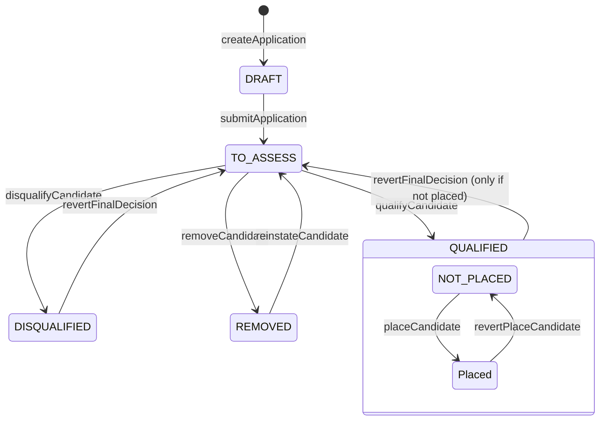

# GC Digital Talent — Data dictionary

**84 tables · 833 columns · 150 foreign key relationships**

> GC Digital Talent is the Government of Canada platform for managing recruitment pools, job postings, talent nominations, and applicant tracking across the federal public service. Data is bilingual (English/French stored as jsonb), uses UUIDs as primary keys, and soft-deletes via `deleted_at`.

---

## Tables

- [activity_log](#activity_log)
- [announcements](#announcements)
- [applicant_filter_classification](#applicant_filter_classification)
- [applicant_filter_pool](#applicant_filter_pool)
- [applicant_filter_qualified_classification](#applicant_filter_qualified_classification)
- [applicant_filter_skill](#applicant_filter_skill)
- [applicant_filter_work_stream](#applicant_filter_work_stream)
- [applicant_filters](#applicant_filters)
- [assessment_results](#assessment_results)
- [assessment_step_pool_skill](#assessment_step_pool_skill)
- [assessment_steps](#assessment_steps)
- [award_experiences](#award_experiences)
- [classification_community_development_program](#classification_community_development_program)
- [classification_development_program](#classification_development_program)
- [classification_pool_candidate_filter](#classification_pool_candidate_filter)
- [classification_talent_nomination_advancement](#classification_talent_nomination_advancement)
- [classification_talent_nomination_group_advancement](#classification_talent_nomination_group_advancement)
- [classification_talent_nomination_group_lateral_movement](#classification_talent_nomination_group_lateral_movement)
- [classifications](#classifications)
- [communities](#communities)
- [community_development_program](#community_development_program)
- [community_development_program_talent_nomination](#community_development_program_talent_nomination)
- [community_development_program_talent_nomination_event](#community_development_program_talent_nomination_event)
- [community_experiences](#community_experiences)
- [community_interest_work_stream](#community_interest_work_stream)
- [community_interests](#community_interests)
- [department_user_career_objective](#department_user_career_objective)
- [department_user_next_role](#department_user_next_role)
- [departments](#departments)
- [development_program_interests](#development_program_interests)
- [development_program_talent_nomination](#development_program_talent_nomination)
- [development_program_talent_nomination_event](#development_program_talent_nomination_event)
- [development_program_user](#development_program_user)
- [development_programs](#development_programs)
- [education_experiences](#education_experiences)
- [experience_skill](#experience_skill)
- [failed_jobs](#failed_jobs)
- [general_question_responses](#general_question_responses)
- [general_questions](#general_questions)
- [generic_job_title_user](#generic_job_title_user)
- [generic_job_titles](#generic_job_titles)
- [job_poster_archives](#job_poster_archives)
- [job_poster_template_skill](#job_poster_template_skill)
- [job_poster_templates](#job_poster_templates)
- [jobs](#jobs)
- [migrations](#migrations)
- [notifications](#notifications)
- [off_platform_recruitment_processes](#off_platform_recruitment_processes)
- [permission_role](#permission_role)
- [permission_user](#permission_user)
- [permissions](#permissions)
- [personal_experiences](#personal_experiences)
- [pool_candidate_education_requirement_experience](#pool_candidate_education_requirement_experience)
- [pool_candidate_filters](#pool_candidate_filters)
- [pool_candidate_search_requests](#pool_candidate_search_requests)
- [pool_candidate_user_bookmarks](#pool_candidate_user_bookmarks)
- [pool_candidates](#pool_candidates)
- [pool_pool_candidate_filter](#pool_pool_candidate_filter)
- [pool_skill](#pool_skill)
- [pool_user_bookmarks](#pool_user_bookmarks)
- [pools](#pools)
- [role_user](#role_user)
- [roles](#roles)
- [screening_question_responses](#screening_question_responses)
- [screening_questions](#screening_questions)
- [skill_families](#skill_families)
- [skill_skill_family](#skill_skill_family)
- [skill_talent_nomination](#skill_talent_nomination)
- [skills](#skills)
- [talent_nomination_events](#talent_nomination_events)
- [talent_nomination_groups](#talent_nomination_groups)
- [talent_nominations](#talent_nominations)
- [talent_request_tracked_users](#talent_request_tracked_users)
- [talent_requests](#talent_requests)
- [teams](#teams)
- [training_opportunities](#training_opportunities)
- [user_search_indices](#user_search_indices)
- [user_skills](#user_skills)
- [user_work_stream_career_objective](#user_work_stream_career_objective)
- [user_work_stream_next_role](#user_work_stream_next_role)
- [users](#users)
- [work_experience_work_stream](#work_experience_work_stream)
- [work_experiences](#work_experiences)
- [work_streams](#work_streams)

---

## activity_log

Audit log of system events, tracking who did what and to which record. Used for change history, debugging, compliance, and the pool activity feed in the admin UI (`Pool.activities` in GraphQL). Powered by the Spatie Laravel Activity Log package (v5). Entries are never pruned automatically. `config/activitylog.php` sets `clean_after_days` to 365, but that only applies when someone runs `php artisan activitylog:clean`, and that command isn't scheduled.

Rows are written in two ways:

- **Automatic model logging (`log_name` = `default`).** Models that use Spatie's `LogsActivity` trait log a row on every create, update and delete, with the changed attributes in `attribute_changes`. These models are AssessmentResult, AssessmentStep, AssessmentStepPoolSkill, GeneralQuestion, Pool, PoolCandidate, PoolSkill, ScreeningQuestion, TalentNomination, TalentNominationEvent, TalentNominationGroup, TalentRequest, TalentRequestTrackedUser and User.
- **Custom process events (`log_name` = `process`).** Pool, PoolCandidate, AssessmentStep and PoolSkill also use the app's `LogsCustomActivity` trait, which calls `logActivity(ActivityEvent::X, $attributes, $old)` to record domain events such as `published`, `submitted`, `qualified` or `placed`. These rows drive the pool activity feed. That feed shows `process` rows whose subject is the pool, or whose `attribute_changes.attributes.pool_id` is the pool. For some actions the model turns off automatic logging so that only the `process` row is written, as on qualify and disqualify. For others both rows are written: creating a pool writes a `default` `created` row and a `process` `created` row.

User role changes are a third, smaller source. They're logged manually as `default` rows with event `roleAdded` or `roleRemoved`.

| Column              | Description                                                                                                                                                                              | Relationship | Constraints                                                                                                                                                                                                                                                                                                                   |
| ------------------- | ---------------------------------------------------------------------------------------------------------------------------------------------------------------------------------------- | ------------ | ----------------------------------------------------------------------------------------------------------------------------------------------------------------------------------------------------------------------------------------------------------------------------------------------------------------------------- |
| `id`                | Unique identifier for this log entry.                                                                                                                                                    |              |                                                                                                                                                                                                                                                                                                                               |
| `log_name`          | Which log stream the entry belongs to. `default` holds automatic model change logs and role changes; `process` holds curated recruitment-process events shown in the pool activity feed. |              | Enum `ActivityLog` (stored lowercase): default, process                                                                                                                                                                                                                                                                       |
| `description`       | Short description of the event. The app always sets it to the same value as `event`.                                                                                                     |              | Not null                                                                                                                                                                                                                                                                                                                      |
| `subject_type`      | The model class that was acted upon (e.g. App\Models\Pool).                                                                                                                              |              |                                                                                                                                                                                                                                                                                                                               |
| `subject_id`        | UUID of the specific record that was acted upon.                                                                                                                                         |              |                                                                                                                                                                                                                                                                                                                               |
| `causer_type`       | The model class of the actor who triggered the event.                                                                                                                                    |              | Only `App\Models\User` (the only authenticatable model) or null. Null when nobody is authenticated, as with seeders, console commands, scheduled tasks and queued jobs.                                                                                                                                                       |
| `causer_id`         | UUID of the user who triggered the event.                                                                                                                                                |              | Null whenever causer_type is null                                                                                                                                                                                                                                                                                             |
| `properties`        | Free-form custom properties (Spatie `withProperties()`) that can be stored with custom events. Currently unused, so it's always an empty array `[]`.                                     |              |                                                                                                                                                                                                                                                                                                                               |
| `created_at`        | Timestamp when the log entry was created.                                                                                                                                                |              |                                                                                                                                                                                                                                                                                                                               |
| `updated_at`        | Timestamp when the log entry was last updated.                                                                                                                                           |              |                                                                                                                                                                                                                                                                                                                               |
| `event`             | The kind of action recorded. Set on every event, both automatic and custom.                                                                                                              |              | Automatic logs: created, updated, deleted. Role changes: roleAdded, roleRemoved. Process logs use Enum `ActivityEvent` (stored lowercase): created, updated, deleted, submitted, qualified, disqualified, placed, added, removed, reinstated, reverted, published, special_application_created, special_application_submitted |
| `attribute_changes` | What changed. `attributes` holds the new values (or the event's data) and `old` holds the previous values; see the examples below.                                                       |              | JSON with keys `attributes` and optionally `old`                                                                                                                                                                                                                                                                              |

**Process events (`log_name` = `process`)**

Each row below lists the `event` value, the subject model and the trigger. The keys in `attribute_changes.attributes` are the ones each event records; PoolCandidate events also always add `user_name` and `pool_id`, and AssessmentStep events add `name`.

| `event`                         | Subject        | When it's logged                                                                                                                                                                                                                    | `attribute_changes`                                                                                                                                                                                                                         |
| ------------------------------- | -------------- | ----------------------------------------------------------------------------------------------------------------------------------------------------------------------------------------------------------------------------------- | ------------------------------------------------------------------------------------------------------------------------------------------------------------------------------------------------------------------------------------------- |
| `created`                       | Pool           | A new pool (draft) is saved, by `PoolObserver::created`.                                                                                                                                                                            | `attributes`: every attribute set on creation                                                                                                                                                                                               |
| `updated`                       | Pool           | Any change is saved to a pool, by `PoolObserver::updated`. Publishing doesn't log this; it logs `published` instead.                                                                                                                | `attributes`: the changed values; `old`: their previous values                                                                                                                                                                              |
| `published`                     | Pool           | An admin publishes the pool (`Pool::publish()` sets `published_at`).                                                                                                                                                                | none                                                                                                                                                                                                                                        |
| `added`                         | AssessmentStep | An assessment step is added to the pool's assessment plan.                                                                                                                                                                          | `pool_id`, `sort_order`, `type`, `title`, `name`                                                                                                                                                                                            |
| `updated`                       | AssessmentStep | An assessment step is edited or reordered.                                                                                                                                                                                          | `pool_id`, `sort_order`, `type`, `title`, `name` (new values only)                                                                                                                                                                          |
| `removed`                       | AssessmentStep | An assessment step is deleted. The later steps are renumbered, which logs an `updated` row for each.                                                                                                                                | `pool_id`, `sort_order`, `type`, `title`, `name`                                                                                                                                                                                            |
| `added`                         | PoolSkill      | A skill is added to the pool's essential or asset skills.                                                                                                                                                                           | `pool_id`, `type`, `required_skill_level`, `skill` (bilingual name), `category`                                                                                                                                                             |
| `updated`                       | PoolSkill      | A pool skill's type or required level is changed.                                                                                                                                                                                   | the same keys as `added` (new values only)                                                                                                                                                                                                  |
| `removed`                       | PoolSkill      | A skill is removed from the pool.                                                                                                                                                                                                   | the same keys as `added`                                                                                                                                                                                                                    |
| `submitted`                     | PoolCandidate  | An applicant submits a regular application, which moves it from DRAFT to TO_ASSESS.                                                                                                                                                 | `signature`                                                                                                                                                                                                                                 |
| `special_application_created`   | PoolCandidate  | An admin creates a special application, either by converting the user's existing draft or by creating a new draft for them. A special application can bypass normal restrictions on who can apply to a job and when the job closes. | `user_id`, `special_application_type`, `special_application_justification`, `special_application_closing_date`, `special_application_type_en`, `special_application_type_fr`; also `application_status` (DRAFT) when a new draft is created |
| `special_application_submitted` | PoolCandidate  | The applicant submits a special application. This is logged instead of `submitted`.                                                                                                                                                 | `signature`, `special_application_type`, `special_application_type_en`, `special_application_type_fr`                                                                                                                                       |
| `qualified`                     | PoolCandidate  | An assessor qualifies the candidate (final decision).                                                                                                                                                                               | `expiry_date`                                                                                                                                                                                                                               |
| `disqualified`                  | PoolCandidate  | An assessor disqualifies the candidate (final decision).                                                                                                                                                                            | none                                                                                                                                                                                                                                        |
| `placed`                        | PoolCandidate  | A qualified candidate is placed (any placement type). That means the candidate has been matched with a hiring manager. An indeterminate placement also pauses their referrals.                                                      | `placement_type`, `placed_department_id`                                                                                                                                                                                                    |
| `removed`                       | PoolCandidate  | An admin removes the candidate from the process.                                                                                                                                                                                    | `removal_reason`, `removal_reason_other`                                                                                                                                                                                                    |
| `reinstated`                    | PoolCandidate  | An admin reinstates a removed candidate, which returns them to TO_ASSESS.                                                                                                                                                           | none                                                                                                                                                                                                                                        |
| `reverted`                      | PoolCandidate  | An admin undoes either a placement (`revertPlacement`) or a final qualify/disqualify decision (`revertFinalDecision`).                                                                                                              | Placement: `placed_at` and `placed_department_id`. Final decision: `application_status`, `expiry_date`, `status_updated_at` and `screening_stage`. Both have `attributes` (new) and `old` (previous)                                        |

`deleted` exists in `ActivityEvent` but isn't logged to the `process` stream; deleting a pool doesn't log a process event. For PoolCandidate events, the model turns off Spatie's automatic logging first, so no matching `default` `updated` row is written. Pool `created`/`updated` and the AssessmentStep and PoolSkill events do also get automatic `default` rows.

**`attribute_changes` examples**

An automatic `default` / `updated` row for a Pool. Only the changed attributes are logged:

```json
{
  "attributes": {
    "classification_id": "2b6581cb-…",
    "advertisement_language": "VARIOUS"
  },
  "old": {
    "classification_id": "61c4ca02-…",
    "advertisement_language": "VARIOUS_BILINGUAL"
  }
}
```

A `process` / `qualified` row for a PoolCandidate. It has no `old` key. PoolCandidate always adds `user_name` and `pool_id`, and AssessmentStep adds `name`:

```json
{
  "attributes": {
    "expiry_date": "2028-11-03 00:00:00",
    "user_name": "Esta Brekke",
    "pool_id": "2b1d4e34-…"
  }
}
```

A `default` / `roleAdded` row for a User. `team_id` is present only for team-scoped roles:

```json
{
  "attributes": {
    "user_id": "ec2b6c8e-…",
    "role_id": "96a912dc-…",
    "team_id": "…"
  }
}
```

`properties` is currently always `[]`. If the app starts using it, it will hold arbitrary extra context set with `withProperties()`, for example `{ "ip": "…", "source": "bulk_import" }`.

---

## announcements

Platform-wide announcements displayed to users in the application UI, such as maintenance notices or feature updates. Supports scheduling and dismissal.

| Column           | Description                                                                                                                                                                        | Relationship | Constraints                                                                                                                                                             |
| ---------------- | ---------------------------------------------------------------------------------------------------------------------------------------------------------------------------------- | ------------ | ----------------------------------------------------------------------------------------------------------------------------------------------------------------------- |
| `id`             | Unique identifier for the announcement.                                                                                                                                            |              |                                                                                                                                                                         |
| `key`            | Unique human-readable slug for the announcement.                                                                                                                                   |              | Unique; only `sitewide_announcement` is used                                                                                                                            |
| `title`          | Bilingual (EN/FR) title text shown as the announcement headline.                                                                                                                   |              | Bilingual: en and fr both required. JSON: `{"en": "Scheduled maintenance", "fr": "Maintenance planifiée"}`                                                              |
| `message`        | Bilingual (EN/FR) body text of the announcement.                                                                                                                                   |              | Bilingual: en and fr both required. JSON: `{"en": "The site will be unavailable Saturday 8–10 a.m. ET.", "fr": "Le site sera indisponible samedi de 8 h à 10 h (HE)."}` |
| `is_enabled`     | Whether the announcement is currently active and visible. App client only displays an announcment if is_enabled is true AND current date is between publishe_date and expiry_date. |              | Default false                                                                                                                                                           |
| `is_dismissible` | Whether users can permanently dismiss this announcement.                                                                                                                           |              | Default false                                                                                                                                                           |
| `publish_date`   | Date and time when the announcement becomes visible.                                                                                                                               |              | Required (via mutation)                                                                                                                                                 |
| `expiry_date`    | Date and time when the announcement stops being shown.                                                                                                                             |              | Required (via mutation); must be after publish_date                                                                                                                     |
| `created_at`     | Timestamp when the announcement was created.                                                                                                                                       |              |                                                                                                                                                                         |
| `updated_at`     | Timestamp when the announcement was last modified.                                                                                                                                 |              |                                                                                                                                                                         |

---

## applicant_filter_classification

Junction table linking an applicant filter to one or more GC job classifications (e.g. EC-06, CS-03). Allows stored filters to filter applicants by their target or current classification. Owned by the [applicant_filters](#applicant_filters) model.

| Column | Description | Relationship | Constraints |
|--------|-------------|--------------|-------------|
| `id` | Unique identifier for this filter-classification link. |  |  |
| `created_at` | Timestamp when the link was created. |  |  |
| `updated_at` | Timestamp when the link was last modified. |  |  |
| `applicant_filter_id` | FK to the parent applicant_filters record. | FK → `applicant_filters.id` |  |
| `classification_id` | FK to the classification being filtered on. | FK → `classifications.id` | Unique per (applicant_filter_id, classification_id) |

---

## applicant_filter_pool

Junction table linking an applicant filter to specific recruitment pools, allowing stored filters to restrict a talent search to candidates from certain pools. Owned by the [applicant_filters](#applicant_filters) model.

| Column | Description | Relationship | Constraints |
|--------|-------------|--------------|-------------|
| `id` | Unique identifier for this filter-pool link. |  |  |
| `created_at` | Timestamp when the link was created. |  |  |
| `updated_at` | Timestamp when the link was last modified. |  |  |
| `applicant_filter_id` | FK to the parent applicant_filters record. | FK → `applicant_filters.id` |  |
| `pool_id` | FK to the pool being included in the filter. | FK → `pools.id` | Unique per (applicant_filter_id, pool_id) |

---

## applicant_filter_qualified_classification

Junction table linking an applicant filter to classifications the applicant must be "qualified at". The exact interpretation of "qualified at" depends on the Talent Sources involved in the filter; it can mean the candidate has been qualified in a pool for this classification, or nominated for advancement to this classification, or currently holds this classification. See [applicant_filters](#applicant_filters) for more details. Owned by the [applicant_filter](#applicant_filters) model.

| Column                | Description                                  | Relationship                | Constraints                                         |
| --------------------- | -------------------------------------------- | --------------------------- | --------------------------------------------------- |
| `id`                  | Unique identifier for this link.             |                             |                                                     |
| `created_at`          | Timestamp when the link was created.         |                             |                                                     |
| `updated_at`          | Timestamp when the link was last modified.   |                             |                                                     |
| `applicant_filter_id` | FK to the parent applicant_filters record.   | FK → `applicant_filters.id` |                                                     |
| `classification_id`   | FK to the required qualified classification. | FK → `classifications.id`   | Unique per (applicant_filter_id, classification_id) |

---

## applicant_filter_skill

Junction table linking an applicant filter to required skills. Allows managers to search for candidates who possess specific skills. Owned by the [applicant_filter](#applicant_filters) model.

| Column | Description | Relationship | Constraints |
|--------|-------------|--------------|-------------|
| `id` | Unique identifier for this filter-skill link. |  |  |
| `created_at` | Timestamp when the link was created. |  |  |
| `updated_at` | Timestamp when the link was last modified. |  |  |
| `applicant_filter_id` | FK to the parent applicant_filters record. | FK → `applicant_filters.id` |  |
| `skill_id` | FK to the required skill. | FK → `skills.id` | Unique per (applicant_filter_id, skill_id) |

---

## applicant_filter_work_stream

Junction table linking an applicant filter to work streams (functional specializations within a community). Cascades on delete. Owned by the [applicant_filter](#applicant_filters) model.

| Column | Description | Relationship | Constraints |
|--------|-------------|--------------|-------------|
| `id` | Unique identifier for this filter-work-stream link. |  |  |
| `applicant_filter_id` | FK to the parent applicant_filters record. | FK → `applicant_filters.id` |  |
| `work_stream_id` | FK to the targeted work stream. | FK → `work_streams.id` |  |

---

## applicant_filters

The criteria of a talent request: what a hiring manager is looking for. Community recruiters use it to find matching Users, in the talent request matches table (`talentRequestMatches` / `UserBuilder::whereMatchesTalentRequest`). Each `talent_requests` row (and each legacy `pool_candidate_search_requests` row) points at one filter. The rules for how each column filters Users are in the Description column and in the notes below the table.

| Column                     | Description                                                                                                                                                                                                                                                                                                                                                                                                                                                                                                                        | Relationship          | Constraints                                                                                                                                 |
| -------------------------- | ---------------------------------------------------------------------------------------------------------------------------------------------------------------------------------------------------------------------------------------------------------------------------------------------------------------------------------------------------------------------------------------------------------------------------------------------------------------------------------------------------------------------------------- | --------------------- | ------------------------------------------------------------------------------------------------------------------------------------------- |
| `id`                       | Unique identifier for this filter set.                                                                                                                                                                                                                                                                                                                                                                                                                                                                                             |                       |                                                                                                                                             |
| `created_at`               | Timestamp when the filter was created.                                                                                                                                                                                                                                                                                                                                                                                                                                                                                             |                       |                                                                                                                                             |
| `updated_at`               | Timestamp when the filter was last modified.                                                                                                                                                                                                                                                                                                                                                                                                                                                                                       |                       |                                                                                                                                             |
| `has_diploma`              | Whether the manager asked for a candidate with a post-secondary diploma. It's shown to community recruiters as information only and **isn't used for matching**. Applicants have nowhere to record whether they have a diploma: no UI writes `users.has_diploma`, although the API still accepts it. The frontend never sends `hasDiploma` to the matching or count queries. `UserBuilder::whereHasDiploma` would filter on `users.has_diploma = true` if it were sent.                                                            |                       |                                                                                                                                             |
| `has_disability`           | Employment equity: the manager wants candidates who have declared a disability. Matches `users.has_disability = true`. The four employment equity columns are combined with **OR**: a user matches if they belong to any one of the selected groups.                                                                                                                                                                                                                                                                               |                       |                                                                                                                                             |
| `is_indigenous`            | Employment equity: the manager wants candidates who have self-identified as Indigenous. Matches users whose `indigenous_communities` array is non-empty; there is no `users.is_indigenous` column. Combined with **OR** with the other equity columns.                                                                                                                                                                                                                                                                             |                       |                                                                                                                                             |
| `is_visible_minority`      | Employment equity: the manager wants candidates who have self-identified as a visible minority. Matches `users.is_visible_minority = true`. Combined with **OR** with the other equity columns.                                                                                                                                                                                                                                                                                                                                    |                       |                                                                                                                                             |
| `is_woman`                 | Employment equity: the manager wants candidates who have self-identified as a woman. Matches `users.is_woman = true`. Combined with **OR** with the other equity columns.                                                                                                                                                                                                                                                                                                                                                          |                       |                                                                                                                                             |
| `language_ability`         | The language profile the position needs. Matches the user's stated interest in positions in that language, not their language skill: ENGLISH requires `users.looking_for_english`, FRENCH requires `looking_for_french`, BILINGUAL requires `looking_for_bilingual`. `estimated_language_ability` and the evaluated levels aren't checked.                                                                                                                                                                                         |                       | Enum `LanguageAbility`: ENGLISH, FRENCH, BILINGUAL                                                                                          |
| `location_preferences`     | Work regions where the position can be located. A user matches if their `location_preferences` include **at least one** listed region. This combines with `flexible_work_locations`; see that row.                                                                                                                                                                                                                                                                                                                                 |                       | Array of `WorkRegion`: TELEWORK, NATIONAL_CAPITAL, ATLANTIC, QUEBEC, ONTARIO, PRAIRIE, BRITISH_COLUMBIA, NORTH                              |
| `operational_requirements` | Operational conditions the position involves. **AND** filter: the user's `accepted_operational_requirements` must contain **all** the listed requirements.                                                                                                                                                                                                                                                                                                                                                                         |                       | Array of `OperationalRequirement`: SHIFT_WORK, ON_CALL, TRAVEL, TRANSPORT_EQUIPMENT, DRIVERS_LICENSE, OVERTIME_OCCASIONAL, OVERTIME_REGULAR |
| `position_duration`        | The kind of employment on offer: term or indeterminate. A user matches if their `users.position_duration` contains **any** listed value. The request form only allows choosing one.                                                                                                                                                                                                                                                                                                                                                |                       | Array of `PositionDuration`: TEMPORARY (term), PERMANENT (indeterminate)                                                                    |
| `qualified_streams`        | Legacy JSON array of work streams, replaced by `applicant_filter_work_stream`. Not exposed in GraphQL and not used for matching.                                                                                                                                                                                                                                                                                                                                                                                                   |                       | Not null, default []                                                                                                                        |
| `community_id`             | The community that owns and handles the talent request and responds to the hiring manager. Limits the candidates each talent source returns to this community; see the notes.                                                                                                                                                                                                                                                                                                                                                      | FK → `communities.id` | Not null                                                                                                                                    |
| `flexible_work_locations`  | The work arrangements the position allows. Combined with `location_preferences` by `whereFlexibleLocationAndRegionSpecialMatching`. A user matches if **any** of these are true: REMOTE is requested and the user accepts REMOTE, in any region; HYBRID is requested and the user accepts HYBRID and has a matching region; ONSITE is requested and the user accepts ONSITE and has a matching region. If no regions are requested, only the arrangement is checked. If no arrangements are requested, only the region is checked. |                       | Array of `FlexibleWorkLocation`: REMOTE, HYBRID, ONSITE; default []                                                                         |
| `talent_sources`           | Which talent sources to search. A user matches if **any** selected source matches; see the notes.                                                                                                                                                                                                                                                                                                                                                                                                                                  |                       | Array of `TalentRequestSource`: QUALIFIED_IN_POOL, AT_LEVEL, ADVANCEMENT, LATERAL_MOVEMENT. Default []; empty means all four                |

**How a User is matched**

A User matches the filter when both of these are true:

1. **User-level attributes match.** These are the columns above from `has_disability` to `flexible_work_locations`, plus the skills in `applicant_filter_skill`, where a user matches with **any** of the listed skills. They're checked on the `users` row the same way for every talent source. Empty columns in the filter are ignored.
2. **At least one selected talent source matches.** Each source answers a different question about where the candidate came from. Each one interprets `community_id`, `applicant_filter_qualified_classification` and `applicant_filter_work_stream` against different records:

| Talent source       | Candidate pool                                                                           | `community_id` must match                                                          | `applicant_filter_qualified_classification` (group and level) must match                                                                                   | `applicant_filter_work_stream` must match                        | Other conditions                                                                                                                                                                                                                                                                                                |
| ------------------- | ---------------------------------------------------------------------------------------- | ---------------------------------------------------------------------------------- | ---------------------------------------------------------------------------------------------------------------------------------------------------------- | ---------------------------------------------------------------- | --------------------------------------------------------------------------------------------------------------------------------------------------------------------------------------------------------------------------------------------------------------------------------------------------------------- |
| `QUALIFIED_IN_POOL` | Candidates qualified in a recruitment pool (`pool_candidates`)                           | the pool's `community_id`                                                          | the pool's classification                                                                                                                                  | the pool's `work_stream_id`                                      | The candidacy must be available: QUALIFIED, placed in a searchable placement type or not placed, referrals not paused, not suspended, not expired. The pool must not be hidden (`pools.is_hidden`) and must have a community. If `applicant_filter_pool` has rows, the candidacy must be in one of those pools. |
| `AT_LEVEL`          | Government employees who have registered interest in a community (`community_interests`) | the interest's `community_id`                                                      | the user's current classification (`users.computed_classification`, from their latest current government work experience, which may be an acting position) | a work stream on the interest (`community_interest_work_stream`) | The user must be a verified government employee and must have consented to share their profile on the interest (`consent_to_share_profile`).                                                                                                                                                                    |
| `ADVANCEMENT`       | Nominees approved for advancement (`talent_nomination_groups`)                           | the nomination event's `community_id`, and the nominee's interest in the community | a classification approved for the group (`classification_talent_nomination_group_advancement`)                                                             | a work stream on the nominee's community interest                | `advancement_decision` = APPROVED and `advancement_referral_expiry_date` is today or later. The nominee must be a verified government employee and must have consented to share their profile on a community interest.                                                                                          |
| `LATERAL_MOVEMENT`  | Nominees approved for lateral movement (`talent_nomination_groups`)                      | the nomination event's `community_id`, and the nominee's interest in the community | a classification approved for the group (`classification_talent_nomination_group_lateral_movement`)                                                        | a work stream on the nominee's community interest                | The same as `ADVANCEMENT`, using `lateral_movement_decision` and `lateral_movement_referral_expiry_date`.                                                                                                                                                                                                       |

Classifications are matched by `group` and `level`, not by classification id. Within each child table, any listed row matching is enough.

**Related tables**

- `applicant_filter_qualified_classification`: the requested classifications, used by every source as shown above.
- `applicant_filter_work_stream`: the requested work streams, used by every source as shown above.
- `applicant_filter_pool`: specific pools. These only narrow `QUALIFIED_IN_POOL`; the other sources ignore them.
- `applicant_filter_skill`: the requested skills, matched at the user level (any one skill), whatever the source. Each match also gets a `skillCount` of how many requested skills they have, which the table can sort on (`orderBySkillCount`).
- `applicant_filter_classification`: legacy. It isn't exposed in GraphQL, can't be written through the API, and isn't used for matching. Use `applicant_filter_qualified_classification`instead.

**Referenced by:** `applicant_filter_classification.applicant_filter_id`, `applicant_filter_pool.applicant_filter_id`, `applicant_filter_qualified_classification.applicant_filter_id`, `applicant_filter_skill.applicant_filter_id`, `applicant_filter_work_stream.applicant_filter_id`, `pool_candidate_search_requests.applicant_filter_id`, `talent_requests.applicant_filter_id`

---

## assessment_results

Records the outcome of assessing a pool candidate against a specific skill at a specific assessment step. Captures both the decision and supporting justification.

| Column                      | Description                                                                                                                                                                                                       | Relationship               | Constraints                                                                                                                                                                                                                                                                                                                                                                                                      |
| --------------------------- | ----------------------------------------------------------------------------------------------------------------------------------------------------------------------------------------------------------------- | -------------------------- | ---------------------------------------------------------------------------------------------------------------------------------------------------------------------------------------------------------------------------------------------------------------------------------------------------------------------------------------------------------------------------------------------------------------- |
| `id`                        | Unique identifier for this assessment result.                                                                                                                                                                     |                            |                                                                                                                                                                                                                                                                                                                                                                                                                  |
| `created_at`                | Timestamp when the result was recorded.                                                                                                                                                                           |                            |                                                                                                                                                                                                                                                                                                                                                                                                                  |
| `updated_at`                | Timestamp when the result was last updated.                                                                                                                                                                       |                            |                                                                                                                                                                                                                                                                                                                                                                                                                  |
| `assessment_step_id`        | FK to the assessment step where this evaluation took place.                                                                                                                                                       | FK → `assessment_steps.id` | Step, candidate and pool skill must all belong to the same pool                                                                                                                                                                                                                                                                                                                                                  |
| `pool_candidate_id`         | FK to the candidate being assessed.                                                                                                                                                                               | FK → `pool_candidates.id`  |                                                                                                                                                                                                                                                                                                                                                                                                                  |
| `pool_skill_id`             | FK to the specific skill being assessed.                                                                                                                                                                          | FK → `pool_skill.id`       | Required when assessment_result_type = SKILL                                                                                                                                                                                                                                                                                                                                                                     |
| `assessment_result_type`    | Whether this is an education, skill, or other result type.                                                                                                                                                        |                            | Enum `AssessmentResultType`: EDUCATION, SKILL; unique per (assessment_step_id, pool_candidate_id, pool_skill_id, assessment_result_type)                                                                                                                                                                                                                                                                         |
| `assessment_decision`       | The decision outcome (e.g. successful, unsuccessful, hold). Hold is used to indicate that the candidate should move to further assessment steps, though a decision has not been made on this assessment step yet. |                            | Enum `AssessmentDecision`: HOLD, SUCCESSFUL, UNSUCCESSFUL                                                                                                                                                                                                                                                                                                                                                        |
| `justifications`            | JSON array of reasons or evidence supporting the decision.                                                                                                                                                        |                            | Array of `AssessmentResultJustification`: EDUCATION_ACCEPTED_INFORMATION, EDUCATION_ACCEPTED_WORK_EXPERIENCE_EQUIVALENCY, EDUCATION_ACCEPTED_COMBINATION_EDUCATION_WORK_EXPERIENCE, EDUCATION_FAILED_NOT_RELEVANT, EDUCATION_FAILED_REQUIREMENT_NOT_MET, SKILL_FAILED_INSUFFICIENTLY_DEMONSTRATED, FAILED_NOT_ENOUGH_INFORMATION, FAILED_OTHER; EDUCATION_* only for EDUCATION type, SKILL_* only for SKILL type |
| `assessment_decision_level` | Granularity of the decision (e.g. at the pool or step level).                                                                                                                                                     |                            | Enum `AssessmentDecisionLevel`: AT_REQUIRED, ABOVE_REQUIRED, ABOVE_AND_BEYOND_REQUIRED; only allowed when type = SKILL and decision = SUCCESSFUL                                                                                                                                                                                                                                                                 |
| `skill_decision_notes`      | Free-text notes from the assessor on the skill evaluation.                                                                                                                                                        |                            |                                                                                                                                                                                                                                                                                                                                                                                                                  |

---

## assessment_step_pool_skill

Junction table linking assessment steps to the pool skills being evaluated at that step. Defines which skills are assessed at which stage of the selection process. Owned by the [assessment_step](#assessment_steps) model.

| Column | Description | Relationship | Constraints |
|--------|-------------|--------------|-------------|
| `id` | Unique identifier for this step-skill link. |  |  |
| `assessment_step_id` | FK to the assessment step. | FK → `assessment_steps.id` |  |
| `pool_skill_id` | FK to the pool skill being evaluated at this step. | FK → `pool_skill.id` | Pool skill must belong to the same pool as the assessment step |
| `created_at` | Timestamp when the link was created. |  |  |
| `updated_at` | Timestamp when the link was last modified. |  |  |

---

## assessment_steps

Defines the ordered stages of a pool's assessment process (e.g. application review, written exam, interview). Each step can assess different skills. The assessment process (made of assessment_steps) is typically defined alongside a pool, before it is published.

| Column       | Description                                                      | Relationship    | Constraints                                                                                                                                                                                                                                                                                                        |
| ------------ | ---------------------------------------------------------------- | --------------- | ------------------------------------------------------------------------------------------------------------------------------------------------------------------------------------------------------------------------------------------------------------------------------------------------------------------ |
| `id`         | Unique identifier for this assessment step.                      |                 |                                                                                                                                                                                                                                                                                                                    |
| `pool_id`    | FK to the recruitment pool this step belongs to.                 | FK → `pools.id` |                                                                                                                                                                                                                                                                                                                    |
| `sort_order` | Numeric order of this step within the pool's assessment process. |                 | Unique per (pool_id, sort_order), deferrable; set automatically: APPLICATION_SCREENING = 1, SCREENING_QUESTIONS_AT_APPLICATION = 2, others appended                                                                                                                                                                |
| `type`       | Type of assessment (e.g. screening, written test, interview).    |                 | Enum `AssessmentStepType`: SCREENING_QUESTIONS_AT_APPLICATION, TECHNICAL_EXAM_AT_SITE, TECHNICAL_EXAM_AT_HOME, PSC_EXAM, INTERVIEW_GROUP, INTERVIEW_INDIVIDUAL, INTERVIEW_FOLLOWUP, REFERENCE_CHECK, APPLICATION_SCREENING, ADDITIONAL_ASSESSMENT; APPLICATION_SCREENING cannot be set via create/update mutations |
| `title`      | Bilingual label for this assessment step.                        |                 | Bilingual (en, fr); default empty strings. Example: `{"en": "Technical interview", "fr": "Entrevue technique"}`                                                                                                                                                                                                    |
| `created_at` | Timestamp when the step was created.                             |                 |                                                                                                                                                                                                                                                                                                                    |
| `updated_at` | Timestamp when the step was last modified.                       |                 |                                                                                                                                                                                                                                                                                                                    |

**Referenced by:** `assessment_results.assessment_step_id`, `assessment_step_pool_skill.assessment_step_id`, `pool_candidates.assessment_step_id`, `screening_questions.assessment_step_id`

---

## award_experiences

Applicant-reported awards, recognitions, or honours on their GC Talent profile. One of the five Experience types, owned by the [user](#users) model.

Together, a user's experiences make up their CV or résumé on the platform, replacing the uploaded CV or résumé another hiring system might ask for. Experiences are linked to the skills on the user's profile through [experience_skill](#experience_skill), where `details` holds the user's description of how they demonstrated that skill in that experience. Applications reuse these same links as evidence for the pool's required skills. An application can also link experiences to the pool's education requirement through [pool_candidate_education_requirement_experience](#pool_candidate_education_requirement_experience).

| Column                    | Description                                                                                                                                                                                                                                                                                                                                                                          | Relationship    | Constraints                                                                                                                         |
| ------------------------- | ------------------------------------------------------------------------------------------------------------------------------------------------------------------------------------------------------------------------------------------------------------------------------------------------------------------------------------------------------------------------------------ | --------------- | ----------------------------------------------------------------------------------------------------------------------------------- |
| `id`                      | Unique identifier for this award experience.                                                                                                                                                                                                                                                                                                                                         |                 |                                                                                                                                     |
| `user_id`                 | FK to the user who received the award.                                                                                                                                                                                                                                                                                                                                               | FK → `users.id` | Not null                                                                                                                            |
| `title`                   | Name or title of the award or recognition.                                                                                                                                                                                                                                                                                                                                           |                 |                                                                                                                                     |
| `issued_by`               | Organization or body that issued the award.                                                                                                                                                                                                                                                                                                                                          |                 |                                                                                                                                     |
| `awarded_date`            | Date the award was received.                                                                                                                                                                                                                                                                                                                                                         |                 | Must be today or earlier                                                                                                            |
| `awarded_to`              | Scope of who received the award (individual, team, organization).                                                                                                                                                                                                                                                                                                                    |                 | Enum `AwardedTo`: ME, MY_TEAM, MY_PROJECT, MY_ORGANIZATION                                                                          |
| `awarded_scope`           | Level or breadth of the award (local, national, international).                                                                                                                                                                                                                                                                                                                      |                 | Enum `AwardedScope`: INTERNATIONAL, NATIONAL, PROVINCIAL, LOCAL, COMMUNITY, ORGANIZATIONAL, SUB_ORGANIZATIONAL                      |
| `details`                 | Additional context or description of the award.                                                                                                                                                                                                                                                                                                                                      |                 |                                                                                                                                     |
| `created_at`              | Timestamp when the record was created.                                                                                                                                                                                                                                                                                                                                               |                 |                                                                                                                                     |
| `updated_at`              | Timestamp when the record was last modified.                                                                                                                                                                                                                                                                                                                                         |                 |                                                                                                                                     |
| `deleted_at`              | Soft-delete timestamp; null means the record is active. Experiences are never fully deleted from the database, instead deleted_at is set to now(), which hides it from all queries. This is legacy behaviour; since experiences are preserved in ProfileSnapshots (since snapshots were introduced in 2022), there is no real need to avoid deleting user experiences from database. |                 |                                                                                                                                     |
| `project_name`            | Name of the project that received the award.                                                                                                                                                                                                                                                                                                                                         |                 | Required if awarded_to = MY_PROJECT                                                                                                 |
| `related_experience_type` | Model class of another of the user's experiences this award is linked to.                                                                                                                                                                                                                                                                                                            |                 | One of App\Models\WorkExperience, PersonalExperience, CommunityExperience, EducationExperience. Required with related_experience_id |
| `related_experience_id`   | UUID of the linked experience (polymorphic with related_experience_type).                                                                                                                                                                                                                                                                                                            |                 | Must be one of the current user's own experiences of related_experience_type                                                        |

**Experience types:** [award_experiences](#award_experiences), [community_experiences](#community_experiences), [education_experiences](#education_experiences), [personal_experiences](#personal_experiences), [work_experiences](#work_experiences)

---

## classification_community_development_program

Junction table linking GC job classifications to community_development_programs, which is itself a junction table linking communities to development programs. This allows for multiple Communities to offer the same development programs, and for each community to have their own rules about which Classifications they are available to.

| Column | Description | Relationship | Constraints |
|--------|-------------|--------------|-------------|
| `id` | Unique identifier for this link. |  |  |
| `classification_id` | FK to the eligible classification. | FK → `classifications.id` |  |
| `community_development_program_id` | FK to the community development program. | FK → `community_development_program.id` | Unique per (classification_id, community_development_program_id) |

---

## classification_development_program

**This table is unused and planned for deletion.** Junction table linking GC job classifications to platform-wide development programs, allowing programs to express that they are only available to certain classifications. This table has been replaced by classification_community_development_program, and will be deleted.

| Column | Description | Relationship | Constraints |
|--------|-------------|--------------|-------------|
| `id` | Unique identifier for this link. |  |  |
| `classification_id` | FK to the eligible classification. | FK → `classifications.id` |  |
| `development_program_id` | FK to the development program. | FK → `development_programs.id` | Unique per (classification_id, development_program_id) |

---

## classification_pool_candidate_filter

Junction table storing classification filters as part of a pool candidate filter. Owned by [pool_candidate_filter](#pool_candidate_filters). Since pool_candidate_filter has been replaced by [applicant_filter](#applicant_filters), this table only holds legacy data.

| Column                     | Description                                 | Relationship                     | Constraints |
| -------------------------- | ------------------------------------------- | -------------------------------- | ----------- |
| `id`                       | Unique identifier for this link.            |                                  |             |
| `created_at`               | Timestamp when the link was created.        |                                  |             |
| `updated_at`               | Timestamp when the link was last modified.  |                                  |             |
| `pool_candidate_filter_id` | FK to the pool candidate filter.            | FK → `pool_candidate_filters.id` |             |
| `classification_id`        | FK to the classification being filtered on. | FK → `classifications.id`        |             |

---

## classification_talent_nomination_advancement

Junction table linking a talent nomination to the classifications the nominator recommends the nominee for advancement into. Owned by [talent_nomination](#talent_nominations).Rolled up into the nominations Excel export alongside the group's approved classifications.

| Column                 | Description                                       | Relationship                 | Constraints                                          |
| ---------------------- | ------------------------------------------------- | ---------------------------- | ---------------------------------------------------- |
| `id`                   | Unique identifier for this link.                  |                              |                                                      |
| `created_at`           | Timestamp when the link was created.              |                              |                                                      |
| `updated_at`           | Timestamp when the link was last modified.        |                              |                                                      |
| `classification_id`    | FK to the recommended advancement classification. | FK → `classifications.id`    | Unique per (classification_id, talent_nomination_id) |
| `talent_nomination_id` | FK to the nomination making the recommendation.   | FK → `talent_nominations.id` |                                                      |

---

## classification_talent_nomination_group_advancement

Junction table recording the classifications an admin has approved a nominee for advancement into, at the talent nomination group level. Set when an advancement decision is made on the group. Owned by [talent_nomination_group](#talent_nomination_groups).

| Column                       | Description                                         | Relationship                       | Constraints                                                |
| ---------------------------- | --------------------------------------------------- | ---------------------------------- | ---------------------------------------------------------- |
| `id`                         | Unique identifier for this link.                    |                                    |                                                            |
| `created_at`                 | Timestamp when the link was created.                |                                    |                                                            |
| `updated_at`                 | Timestamp when the link was last modified.          |                                    |                                                            |
| `classification_id`          | FK to the approved advancement classification.      | FK → `classifications.id`          | Unique per (classification_id, talent_nomination_group_id) |
| `talent_nomination_group_id` | FK to the nomination group the decision applies to. | FK → `talent_nomination_groups.id` |                                                            |

---

## classification_talent_nomination_group_lateral_movement

Junction table recording the classifications an admin has approved a nominee for lateral movement into, at the talent nomination group level. Set when a lateral movement decision is made on the group. Owned by [talent_nomination_group](#talent_nomination_groups).

| Column | Description | Relationship | Constraints |
|--------|-------------|--------------|-------------|
| `id` | Unique identifier for this link. |  |  |
| `created_at` | Timestamp when the link was created. |  |  |
| `updated_at` | Timestamp when the link was last modified. |  |  |
| `classification_id` | FK to the approved lateral movement classification. | FK → `classifications.id` | Unique per (classification_id, talent_nomination_group_id) |
| `talent_nomination_group_id` | FK to the nomination group the decision applies to. | FK → `talent_nomination_groups.id` |  |

---

## classifications

Reference table of GC occupational group and level classifications (e.g. EC-06, CS-03, AS-04). Referenced by most other significant data models in some way.

 Sometimes used as a proxy for salary; filtering for jobs within a certain salary range would return job posters whose classification's salary overlaps with the filter range.

| Column                   | Description                                                                                                               | Relationship | Constraints                                                                                 |
| ------------------------ | ------------------------------------------------------------------------------------------------------------------------- | ------------ | ------------------------------------------------------------------------------------------- |
| `id`                     | Unique identifier for the classification.                                                                                 |              |                                                                                             |
| `created_at`             | Timestamp when the record was created.                                                                                    |              |                                                                                             |
| `updated_at`             | Timestamp when the record was last modified.                                                                              |              |                                                                                             |
| `name`                   | Bilingual display name for the classification.                                                                            |              | Not null. Example: `{"en": "Information Technology", "fr": "Technologie de l’information"}` |
| `group`                  | Occupational group code (e.g. EC, CS, AS, PE).                                                                            |              | Not null; string (varchar 255), e.g. `IT`                                                   |
| `level`                  | Numeric level within the group. Stored as an integer, e.g. `6` (not `"06"`); the UI zero-pads it for display, e.g. IT-06; |              | Not null; must be >= 0 (DB CHECK); cannot be changed via update mutation                    |
| `min_salary`             | Minimum annual salary for this classification. Stored as an integer, in whole dollars.                                    |              | Nullable; must be >= 0 (DB CHECK)                                                           |
| `max_salary`             | Maximum annual salary for this classification. Stored as an integer, in whole dollars.                                    |              | Nullable; must be >= 0 and >= min_salary (DB CHECK)                                         |
| `deleted_at`             | Soft-delete timestamp; null means the classification is active.                                                           |              |                                                                                             |
| `is_available_in_search` | Purely used for UI: controls whether this classification appears in search filters on the Find Talent page.               |              | Not null, default false                                                                     |

**Referenced by:** `applicant_filter_classification.classification_id`, `applicant_filter_qualified_classification.classification_id`, `classification_community_development_program.classification_id`, `classification_development_program.classification_id`, `classification_pool_candidate_filter.classification_id`, `classification_talent_nomination_advancement.classification_id`, `classification_talent_nomination_group_advancement.classification_id`, `classification_talent_nomination_group_lateral_movement.classification_id`, `generic_job_titles.classification_id`, `job_poster_templates.classification_id`, `off_platform_recruitment_processes.classification_id`, `pools.classification_id`, `talent_nomination_groups.classification_at_time_of_last_approval_id`, `talent_nominations.advancement_reference_fallback_classification_id`, `talent_nominations.nominator_fallback_classification_id`, `users.career_objective_classification_id`, `users.computed_classification`, `users.next_role_classification_id`, `work_experiences.classification_id`

---

## communities

Functional communities within the GC (e.g. Data Science, Digital, Finance). Communities group related work streams, pools, and development programs, and serve as the primary organizing unit for talent management. Communities are one of the entities which can function as a "team" in the roles and permissions framework.

| Column              | Description                                                                     | Relationship | Constraints                                                                                                                                                               |
| ------------------- | ------------------------------------------------------------------------------- | ------------ | ------------------------------------------------------------------------------------------------------------------------------------------------------------------------- |
| `id`                | Unique identifier for the community.                                            |              |                                                                                                                                                                           |
| `created_at`        | Timestamp when the community was created.                                       |              |                                                                                                                                                                           |
| `updated_at`        | Timestamp when the community was last modified.                                 |              |                                                                                                                                                                           |
| `key`               | Human-readable unique slug for the community.                                   |              | Not null; unique                                                                                                                                                          |
| `name`              | Bilingual display name of the community.                                        |              | Bilingual: en and fr required together. Example: `{"en": "Digital Community", "fr": "Communauté numérique"}`                                                              |
| `description`       | Bilingual description of the community's mandate and focus.                     |              | Bilingual: en and fr required together. Example: `{"en": "Supports the digital community across government.", "fr": "Soutient la communauté numérique du gouvernement."}` |
| `mandate_authority` | The GC body or authority responsible for this community.                        |              | Bilingual: en and fr required together. Example: `{"en": "Office of the Chief Information Officer", "fr": "Bureau du dirigeant principal de l’information"}`              |
| `information_url`   | Link to external information about the community.                               |              | Bilingual: en and fr required together; must be http/https URLs. Example: `{"en": "https://example.gc.ca/en/digital", "fr": "https://example.gc.ca/fr/numerique"}`        |
| `contact_email`     | Contact email address for the community team. Not currently displayed anywhere. |              |                                                                                                                                                                           |

**Referenced by:** `applicant_filters.community_id`, `community_development_program.community_id`, `community_interests.community_id`, `development_programs.community_id`, `pool_candidate_search_requests.community_id`, `pools.community_id`, `talent_nomination_events.community_id`, `talent_requests.community_id`, `users.career_objective_community_id`, `users.next_role_community_id`, `work_streams.community_id`

---

## community_development_program

Junction table which links a development program to a specific community, indicating that the program is offered or managed within that community context. Different communities can offer the same development program, and each community can offer it to a different set of classifications (stored in classification_community_development_program). Supports soft-delete, which means it will no longer be offered, without disrupting existing records which link to this. 

| Column | Description | Relationship | Constraints |
|--------|-------------|--------------|-------------|
| `id` | Unique identifier for this community-program link. |  |  |
| `created_at` | Timestamp when the link was created. |  |  |
| `updated_at` | Timestamp when the link was last modified. |  |  |
| `community_id` | FK to the community offering the program. | FK → `communities.id` |  |
| `development_program_id` | FK to the development program. | FK → `development_programs.id` | Unique per (community_id, development_program_id); soft-deleted rows are restored rather than recreated |
| `deleted_at` | Soft-delete timestamp; null means the link is active. |  |  |

**Referenced by:** `classification_community_development_program.community_development_program_id`, `community_development_program_talent_nomination.community_development_program_id`, `community_development_program_talent_nomination_event.community_development_program_id`, `development_program_interests.community_development_program_id`

---

## community_development_program_talent_nomination

Junction table linking a talent nomination to a specific community development program, recording that a nominee has been nominated for a community-run program.

| Column | Description | Relationship | Constraints |
|--------|-------------|--------------|-------------|
| `id` | Unique identifier for this link. |  |  |
| `community_development_program_id` | FK to the community development program. | FK → `community_development_program.id` |  |
| `talent_nomination_id` | FK to the talent nomination. | FK → `talent_nominations.id` | Unique per (community_development_program_id, talent_nomination_id) |

---

## community_development_program_talent_nomination_event

Links a community development program to a talent nomination event, and stores the program-specific description shown to nominators for that event.

| Column | Description | Relationship | Constraints |
|--------|-------------|--------------|-------------|
| `id` | Unique identifier for this link. |  |  |
| `community_development_program_id` | FK to the community development program. | FK → `community_development_program.id` | Must belong to the same community as the talent nomination event |
| `talent_nomination_event_id` | FK to the talent nomination event. | FK → `talent_nomination_events.id` | Unique per (community_development_program_id, talent_nomination_event_id) |
| `description_for_nominations` | Custom bilingual description shown to nominators for this program at this event. |  | Bilingual (en, fr); default empty strings. Example: `{"en": "Nominate employees ready for leadership training.", "fr": "Proposez des employés prêts pour une formation en leadership."}` |

---

## community_experiences

Applicant-reported volunteer, community, or civic experiences on their GC Talent profile. Captures unpaid or non-employment activities that demonstrate skills. One of the five Experience types, owned by the [user](#users) model, and unrelated to the [communities](#communities) model.

Together, a user's experiences make up their CV or résumé on the platform, replacing the uploaded CV or résumé another hiring system might ask for. Experiences are linked to the skills on the user's profile through [experience_skill](#experience_skill), where `details` holds the user's description of how they demonstrated that skill in that experience. Applications reuse these same links as evidence for the pool's required skills. An application can also link experiences to the pool's education requirement through [pool_candidate_education_requirement_experience](#pool_candidate_education_requirement_experience).

| Column         | Description                                                                                                                                                                                                                                                                                                                                                  | Relationship    | Constraints |
| -------------- | ------------------------------------------------------------------------------------------------------------------------------------------------------------------------------------------------------------------------------------------------------------------------------------------------------------------------------------------------------------ | --------------- | ----------- |
| `id`           | Unique identifier for this experience.                                                                                                                                                                                                                                                                                                                       |                 |             |
| `user_id`      | FK to the user who had this experience.                                                                                                                                                                                                                                                                                                                      | FK → `users.id` |             |
| `title`        | Role or title held during the experience.                                                                                                                                                                                                                                                                                                                    |                 |             |
| `organization` | Name of the organization or group.                                                                                                                                                                                                                                                                                                                           |                 |             |
| `project`      | Specific project or initiative the user contributed to.                                                                                                                                                                                                                                                                                                      |                 |             |
| `start_date`   | Date when the experience began.                                                                                                                                                                                                                                                                                                                              |                 |             |
| `end_date`     | Date when the experience ended; null if ongoing.                                                                                                                                                                                                                                                                                                             |                 |             |
| `details`      | Free-text description of the experience and contributions.                                                                                                                                                                                                                                                                                                   |                 |             |
| `created_at`   | Timestamp when the record was created.                                                                                                                                                                                                                                                                                                                       |                 |             |
| `updated_at`   | Timestamp when the record was last modified.                                                                                                                                                                                                                                                                                                                 |                 |             |
| `deleted_at`   | Soft-delete timestamp; null means the record is active. Experiences are never fully deleted from the database, instead deleted_at is set to now(), which hides it from all queries. This is legacy behaviour; since experiences are preserved in ProfileSnapshots (since snapshots were introduced in 2022), there is no real need to avoid deleting user experiences from database. |                 |             |

**Experience types:** [award_experiences](#award_experiences), [community_experiences](#community_experiences), [education_experiences](#education_experiences), [personal_experiences](#personal_experiences), [work_experiences](#work_experiences)

---

## community_interest_work_stream

Junction table recording which work streams a user is interested in within a community. Part of the user's community interest profile. Owned by [community_interests](#community_interests).

| Column | Description | Relationship | Constraints |
|--------|-------------|--------------|-------------|
| `id` | Unique identifier for this link. |  |  |
| `community_interest_id` | FK to the user's community interest record. | FK → `community_interests.id` |  |
| `work_stream_id` | FK to the work stream the user is interested in. | FK → `work_streams.id` | Unique per (community_interest_id, work_stream_id); work stream must belong to the interest's community |

---

## community_interests

Records a user's expressed interest in a specific community, including whether they want jobs, training, or development opportunities. Also captures community-specific profile fields (e.g. Finance Chief, Procurement SDO). Owned by the [user](#users) model.

| Column                      | Description                                                                                                                                                                                                                                           | Relationship          | Constraints                                                                                                                                                                                                                                                                                                 |
| --------------------------- | ----------------------------------------------------------------------------------------------------------------------------------------------------------------------------------------------------------------------------------------------------- | --------------------- | ----------------------------------------------------------------------------------------------------------------------------------------------------------------------------------------------------------------------------------------------------------------------------------------------------------- |
| `id`                        | Unique identifier for this community interest record.                                                                                                                                                                                                 |                       |                                                                                                                                                                                                                                                                                                             |
| `user_id`                   | FK to the interested user.                                                                                                                                                                                                                            | FK → `users.id`       |                                                                                                                                                                                                                                                                                                             |
| `community_id`              | FK to the community they are interested in.                                                                                                                                                                                                           | FK → `communities.id` | Unique per (user_id, community_id)                                                                                                                                                                                                                                                                          |
| `job_interest`              | Whether the user is interested in job opportunities in this community.                                                                                                                                                                                |                       |                                                                                                                                                                                                                                                                                                             |
| `training_interest`         | Whether the user wants training opportunities from this community.                                                                                                                                                                                    |                       |                                                                                                                                                                                                                                                                                                             |
| `additional_information`    | Free-text notes the user wants to share with the community.                                                                                                                                                                                           |                       |                                                                                                                                                                                                                                                                                                             |
| `created_at`                | Timestamp when the record was created.                                                                                                                                                                                                                |                       |                                                                                                                                                                                                                                                                                                             |
| `updated_at`                | Timestamp when the record was last modified.                                                                                                                                                                                                          |                       |                                                                                                                                                                                                                                                                                                             |
| `finance_is_chief`          | Finance-community specific: whether the user is currently a Chief-level finance officer.                                                                                                                                                              |                       | Only allowed when community key is `finance`                                                                                                                                                                                                                                                                |
| `additional_duties`         | Community-specific additional roles or responsibilities.                                                                                                                                                                                              |                       | Array of `CommunityInterestAdditionalDuty`: CORPORATE_COMMUNICATIONS, FACILITIES_MANAGEMENT_AND_SECURITY, HUMAN_RESOURCES, INFORMATION_TECHNOLOGY, MATERIEL_MANAGEMENT, PROCUREMENT, PROJECT_MANAGEMENT, REAL_PROPERTY_MANAGEMENT; distinct values; only allowed for `finance` or `procurement` communities |
| `finance_other_roles`       | Finance-specific: other finance roles held by the user.                                                                                                                                                                                               |                       | Array of `FinanceChiefRole`: CHIEF_SECURITY_OFFICER, CHIEF_INFORMATION_OFFICER, HEAD_OF_HUMAN_RESOURCES, HEAD_OF_PROCUREMENT, OTHER; distinct values; only allowed for `finance` community                                                                                                                  |
| `finance_other_roles_other` | Finance-specific: free-text for other finance roles not in the standard list.                                                                                                                                                                         |                       | Required if finance_other_roles includes OTHER; only allowed for `finance` community                                                                                                                                                                                                                        |
| `consent_to_share_profile`  | Whether the user consents to sharing their profile with the community. Note that while we make this explicit, we require it to be true when creating or saving community_interest, as there is no use for this data if not shared with the community. |                       | Must be true (accepted) when creating/updating via API; DB default false                                                                                                                                                                                                                                    |
| `procurement_is_sdo`        | Procurement-community specific: whether the user is a Departmental Security Officer.                                                                                                                                                                  |                       | Only allowed when community key is `procurement`                                                                                                                                                                                                                                                            |

**Referenced by:** `community_interest_work_stream.community_interest_id`, `development_program_interests.community_interest_id`

---

## department_user_career_objective

Junction table recording which GC departments a user is targeting as part of their career objective (long-term career goal). Multiple departments can be listed. Part of an employee's Career Planning profile, which recruiters can see on the user's profile. Owned by [users](#users) table.

| Column | Description | Relationship | Constraints |
|--------|-------------|--------------|-------------|
| `id` | Unique identifier for this link. |  |  |
| `user_id` | FK to the user. | FK → `users.id` |  |
| `department_id` | FK to the target department. | FK → `departments.id` |  |

---

## department_user_next_role

Junction table recording which GC departments a user is targeting for their next role (short-term move). Multiple departments can be listed. Part of an employee's Career Planning profile, which recruiters can see on the user's profile. Owned by [users](#users) table.

| Column | Description | Relationship | Constraints |
|--------|-------------|--------------|-------------|
| `id` | Unique identifier for this link. |  |  |
| `user_id` | FK to the user. | FK → `users.id` |  |
| `department_id` | FK to the target department. | FK → `departments.id` |  |

---

## departments

Reference table of GC departments and agencies (e.g. Treasury Board, DND, PSC). Used across pools, work experiences, nominations, and user profiles to identify organizational affiliation. Departments are one of the entities which can function as a "team" in the roles and permissions framework.

| Column                          | Description                                                                                                                                                                                                                                                                             | Relationship | Constraints                                                                                                                                                                 |
| ------------------------------- | --------------------------------------------------------------------------------------------------------------------------------------------------------------------------------------------------------------------------------------------------------------------------------------- | ------------ | --------------------------------------------------------------------------------------------------------------------------------------------------------------------------- |
| `id`                            | Unique identifier for the department.                                                                                                                                                                                                                                                   |              |                                                                                                                                                                             |
| `created_at`                    | Timestamp when the record was created.                                                                                                                                                                                                                                                  |              |                                                                                                                                                                             |
| `updated_at`                    | Timestamp when the record was last modified.                                                                                                                                                                                                                                            |              |                                                                                                                                                                             |
| `department_number`             | Official GC department number.                                                                                                                                                                                                                                                          |              | Unique; NOT NULL                                                                                                                                                            |
| `name`                          | Bilingual official name of the department or agency.                                                                                                                                                                                                                                    |              | Localized JSON (en, fr); NOT NULL, defaults to empty strings. Example: `{"en": "Treasury Board of Canada Secretariat", "fr": "Secrétariat du Conseil du Trésor du Canada"}` |
| `deleted_at`                    | Soft-delete timestamp; null means the department is active. Currently unused, as the application offers no way to delete a deparment. They can be "archived" instead.                                                                                                                   |              |                                                                                                                                                                             |
| `org_identifier`                | Short code or acronym identifying the organization.                                                                                                                                                                                                                                     |              | Required on create                                                                                                                                                          |
| `size`                          | Approximate size category of the department, by number of employees: MICRO is up to 250, SMALL up to 1000, MEDIUM up to 5000, LARGE more than 5000.                                                                                                                                     |              | Enum `DepartmentSize`: MICRO, SMALL, MEDIUM, LARGE; required on create                                                                                                      |
| `is_core_public_administration` | Whether the department is part of the core public administration (Schedule I).                                                                                                                                                                                                          |              | Required on create; default false                                                                                                                                           |
| `is_central_agency`             | Whether this is a central agency (e.g. TBS, PCO, Finance).                                                                                                                                                                                                                              |              | Required on create; default false                                                                                                                                           |
| `is_science`                    | Whether this is a science-based department or agency.                                                                                                                                                                                                                                   |              | Required on create; default false                                                                                                                                           |
| `is_regulatory`                 | Whether this is a regulatory body.                                                                                                                                                                                                                                                      |              | Required on create; default false                                                                                                                                           |
| `archived_at`                   | Timestamp when the department was archived (no longer active). When archived,  `(archived)`/ `(archivé)` is added to the department name, and can no longer be linked to pools, nominations, etc, but it remains visible on existing data (eg pools) which were already attached to it. |              | When set, department can no longer be connected to pools, nominations, etc. (`DepartmentNotArchived` rule)                                                                  |

**Referenced by:** `department_user_career_objective.department_id`, `department_user_next_role.department_id`, `off_platform_recruitment_processes.department_id`, `pool_candidate_search_requests.department_id`, `pool_candidates.placed_department_id`, `pools.department_id`, `talent_nominations.advancement_reference_fallback_department_id`, `talent_nominations.nominator_fallback_department_id`, `talent_requests.department_id`, `users.computed_department`, `work_experiences.department_id`

---

## development_program_interests

Records a user's interest or participation in a specific development program, linked through their community interest. Tracks participation status and completion. Deprecated in GraphQL in favour of `development_program_user` and planned for deletion. Essentially, now that development programs exist independently of a community and can be adopted by multiple communities, we record the user's interest in the program independently of community as well.

| Column | Description | Relationship | Constraints |
|--------|-------------|--------------|-------------|
| `id` | Unique identifier for this interest record. |  |  |
| `created_at` | Timestamp when the record was created. |  |  |
| `updated_at` | Timestamp when the record was last modified. |  |  |
| `development_program_id` | FK to the development program. | FK → `development_programs.id` | Unique per (development_program_id, community_interest_id); nullable since community_development_program_id was added |
| `community_interest_id` | FK to the user's community interest driving this program interest. | FK → `community_interests.id` |  |
| `participation_status` | Current status (e.g. interested, applied, participating, completed). |  | Enum `DevelopmentProgramParticipationStatus`: NOT_INTERESTED, INTERESTED, ENROLLED, COMPLETED |
| `completion_date` | Date the user completed the program, if applicable. |  |  |
| `community_development_program_id` | FK to the community-specific program offering. | FK → `community_development_program.id` | NOT NULL |

---

## development_program_talent_nomination

Junction table linking a talent nomination to a development program, recording that the nominee is being nominated for a specific development program. Owned by [talent_nominations](#talent_nominations).

| Column | Description | Relationship | Constraints |
|--------|-------------|--------------|-------------|
| `id` | Unique identifier for this link. |  |  |
| `development_program_id` | FK to the development program. | FK → `development_programs.id` |  |
| `talent_nomination_id` | FK to the talent nomination. | FK → `talent_nominations.id` | Unique per (development_program_id, talent_nomination_id) |

---

## development_program_talent_nomination_event

Junction table linking development programs to talent nomination events, defining which programs are available for nomination within a given event. Owned by [talent_nomination_events](#talent_nomination_events).

| Column                       | Description                                                | Relationship                       | Constraints |
| ---------------------------- | ---------------------------------------------------------- | ---------------------------------- | ----------- |
| `development_program_id`     | FK to the development program (part of composite key).     | FK → `development_programs.id`     |             |
| `talent_nomination_event_id` | FK to the talent nomination event (part of composite key). | FK → `talent_nomination_events.id` |             |

---

## development_program_user

Records a user's direct enrollment or participation in a development program, optionally linked to a supporting education experience. Tracks status and completion. Replaces [development_program_interest](#development_program_interest). Essentially, now that development programs exist independently of a community and can be adopted by multiple communities, we record the user's interest in the program independently of community as well. Owned by [users](#users) table.

| Column                    | Description                                                                                                                                                                                                                                                                                                                                                                                                                                                                                                                                                                                                                                                     | Relationship                    | Constraints                                                                                   |
| ------------------------- | --------------------------------------------------------------------------------------------------------------------------------------------------------------------------------------------------------------------------------------------------------------------------------------------------------------------------------------------------------------------------------------------------------------------------------------------------------------------------------------------------------------------------------------------------------------------------------------------------------------------------------------------------------------- | ------------------------------- | --------------------------------------------------------------------------------------------- |
| `id`                      | Unique identifier for this enrollment record.                                                                                                                                                                                                                                                                                                                                                                                                                                                                                                                                                                                                                   |                                 |                                                                                               |
| `created_at`              | Timestamp when the record was created.                                                                                                                                                                                                                                                                                                                                                                                                                                                                                                                                                                                                                          |                                 |                                                                                               |
| `updated_at`              | Timestamp when the record was last modified.                                                                                                                                                                                                                                                                                                                                                                                                                                                                                                                                                                                                                    |                                 |                                                                                               |
| `development_program_id`  | FK to the development program.                                                                                                                                                                                                                                                                                                                                                                                                                                                                                                                                                                                                                                  | FK → `development_programs.id`  |                                                                                               |
| `user_id`                 | FK to the participating user.                                                                                                                                                                                                                                                                                                                                                                                                                                                                                                                                                                                                                                   | FK → `users.id`                 | Unique per (development_program_id, user_id)                                                  |
| `education_experience_id` | Optional link to an education experience on the user's career timeline that serves as evidence of having completed the program (e.g. a certificate or accreditation), so recruiters and hiring managers can validate the user's participation. Set on the Community interest form (Training and development opportunities section), where the option to link an experience only appears when participation_status is COMPLETED; changing the status away from COMPLETED clears it. That rule is only enforced in the frontend. The linked experience's title is included in the community interest sheet of the community talent and nominations Excel exports. | FK → `education_experiences.id` | Must be one of the same user's education experiences                                          |
| `participation_status`    | Current participation status (e.g. enrolled, completed, withdrawn).                                                                                                                                                                                                                                                                                                                                                                                                                                                                                                                                                                                             |                                 | Enum `DevelopmentProgramParticipationStatus`: NOT_INTERESTED, INTERESTED, ENROLLED, COMPLETED |
| `completion_date`         | Date the user completed the program, if applicable.                                                                                                                                                                                                                                                                                                                                                                                                                                                                                                                                                                                                             |                                 |                                                                                               |

---

## development_programs

Catalogue of GC talent development programs (e.g. leadership programs, interchange programs) offered within communities. Includes descriptions for both applicant profiles and nomination forms.

| Column                        | Description                                                                                                                                                                                                                                                      | Relationship          | Constraints                                                                                                                                                                                               |
| ----------------------------- | ---------------------------------------------------------------------------------------------------------------------------------------------------------------------------------------------------------------------------------------------------------------- | --------------------- | --------------------------------------------------------------------------------------------------------------------------------------------------------------------------------------------------------- |
| `id`                          | Unique identifier for the development program.                                                                                                                                                                                                                   |                       |                                                                                                                                                                                                           |
| `created_at`                  | Timestamp when the record was created.                                                                                                                                                                                                                           |                       |                                                                                                                                                                                                           |
| `updated_at`                  | Timestamp when the record was last modified.                                                                                                                                                                                                                     |                       |                                                                                                                                                                                                           |
| `name`                        | Bilingual display name of the program.                                                                                                                                                                                                                           |                       | Localized JSON (en, fr); NOT NULL. Example: `{"en": "Government of Canada IT Apprenticeship Program", "fr": "Programme d’apprentissage en TI du gouvernement du Canada"}`                                 |
| `description_for_profile`     | Bilingual description shown to users on their profile page.                                                                                                                                                                                                      |                       | Localized JSON (en, fr); NOT NULL. Example: `{"en": "I have completed or am enrolled in this program.", "fr": "J’ai terminé ce programme ou j’y suis inscrit."}`                                          |
| `description_for_nominations` | Bilingual description shown to nominators on nomination forms.                                                                                                                                                                                                   |                       | Deprecated; replaced by description on community_development_program_talent_nomination_event. Example: `{"en": "Nominate employees for this program.", "fr": "Proposez des employés pour ce programme."}` |
| `community_id`                | **Deprecated:** replaced by [community_development_program](#community_development_program), which lets a program belong to multiple communities; no longer read by the app. Candidate for dropping. Originally the FK to the community that owned this program. | FK → `communities.id` | Nullable; defaults to NULL                                                                                                                                                                                |
| `information_url`             | Link to external information about the program.                                                                                                                                                                                                                  |                       | Localized URL (http/https); if en or fr is given, both are required. Example: `{"en": "https://example.gc.ca/en/program", "fr": "https://example.gc.ca/fr/programme"}`                                    |
| `abbreviation`                | Short bilingual abbreviation for the program (e.g. FLDP, CSPS).                                                                                                                                                                                                  |                       | Localized; if en or fr is given, both are required. Example: `{"en": "FLDP", "fr": "PPLF"}`                                                                                                               |

**Referenced by:** `classification_development_program.development_program_id`, `community_development_program.development_program_id`, `development_program_interests.development_program_id`, `development_program_talent_nomination.development_program_id`, `development_program_talent_nomination_event.development_program_id`, `development_program_user.development_program_id`

---

## education_experiences

Applicant-reported education on their GC Talent profile: degrees, diplomas, licenses, certifications, courses and fellowships. Used to verify education requirements and demonstrate skills. One of the five Experience types, owned by the [user](#users) model.

Together, a user's experiences make up their CV or résumé on the platform, replacing the uploaded CV or résumé another hiring system might ask for. Experiences are linked to the skills on the user's profile through [experience_skill](#experience_skill), where `details` holds the user's description of how they demonstrated that skill in that experience. Applications reuse these same links as evidence for the pool's required skills. An application can also link experiences to the pool's education requirement through [pool_candidate_education_requirement_experience](#pool_candidate_education_requirement_experience).

| Column                     | Description                                                                                                                                                                                                                                                                                                                                                                          | Relationship    | Constraints                                                                                                                                                                         |
| -------------------------- | ------------------------------------------------------------------------------------------------------------------------------------------------------------------------------------------------------------------------------------------------------------------------------------------------------------------------------------------------------------------------------------ | --------------- | ----------------------------------------------------------------------------------------------------------------------------------------------------------------------------------- |
| `id`                       | Unique identifier for this education experience.                                                                                                                                                                                                                                                                                                                                     |                 |                                                                                                                                                                                     |
| `user_id`                  | FK to the user who completed the education.                                                                                                                                                                                                                                                                                                                                          | FK → `users.id` |                                                                                                                                                                                     |
| `institution`              | Name of the educational institution.                                                                                                                                                                                                                                                                                                                                                 |                 |                                                                                                                                                                                     |
| `area_of_study`            | Field, major, or subject area studied.                                                                                                                                                                                                                                                                                                                                               |                 | Required for education_type of DEGREE_DIPLOMA_CERTIFICATE (except HIGH_SCHOOL) and INDIVIDUAL_COURSE; prohibited for HIGH_SCHOOL, LICENSE_ACCREDITATION, PROFESSIONAL_CERTIFICATION |
| `thesis_title`             | Title of thesis or major research project, if applicable.                                                                                                                                                                                                                                                                                                                            |                 | Only allowed for DEGREE_DIPLOMA_CERTIFICATE with degree MASTERS_DEGREE or PHD                                                                                                       |
| `start_date`               | Date when the program of study began.                                                                                                                                                                                                                                                                                                                                                |                 | Required, except prohibited when status DID_NOT_COMPLETE for license/certification types; must be today or earlier (today or later for in-progress license/certification)           |
| `end_date`                 | Date when the program of study ended; null if ongoing.                                                                                                                                                                                                                                                                                                                               |                 | Must be on or after start_date; required unless IN_PROGRESS (non-license/certification types); prohibited when IN_PROGRESS; cannot be in future for non-license/certification types |
| `status`                   | Completion status (e.g. completed, in progress).                                                                                                                                                                                                                                                                                                                                     |                 | Enum `EducationStatus`: SUCCESS_CREDENTIAL, SUCCESS_NO_CREDENTIAL, IN_PROGRESS, AUDITED, DID_NOT_COMPLETE, SUCCESS (AUDITED not accepted by API); cannot be empty if provided       |
| `details`                  | Additional context or description of the educational experience.                                                                                                                                                                                                                                                                                                                     |                 |                                                                                                                                                                                     |
| `created_at`               | Timestamp when the record was created.                                                                                                                                                                                                                                                                                                                                               |                 |                                                                                                                                                                                     |
| `updated_at`               | Timestamp when the record was last modified.                                                                                                                                                                                                                                                                                                                                         |                 |                                                                                                                                                                                     |
| `deleted_at`               | Soft-delete timestamp; null means the record is active. Experiences are never fully deleted from the database, instead deleted_at is set to now(), which hides it from all queries. This is legacy behaviour; since experiences are preserved in ProfileSnapshots (since snapshots were introduced in 2022), there is no real need to avoid deleting user experiences from database. |                 |                                                                                                                                                                                     |
| `education_type`           | Kind of education (degree, license, certification, course, fellowship or other).                                                                                                                                                                                                                                                                                                     |                 | Enum `EducationType`: DEGREE_DIPLOMA_CERTIFICATE, LICENSE_ACCREDITATION, PROFESSIONAL_CERTIFICATION, INDIVIDUAL_COURSE, FELLOWSHIP, OTHER                                           |
| `other_education_type`     | Free-text education type when education_type is OTHER.                                                                                                                                                                                                                                                                                                                               |                 | Required if education_type = OTHER, otherwise prohibited                                                                                                                            |
| `degree_type`              | Level of degree or diploma.                                                                                                                                                                                                                                                                                                                                                          |                 | Enum `DegreeType`: HIGH_SCHOOL, COLLEGE_DIPLOMA, BACHELORS_DEGREE, MASTERS_DEGREE, PHD. Required if education_type = DEGREE_DIPLOMA_CERTIFICATE, otherwise prohibited               |
| `license_or_accreditation` | Name of the license or accreditation.                                                                                                                                                                                                                                                                                                                                                |                 | Required if education_type = LICENSE_ACCREDITATION, otherwise prohibited                                                                                                            |
| `certification`            | Name of the professional certification.                                                                                                                                                                                                                                                                                                                                              |                 | Required if education_type = PROFESSIONAL_CERTIFICATION, otherwise prohibited                                                                                                       |
| `course_name`              | Name of the individual course.                                                                                                                                                                                                                                                                                                                                                       |                 | Required if education_type = INDIVIDUAL_COURSE, otherwise prohibited                                                                                                                |
| `fellowship_type`          | Kind of fellowship.                                                                                                                                                                                                                                                                                                                                                                  |                 | Enum `FellowshipType`: POST_DOCTORAL, INDUSTRY, OTHER. Required if education_type = FELLOWSHIP, otherwise prohibited                                                                |
| `other_fellowship_type`    | Free-text fellowship type when fellowship_type is OTHER.                                                                                                                                                                                                                                                                                                                             |                 | Required if fellowship_type = OTHER                                                                                                                                                 |
| `prospective_end_date`     | Expected completion date for education still in progress.                                                                                                                                                                                                                                                                                                                            |                 | On or after today and start_date. Required when status is IN_PROGRESS (except license/certification types); prohibited otherwise                                                    |

**Experience types:** [award_experiences](#award_experiences), [community_experiences](#community_experiences), [education_experiences](#education_experiences), [personal_experiences](#personal_experiences), [work_experiences](#work_experiences)

**Referenced by:** `development_program_user.education_experience_id`

---

## experience_skill

Links a specific experience (work, education, community, award, or personal) to a skill the applicant claims it demonstrates. Allows applicants to justify skill claims with concrete evidence. When a user removes a skill from an experience, this row is soft-deleted by setting deleted_at. This means that if the same skill is re-added to an experience, this row can be re-activated and old details text restored.

| Column            | Description                                                               | Relationship          | Constraints                                                                                                                                          |
| ----------------- | ------------------------------------------------------------------------- | --------------------- | ---------------------------------------------------------------------------------------------------------------------------------------------------- |
| `id`              | Unique identifier for this experience-skill link.                         |                       |                                                                                                                                                      |
| `details`         | Free-text explanation of how this experience demonstrates the skill.      |                       |                                                                                                                                                      |
| `experience_id`   | UUID of the experience record (polymorphic — see experience_type).        |                       |                                                                                                                                                      |
| `created_at`      | Timestamp when the link was created.                                      |                       |                                                                                                                                                      |
| `updated_at`      | Timestamp when the link was last modified.                                |                       |                                                                                                                                                      |
| `user_skill_id`   | FK to the user_skills record for the skill being justified.               | FK → `user_skills.id` | Unique per (user_skill_id, experience_id)                                                                                                            |
| `deleted_at`      | Soft-delete timestamp; null means the link is active.                     |                       |                                                                                                                                                      |
| `experience_type` | Model class of the experience (e.g. WorkExperience, EducationExperience). |                       | NOT NULL; Eloquent morph class name, one of App\Models\AwardExperience, CommunityExperience, EducationExperience, PersonalExperience, WorkExperience |

---

## failed_jobs

Laravel queue worker table storing jobs that failed during background processing. Used for debugging and retry workflows. See [jobs](#jobs) for more details.

| Column | Description | Relationship | Constraints |
|--------|-------------|--------------|-------------|
| `id` | Auto-incrementing identifier for the failed job. |  |  |
| `uuid` | Unique UUID for the failed job. |  | Unique |
| `connection` | Queue connection name (e.g. database, redis). |  |  |
| `queue` | Name of the queue the job was on. |  |  |
| `payload` | Serialized job payload including class name and data. |  |  |
| `exception` | Full exception trace from the job failure. |  |  |
| `failed_at` | Timestamp when the job failed. |  |  |

---

## general_question_responses

Stores applicant answers to general (non-screening) questions attached to a pool application. These are open-ended questions that do not gate advancement. Owned by [pool_candidates](#pool_candidates)

| Column                | Description                                                      | Relationship                | Constraints                                                                                                 |
| --------------------- | ---------------------------------------------------------------- | --------------------------- | ----------------------------------------------------------------------------------------------------------- |
| `id`                  | Unique identifier for this response.                             |                             |                                                                                                             |
| `pool_candidate_id`   | FK to the pool candidate (application) this response belongs to. | FK → `pool_candidates.id`   |                                                                                                             |
| `general_question_id` | FK to the question being answered.                               | FK → `general_questions.id` | Unique per (pool_candidate_id, general_question_id); question must belong to the application's pool         |
| `answer`              | The applicant's free-text answer.                                |                             | Required (NOT NULL). Up to 500 words EN / 500 × FRENCH_WORDS_PER_ENGLISH_WORD FR (frontend validation only) |
| `created_at`          | Timestamp when the response was created.                         |                             |                                                                                                             |
| `updated_at`          | Timestamp when the response was last modified.                   |                             |                                                                                                             |

---

## general_questions

Optional open-ended questions added by pool administrators to a job advertisement. Responses are collected but do not screen out applicants. Owned by [pools](#pools). Application forbids editing or deleting general_questions after the pool is published. 

| Column       | Description                                                                                                                      | Relationship    | Constraints                                                                                                                                                                                                     |
| ------------ | -------------------------------------------------------------------------------------------------------------------------------- | --------------- | --------------------------------------------------------------------------------------------------------------------------------------------------------------------------------------------------------------- |
| `id`         | Unique identifier for the question.                                                                                              |                 |                                                                                                                                                                                                                 |
| `pool_id`    | FK to the pool this question is associated with.                                                                                 | FK → `pools.id` |                                                                                                                                                                                                                 |
| `sort_order` | Display order of the question in the application form.                                                                           |                 |                                                                                                                                                                                                                 |
| `question`   | Bilingual question text shown to applicants.                                                                                     |                 | Localized JSON (en, fr); required (NOT NULL). Example: `{"en": "Why are you interested in this role?", "fr": "Pourquoi ce poste vous intéresse-t-il?"}`. Up to 200 words EN / 280 FR (frontend validation only) |
| `deleted_at` | Soft-delete timestamp; null means the question is active. **Unused:** this model is set to hard-delete at the application level. |                 |                                                                                                                                                                                                                 |
| `created_at` | Timestamp when the question was created.                                                                                         |                 |                                                                                                                                                                                                                 |
| `updated_at` | Timestamp when the question was last modified.                                                                                   |                 |                                                                                                                                                                                                                 |

**Referenced by:** `general_question_responses.general_question_id`

---

## generic_job_title_user

Allowed users to record the type of roles they were interested (eg Technician IT-01, Technical Advisor IT-03, Team Leader IT-03). This feature was removed from application in 2023, but legacy data remains. 

| Column | Description | Relationship | Constraints |
|--------|-------------|--------------|-------------|
| `id` | Unique identifier for this user-title link. |  |  |
| `created_at` | Timestamp when the link was created. |  |  |
| `updated_at` | Timestamp when the link was last modified. |  |  |
| `deleted_at` | Soft-delete timestamp; null means the link is active. |  |  |
| `generic_job_title_id` | FK to the generic job title. | FK → `generic_job_titles.id` |  |
| `user_id` | FK to the user. | FK → `users.id` | Unique per (generic_job_title_id, user_id) |

---

## generic_job_titles

Reference table of standardized plain-language job titles mapped to GC classifications. Allows a single classification to be associated with multiple recognizable job titles for display on a job poster, eg IT-03 with Team Leader and Technical Advisor.

| Column | Description | Relationship | Constraints |
|--------|-------------|--------------|-------------|
| `id` | Unique identifier for the generic job title. |  |  |
| `created_at` | Timestamp when the record was created. |  |  |
| `updated_at` | Timestamp when the record was last modified. |  |  |
| `deleted_at` | Soft-delete timestamp; null means the title is active. |  |  |
| `key` | Human-readable slug for the title. |  | Unique; Enum `GenericJobTitleKey`: TECHNICIAN_IT01, ANALYST_IT02, TEAM_LEADER_IT03, TECHNICAL_ADVISOR_IT03, SENIOR_ADVISOR_IT04, MANAGER_IT04, DIGITAL_LEADER_EX_03 |
| `name` | Bilingual plain-language display name. |  | Localized JSON (en, fr); NOT NULL, defaults to empty strings. Example: `{"en": "Analyst", "fr": "Analyste"}` |
| `classification_id` | FK to the GC classification this title maps to. | FK → `classifications.id` |  |

**Referenced by:** `generic_job_title_user.generic_job_title_id`

---

## job_poster_archives

Point-in-time snapshots of a pool's rendered job poster HTML (English and French), captured at a lifecycle stage such as publishing or closing. Exposed via Pool.archives in GraphQL so the advertisement as it appeared can be retrieved later. This ensures that even if a job poster template changes over time, or if reference data (like skills, or department names) changes, a record of how the poster originally appeared is retained for audit or investigation purposes.

| Column | Description | Relationship | Constraints |
|--------|-------------|--------------|-------------|
| `id` | Unique identifier for this archive snapshot. |  |  |
| `type` | The lifecycle stage at which the snapshot was taken. |  | Enum `JobPosterArchiveType`: PUBLISHED, CLOSED; not unique per pool, so multiple snapshots of a type may exist |
| `html` | Bilingual rendered job poster HTML, generated from the job_poster.index Blade view in each locale. |  | Localized JSON {en, fr}; both populated by Pool::storeArchive. Example: `{"en": "<h1>IT-02: Web Developer</h1>…", "fr": "<h1>IT-02 : Développeur(-euse) Web</h1>…"}` |
| `pool_id` | FK to the pool whose poster was archived. | FK → `pools.id` |  |
| `created_at` | Timestamp when the snapshot was taken. |  |  |
| `updated_at` | Timestamp when the snapshot was last modified. |  |  |

---

## job_poster_template_skill

Junction table linking skills to a job job poster template, specifying whether each skill is essential or asset and the expected proficiency level. Owned by [job_poster_tempkates](#job_poster_templates).

| Column | Description | Relationship | Constraints |
|--------|-------------|--------------|-------------|
| `id` | Unique identifier for this template-skill link. |  |  |
| `job_poster_template_id` | FK to the job poster template. | FK → `job_poster_templates.id` |  |
| `skill_id` | FK to the skill. | FK → `skills.id` |  |
| `type` | Whether this skill is essential or an asset for the role. |  | Enum `PoolSkillType`: ESSENTIAL, NONESSENTIAL |
| `required_skill_level` | Expected proficiency level (e.g. beginner, intermediate, advanced, lead). |  | Enum `SkillLevel`: BEGINNER, INTERMEDIATE, ADVANCED, LEAD; required if type ESSENTIAL, must be null if NONESSENTIAL |

---

## job_poster_templates

Reference templates of job advertisements, pre-populated with role descriptions, tasks, keywords, and skills for a given role, classification, and work stream. Recruiters can use these as a starting point, or example, when creating new pools. The library of templates is maintained by platform administrators and is visible to the public.

| Column                                | Description                                                                                                                                                                                                                                         | Relationship              | Constraints                                                                                                                                                          |
| ------------------------------------- | --------------------------------------------------------------------------------------------------------------------------------------------------------------------------------------------------------------------------------------------------- | ------------------------- | -------------------------------------------------------------------------------------------------------------------------------------------------------------------- |
| `id`                                  | Unique identifier for the template.                                                                                                                                                                                                                 |                           |                                                                                                                                                                      |
| `created_at`                          | Timestamp when the template was created.                                                                                                                                                                                                            |                           |                                                                                                                                                                      |
| `updated_at`                          | Timestamp when the template was last modified.                                                                                                                                                                                                      |                           |                                                                                                                                                                      |
| `reference_id`                        | Admin-assigned reference code, by convention `<group>-<level>-<work stream code>-<IC or SU>-<sequence>` (e.g. `IT-03-06-SU-029`); shown on the public job template page and printed on the template download. Free text; the format isn't enforced. |                           | Required; unique (enforced by API validator, not DB)                                                                                                                 |
| `supervisory_status`                  | Whether this role involves supervisory responsibilities.                                                                                                                                                                                            |                           | Enum `SupervisoryStatus`: INDIVIDUAL_CONTRIBUTOR, SUPERVISOR; required on create                                                                                     |
| `name`                                | Bilingual name of the template.                                                                                                                                                                                                                     |                           | Localized JSON (en, fr); required on create. Example: `{"en": "Web Developer", "fr": "Développeur(-euse) Web"}`                                                      |
| `description`                         | Bilingual description of the role for this template.                                                                                                                                                                                                |                           | Localized JSON (en, fr); required on create. Example: `{"en": "As an IT-02 Web Developer, you will…", "fr": "En tant que développeur(-euse) Web IT-02, vous…"}`      |
| `work_description`                    | Bilingual link to the generic work description document on GCPedia (a `.docx` per language), shown as "View on GCPedia" on the public job template page. Templates with the same work stream, level and role often share a document.                |                           | Example: `{"en": "https://www.gcpedia.gc.ca/…_EN.docx", "fr": "https://www.gcpedia.gc.ca/…_FR.docx"}`                                                                |
| `tasks`                               | Bilingual list of typical tasks for this role. Saved as HTML, captured from a rich-text-editor form.                                                                                                                                                |                           | Localized JSON (en, fr); required on create; up to 200 words EN / 200 × `FRENCH_WORDS_PER_ENGLISH_WORD` FR (frontend only). Example: `{"en": "<ul><li><p>Writes new code…</p></li></ul>", "fr": "<ul><li><p>Écrit du nouveau code…</p></li></ul>"}` |
| `keywords`                            | Bilingual keywords to aid discovery and search.                                                                                                                                                                                                     |                           | Localized arrays of strings (en: [], fr: []). Example: `{"en": ["Programmer", "Developer"], "fr": ["Programmeur", "Développeur"]}`                                   |
| `essential_technical_skills_notes`    | Bilingual notes about essential technical skill requirements.                                                                                                                                                                                       |                           | Example: `{"en": "Web Development Languages may be replaced with…", "fr": "Les langages de développement Web peuvent être remplacés par…"}`                          |
| `essential_behavioural_skills_notes`  | Bilingual notes about essential behavioural competencies.                                                                                                                                                                                           |                           | Example: `{"en": "Collaboration may be replaced with…", "fr": "La collaboration peut être remplacée par…"}`                                                          |
| `nonessential_technical_skills_notes` | Bilingual notes about asset technical skills.                                                                                                                                                                                                       |                           | Example: `{"en": "Project management tools may be replaced with…", "fr": "Les outils de gestion de projet peuvent être remplacés par…"}`                             |
| `classification_id`                   | FK to the GC classification this template targets.                                                                                                                                                                                                  | FK → `classifications.id` | Required on create (NOT NULL)                                                                                                                                        |
| `work_stream_id`                      | FK to the work stream this template is designed for.                                                                                                                                                                                                | FK → `work_streams.id`    | Required on create via API (nullable in DB)                                                                                                                          |

**Referenced by:** `job_poster_template_skill.job_poster_template_id`

---

## jobs

Laravel queue jobs table holding background tasks waiting to be processed (e.g. sending notifications, generating reports). Part of the Laravel queue system. A job is deleted from this table when it succeeds. When it fails and has no attempts left, it is removed and recorded in [failed_jobs](#failed_jobs), with the exception. Workers don't set `--tries`, so most jobs fail after a single attempt. `GcNotifyApiRequest` is the exception: it keeps being retried, with rate-limit and exception back-off, for up to 12 hours (`retryUntil`).

| Column | Description | Relationship | Constraints |
|--------|-------------|--------------|-------------|
| `id` | Auto-incrementing identifier for the queued job. |  |  |
| `queue` | Name of the queue this job is on: `<slot>` or `<slot>-low`, where `<slot>` is the `DEPLOYMENT_SLOT_NAME` env var (`default` locally). See the queue naming note below the table. |  | Indexed (jobs_queue_index) |
| `payload` | Serialized job data including class name and constructor arguments. |  |  |
| `attempts` | Number of times this job has been attempted. |  | NOT NULL (smallint) |
| `reserved_at` | Timestamp when a worker picked up this job; null if waiting. |  | Unix timestamp (integer); null = not yet reserved by a worker |
| `available_at` | Earliest timestamp when this job can be processed. |  | Unix timestamp (integer), NOT NULL |
| `created_at` | Timestamp when the job was added to the queue. |  | Unix timestamp (integer), NOT NULL (not a timestamp column) |

**Queue naming:** Each deployment slot has its own pair of queues, named after the slot's `DEPLOYMENT_SLOT_NAME` env var (falls back to `default` when unset, e.g. locally and in CI):

- `<slot>`: the default queue. `config/queue.php` sets both `queue.name` and the database connection's default queue from `DEPLOYMENT_SLOT_NAME`, so any job dispatched without an explicit queue lands here.
- `<slot>-low`: low-priority queue for bulk emails. `GcNotifyEmailChannel::resolveQueuePriority` sends notifications that implement `LowPriorityJob` here (suffix `LowPriorityJob::QUEUE_SUFFIX`), so mass mailings don't starve other jobs.

Workers (`infrastructure/conf/laravel-worker.conf`) run `queue:work --queue=<slot>,<slot>-low --max-time=3600`, so the slot's default queue is always drained before its low-priority queue. Locally and in CI, workers run `--queue=default,default-low`.

Queues are slot-scoped because generated user files are written to the app service instance that runs the job, so a slot's jobs must only be picked up by that slot's workers ([#16924](https://github.com/GCTC-NTGC/gc-digital-talent/pull/16924)). All slots share this one `jobs` table, separated by the `queue` column. The actual production slot names aren't recorded in the repo; check the App Service slot settings in Azure.

---

## migrations

Laravel database migrations tracking table. Records which migration files have been run against this database, preventing re-execution.

| Column | Description | Relationship | Constraints |
|--------|-------------|--------------|-------------|
| `id` | Auto-incrementing identifier for the migration record. |  |  |
| `migration` | Filename of the migration that was executed. |  |  |
| `batch` | Batch number grouping migrations run together in a single artisan migrate call. |  |  |

---

## notifications

Laravel notifications table storing in-app and email notifications sent to users (e.g. application status updates, nomination events). Supports read/unread state and soft-delete.

| Column            | Description                                                                                                                                                                                                                                                                                             | Relationship | Constraints                                                                                          |
| ----------------- | ------------------------------------------------------------------------------------------------------------------------------------------------------------------------------------------------------------------------------------------------------------------------------------------------------- | ------------ | ---------------------------------------------------------------------------------------------------- |
| `id`              | Unique identifier for the notification.                                                                                                                                                                                                                                                                 |              |                                                                                                      |
| `type`            | Fully qualified class name of the notification type.                                                                                                                                                                                                                                                    |              | Notification class name, e.g. App\Notifications\ApplicationStatusChanged, NewJobPosted, VerifyEmails |
| `notifiable_type` | The model class of the recipient. Always App\Models\User in practice: only users receive in-app (database) notifications. PoolCandidate is notifiable too, but only receives the email-only ApplicationReceived, and on-demand recipients (e.g. talent request and nomination emails) are never stored. |              | Polymorphic model class (App\Models\User); indexed with notifiable_id                                |
| `notifiable_id`   | UUID of the recipient record.                                                                                                                                                                                                                                                                           |              |                                                                                                      |
| `data`            | JSON payload with the notification's content, from the notification class's `toArray()`. Its structure depends on `type`; see the list of database notifications below the table.                                                                                                                       |              | jsonb, NOT NULL                                                                                      |
| `read_at`         | Timestamp when the notification was read; null if unread.                                                                                                                                                                                                                                               |              |                                                                                                      |
| `created_at`      | Timestamp when the notification was created.                                                                                                                                                                                                                                                            |              |                                                                                                      |
| `updated_at`      | Timestamp when the notification was last modified.                                                                                                                                                                                                                                                      |              |                                                                                                      |
| `deleted_at`      | Soft-delete timestamp; null means the notification is active.                                                                                                                                                                                                                                           |              |                                                                                                      |

**Database notifications:** These are the notification classes that write rows to this table (all in `App\Notifications`). Most respect the user's preferences: a row is only stored when the notification's family is in `users.enabled_in_app_notifications`.

| `type` | Sent when | Stored when | `data` structure |
| --- | --- | --- | --- |
| `System` | Admin-sent system message (`SendNotificationsSystem` command); always delivered, ignores user preferences | In-app channel chosen when sent | `{"message": {"en": "You've added your current position…", "fr": "Vous avez ajouté votre poste actuel…"}, "href": {"en": "/en/applicant/personal-information#government-section", "fr": "/fr/applicant/personal-information#government-section"}}` |
| `NewJobPosted` | A pool is published; sent to every user with job alerts enabled (`SendNotificationsPoolPublished` command) | JOB_ALERT family enabled | `{"displayName": {"en": "IT-02: Web Developer", "fr": "IT-02 : Développeur(-euse) Web"}, "poolId": "<uuid>"}` |
| `ApplicationStatusChanged` | The user's application status changes (`PoolCandidateObserver`) | APPLICATION_UPDATE family enabled | `{"poolName": {"en": "Web Developer", "fr": "Développeur(-euse) Web"}}` |
| `ApplicationDeadlineApproaching` | A draft application's pool is about to close (`SendNotificationsApplicationDeadlineApproaching` command) | APPLICATION_UPDATE family enabled | `{"closingDate": "2026-12-01", "poolName": {"en": "…", "fr": "…"}, "poolId": "<uuid>", "poolCandidateId": "<uuid>"}` |
| `ApplicationDeadlineExtended` | The closing date of a pool the user has a draft application for is extended (`PoolObserver`) | APPLICATION_UPDATE family enabled | `{"userName": "Jane Doe", "closingDate": "2026-12-15", "poolName": {"en": "…", "fr": "…"}, "poolCandidateId": "<uuid>"}` |
| `UserFileGenerated` | A file the user requested (e.g. an Excel or document download) is ready | Always (in-app only) | `{"fileName": "candidates_2026-11-22.xlsx"}` |
| `UserFileGenerationError` | Generating a file the user requested failed (`GenerateUserFile` job) | Always (in-app only) | `{"fileName": "candidates_2026-11-22.xlsx"}` |
| `Test` | Developer test notification (`SendNotificationsTest` command) | Database channel chosen when sent | `{"name": "…"}` |

---

## off_platform_recruitment_processes

Records recruitment processes that occurred outside the GC Digital Talent platform (e.g. via GC Jobs or another tool). Users can add this to their own profile to track their full recruitment history and share it with recruiters who may see their profile.

| Column              | Description                                                    | Relationship              | Constraints                                        |
| ------------------- | -------------------------------------------------------------- | ------------------------- | -------------------------------------------------- |
| `id`                | Unique identifier for this off-platform process record.        |                           |                                                    |
| `user_id`           | FK to the user who participated in the process.                | FK → `users.id`           | Required                                           |
| `created_at`        | Timestamp when the record was created.                         |                           |                                                    |
| `updated_at`        | Timestamp when the record was last modified.                   |                           |                                                    |
| `process_number`    | The official process or competition number.                    |                           | Required (NOT NULL)                                |
| `department_id`     | FK to the department that ran the process.                     | FK → `departments.id`     | Optional; department must not be archived          |
| `classification_id` | FK to the classification the process was for.                  | FK → `classifications.id` | Required (NOT NULL)                                |
| `platform`          | Name of the platform used (e.g. GC Jobs).                      |                           | Required. Enum `HiringPlatform`: GC_JOBS, OTHER    |
| `platform_other`    | Free-text description if platform is not in the standard list. |                           | Required if platform = OTHER; prohibited otherwise |

---

## permission_role

Junction table assigning permissions to roles. Defines what each role is allowed to do in the platform. Part of [Laratrust](https://laratrust.santigarcor.me/) (`santigarcor/laratrust`).

| Column | Description | Relationship | Constraints |
|--------|-------------|--------------|-------------|
| `permission_id` | FK to the permission being granted. | FK → `permissions.id` | Composite primary key (permission_id, role_id) |
| `role_id` | FK to the role receiving the permission. | FK → `roles.id` | Composite primary key (permission_id, role_id) |

---

## permission_user

Assigns permissions directly to individual users, optionally scoped to a specific team. Used for exceptions beyond what their role provides. Part of [Laratrust](https://laratrust.santigarcor.me/) (`santigarcor/laratrust`), but unused by our application; all permissions are assigned in groups through roles, instead of being granted to users directly.

| Column | Description | Relationship | Constraints |
|--------|-------------|--------------|-------------|
| `permission_id` | FK to the permission being granted. | FK → `permissions.id` | Unique per (user_id, permission_id, user_type, team_id) |
| `user_id` | FK to the user receiving the permission. | FK → `users.id` |  |
| `user_type` | Polymorphic type discriminator for the user model. |  | Polymorphic model class (App\Models\User) |
| `team_id` | FK to the team scope for this permission; null means platform-wide. | FK → `teams.id` | Null for non-team permissions |

---

## permissions

Reference table of all defined platform permissions (e.g. view-pool, update-candidate). Used by the Laratrust Role-Based Access Control (RBAC) system to control access across the application. Implemented using [Laratrust](https://laratrust.santigarcor.me/) (`santigarcor/laratrust`, configured in `config/laratrust.php`). Roles and permissions are defined in `config/rolepermission.php` and seeded by `RolePermissionSeeder`.

| Column         | Description                                           | Relationship | Constraints                                                                                                    |
| -------------- | ----------------------------------------------------- | ------------ | -------------------------------------------------------------------------------------------------------------- |
| `id`           | Unique identifier for the permission.                 |              |                                                                                                                |
| `name`         | Human-readable permission slug (e.g. view-any-pool).  |              | Unique. Format `action-scope-resource` (e.g. update-team-publishedPool), seeded from config/rolepermission.php |
| `display_name` | Human-readable bilingual label for the permission.    |              | Example: `{"en": "View any user", "fr": "Voir tout utilisateur"}`                                              |
| `description`  | Bilingual explanation of what this permission grants. |              | Example: `{"en": "View any user’s profile", "fr": "Voir le profil de tout utilisateur"}`                       |
| `created_at`   | Timestamp when the permission was created.            |              |                                                                                                                |
| `updated_at`   | Timestamp when the permission was last modified.      |              |                                                                                                                |

**Referenced by:** `permission_role.permission_id`, `permission_user.permission_id`

---

## personal_experiences

Applicant-reported personal life experiences on their GC Talent profile (e.g. caregiving, self-directed learning). Used as evidence of skills not captured through formal employment or education. One of the five Experience types, owned by the [user](#users) model.

Together, a user's experiences make up their CV or résumé on the platform, replacing the uploaded CV or résumé another hiring system might ask for. Experiences are linked to the skills on the user's profile through [experience_skill](#experience_skill), where `details` holds the user's description of how they demonstrated that skill in that experience. Applications reuse these same links as evidence for the pool's required skills. An application can also link experiences to the pool's education requirement through [pool_candidate_education_requirement_experience](#pool_candidate_education_requirement_experience).

| Column                 | Description                                                                                                                                                                                                                                                                                                                                                                          | Relationship    | Constraints |
| ---------------------- | ------------------------------------------------------------------------------------------------------------------------------------------------------------------------------------------------------------------------------------------------------------------------------------------------------------------------------------------------------------------------------------ | --------------- | ----------- |
| `id`                   | Unique identifier for this personal experience.                                                                                                                                                                                                                                                                                                                                      |                 |             |
| `user_id`              | FK to the user reporting the experience.                                                                                                                                                                                                                                                                                                                                             | FK → `users.id` |             |
| `title`                | Brief title or name for the experience.                                                                                                                                                                                                                                                                                                                                              |                 |             |
| `description`          | **Legacy:** replaced by `learning_description` in the 2026 personal experience rework, which concatenated `description` and `details` into it. No longer written or exposed through the API. Originally: description of the experience and what it involved.                                                                                                                         |                 |             |
| `start_date`           | Date when the experience began.                                                                                                                                                                                                                                                                                                                                                      |                 |             |
| `end_date`             | Date when the experience ended; null if ongoing.                                                                                                                                                                                                                                                                                                                                     |                 |             |
| `details`              | **Legacy:** replaced by `learning_description` in the 2026 personal experience rework, which concatenated `description` and `details` into it. No longer written or exposed through the API. Originally: additional context about skills demonstrated.                                                                                                                               |                 |             |
| `created_at`           | Timestamp when the record was created.                                                                                                                                                                                                                                                                                                                                               |                 |             |
| `updated_at`           | Timestamp when the record was last modified.                                                                                                                                                                                                                                                                                                                                         |                 |             |
| `deleted_at`           | Soft-delete timestamp; null means the record is active. Experiences are never fully deleted from the database, instead deleted_at is set to now(), which hides it from all queries. This is legacy behaviour; since experiences are preserved in ProfileSnapshots (since snapshots were introduced in 2022), there is no real need to avoid deleting user experiences from database. |                 |             |
| `learning_description` | What the user learned from the experience.                                                                                                                                                                                                                                                                                                                                           |                 |             |
| `organization`         | Organization associated with the experience, if any.                                                                                                                                                                                                                                                                                                                                 |                 |             |

**Experience types:** [award_experiences](#award_experiences), [community_experiences](#community_experiences), [education_experiences](#education_experiences), [personal_experiences](#personal_experiences), [work_experiences](#work_experiences)

---

## pool_candidate_education_requirement_experience

Links a pool candidate's application to the specific experience(s) they are using to meet the education requirement for a pool. Supports polymorphic experience types. Which experience types can be selected depends on the candidate's `education_requirement_option`: for EDUCATION, only education experiences; for APPLIED_WORK or PROFESSIONAL_DESIGNATION, any of the five types. This restriction is only enforced in the frontend; the API accepts any experience type. Owned by [pool_candidate](#pool_candidates).

| Column | Description | Relationship | Constraints |
|--------|-------------|--------------|-------------|
| `id` | Unique identifier for this link. |  |  |
| `pool_candidate_id` | FK to the pool candidate application. | FK → `pool_candidates.id` |  |
| `experience_id` | UUID of the experience record used to satisfy the education requirement. |  | Experience must belong to the candidate's user |
| `created_at` | Timestamp when the link was created. |  |  |
| `updated_at` | Timestamp when the link was last modified. |  |  |
| `experience_type` | Model class of the experience (e.g. EducationExperience, WorkExperience). |  | Polymorphic class: App\Models\AwardExperience, CommunityExperience, EducationExperience, PersonalExperience, WorkExperience |

---

## pool_candidate_filters

Legacy filter configuration for candidate search requests (predating applicant_filters). Stores equity, language, and region criteria used to narrow pool candidate search results.

| Column | Description | Relationship | Constraints |
|--------|-------------|--------------|-------------|
| `id` | Unique identifier for this filter. |  |  |
| `created_at` | Timestamp when the filter was created. |  |  |
| `updated_at` | Timestamp when the filter was last modified. |  |  |
| `is_woman` | Filter: candidate has self-identified as a woman. |  |  |
| `has_diploma` | Filter: candidate must have a post-secondary diploma. |  |  |
| `has_disability` | Filter: candidate has declared a disability. |  |  |
| `is_indigenous` | Filter: candidate has self-identified as Indigenous. |  |  |
| `is_visible_minority` | Filter: candidate has self-identified as a visible minority. |  |  |
| `language_ability` | Filter: required language profile. |  | Enum `LanguageAbility`: ENGLISH, FRENCH, BILINGUAL |
| `work_regions` | JSON array of geographic work regions acceptable to the candidate. |  | Array of `WorkRegion`: TELEWORK, NATIONAL_CAPITAL, ATLANTIC, QUEBEC, ONTARIO, PRAIRIE, BRITISH_COLUMBIA, NORTH |
| `deleted_at` | Soft-delete timestamp; null means the filter is active. |  |  |
| `operational_requirements` | JSON array of operational conditions the candidate accepts. |  | Array of `OperationalRequirement`: SHIFT_WORK, ON_CALL, TRAVEL, TRANSPORT_EQUIPMENT, DRIVERS_LICENSE, OVERTIME_OCCASIONAL, OVERTIME_REGULAR |

**Referenced by:** `classification_pool_candidate_filter.pool_candidate_filter_id`, `pool_candidate_search_requests.pool_candidate_filter_id`, `pool_pool_candidate_filter.pool_candidate_filter_id`

---

## pool_candidate_search_requests

Legacy table of manager and HR advisor requests to search for qualified candidates. Early pool_candidate_search_requests linked to a set of filters saved in pool_candidate_filters; later search requests linked to filters saved in applicant_filters instead. This entire search requests model is now deprecated, and superseded by `talent_requests`. Legacy search_requests data has been copied into the talent_requests table, but this includes only rows that have a non-null applicant_filter_id, meaning very early search requests, which used pool_candidate_filters instead, were not backfilled into talent_requests table.

| Column                      | Description                                                                                           | Relationship                     | Constraints                                                                                                                                                                         |
| --------------------------- | ----------------------------------------------------------------------------------------------------- | -------------------------------- | ----------------------------------------------------------------------------------------------------------------------------------------------------------------------------------- |
| `id`                        | Unique identifier for this search request.                                                            |                                  |                                                                                                                                                                                     |
| `created_at`                | Timestamp when the request was submitted.                                                             |                                  |                                                                                                                                                                                     |
| `updated_at`                | Timestamp when the request was last modified.                                                         |                                  |                                                                                                                                                                                     |
| `full_name`                 | Name of the manager or HR advisor making the request.                                                 |                                  | Required (NOT NULL)                                                                                                                                                                 |
| `email`                     | Contact email of the requestor.                                                                       |                                  | Required (NOT NULL)                                                                                                                                                                 |
| `job_title`                 | Job title of the position being staffed.                                                              |                                  | Required (NOT NULL)                                                                                                                                                                 |
| `additional_comments`       | Free-text comments from the requestor.                                                                |                                  |                                                                                                                                                                                     |
| `pool_candidate_filter_id`  | FK to the legacy filter criteria for this request.                                                    | FK → `pool_candidate_filters.id` |                                                                                                                                                                                     |
| `admin_notes`               | Internal notes added by the talent management team.                                                   |                                  |                                                                                                                                                                                     |
| `deleted_at`                | Soft-delete timestamp; null means the request is active.                                              |                                  |                                                                                                                                                                                     |
| `department_id`             | FK to the hiring department.                                                                          | FK → `departments.id`            | Required (NOT NULL)                                                                                                                                                                 |
| `applicant_filter_id`       | FK to the modern applicant filter criteria for this request.                                          | FK → `applicant_filters.id`      |                                                                                                                                                                                     |
| `request_status_changed_at` | Timestamp when the status last changed.                                                               |                                  |                                                                                                                                                                                     |
| `was_empty`                 | Whether the search returned zero results when it was submitted.                                       |                                  | Default false                                                                                                                                                                       |
| `request_status`            | **Legacy**: current status of the request (e.g. pending, done, waiting). Superceded by status column. |                                  | Default NEW. Values: NEW, IN_PROGRESS, WAITING, DONE, DONE_NO_CANDIDATES, NOT_COMPLIANT                                                                                             |
| `manager_job_title`         | Job title of the hiring manager.                                                                      |                                  |                                                                                                                                                                                     |
| `position_type`             | Type of position being staffed (Individual contributor or a supervisor/manager role).                 |                                  | Enum `TalentRequestPositionType`: INDIVIDUAL_CONTRIBUTOR, TEAM_LEAD                                                                                                                 |
| `reason`                    | Reason for the staffing request.                                                                      |                                  | Enum `TalentRequestReason`: IMMEDIATE_HIRE, UPCOMING_NEED, GENERAL_INTEREST, REQUIRED_BY_DIRECTIVE                                                                                  |
| `hr_advisor_email`          | Email of the HR advisor assisting with the request.                                                   |                                  |                                                                                                                                                                                     |
| `request_status_weight`     | Computed numeric weight for sorting requests by status.                                               |                                  | Generated (stored) from request_status: NEW=10, IN_PROGRESS=20, WAITING=30, DONE=40, DONE_NO_CANDIDATES=41, NOT_COMPLIANT=50                                                        |
| `community_id`              | FK to the community the request is directed to.                                                       | FK → `communities.id`            | Required (NOT NULL)                                                                                                                                                                 |
| `user_id`                   | FK to the platform user who submitted the request. Null if                                            | FK → `users.id`                  |                                                                                                                                                                                     |
| `initial_result_count`      | Number of candidates returned when the request was submitted.                                         |                                  |                                                                                                                                                                                     |
| `follow_up_date`            | Date an admin plans to follow up on the request.                                                      |                                  |                                                                                                                                                                                     |
| `status`                    | Current status of the request (replaces request_status).                                              |                                  | Enum `TalentRequestStatus`: NEW, IN_PROGRESS, COMPLETED. Default NEW                                                                                                                |
| `in_progress_details`       | Sub-status describing progress on an in-progress request.                                             |                                  | Enum `TalentRequestInProgressDetail`: INITIAL_CONVERSATION, TALENT_SENT, FOLLOW_UP_SENT, DISCUSSION_ONGOING, OTHER                                                                  |
| `completion_details`        | Outcome of a completed request (renamed from closed_details).                                         |                                  | Enum `TalentRequestCompletionDetail`: HIRE_MADE, PROCESS_WILL_BE_LAUNCHED, HIRING_MANAGER_NOT_RESPONSIVE, NO_CANDIDATES_FOUND, NO_LONGER_REQUIRED, DUPLICATE_REQUEST, NON_COMPLIANT |
| `status_weight`             | Computed numeric weight for sorting requests by status.                                               |                                  | Generated (stored) from status: NEW=10, IN_PROGRESS=20, COMPLETED=30                                                                                                                |

---

## pool_candidate_user_bookmarks

Allows platform users (managers, HR advisors) to bookmark specific pool candidates for easy retrieval. Personal to the bookmarking user.

| Column | Description | Relationship | Constraints |
|--------|-------------|--------------|-------------|
| `id` | Unique identifier for this bookmark. |  |  |
| `created_at` | Timestamp when the bookmark was created. |  |  |
| `updated_at` | Timestamp when the bookmark was last modified. |  |  |
| `pool_candidate_id` | FK to the bookmarked pool candidate. | FK → `pool_candidates.id` | Unique per (pool_candidate_id, user_id) |
| `user_id` | FK to the user who created the bookmark. | FK → `users.id` | Unique per (pool_candidate_id, user_id) |

---

## pool_candidates

The core application record representing a user's submission to a specific recruitment pool. Tracks the full lifecycle from submission through assessment, placement, and archival. Central to the platform's staffing workflow.

| Column                              | Description                                                                                                                                                                                                                                                                                                                                                                                                                                                                                                                                                                                                                                                                                                                                                                                                                                                                                      | Relationship               | Constraints                                                                                                                                                                                                                                                                                                                                                     |
| ----------------------------------- | ------------------------------------------------------------------------------------------------------------------------------------------------------------------------------------------------------------------------------------------------------------------------------------------------------------------------------------------------------------------------------------------------------------------------------------------------------------------------------------------------------------------------------------------------------------------------------------------------------------------------------------------------------------------------------------------------------------------------------------------------------------------------------------------------------------------------------------------------------------------------------------------------ | -------------------------- | --------------------------------------------------------------------------------------------------------------------------------------------------------------------------------------------------------------------------------------------------------------------------------------------------------------------------------------------------------------- |
| `id`                                | Unique identifier for this application.                                                                                                                                                                                                                                                                                                                                                                                                                                                                                                                                                                                                                                                                                                                                                                                                                                                          |                            |                                                                                                                                                                                                                                                                                                                                                                 |
| `created_at`                        | Timestamp when the application was created.                                                                                                                                                                                                                                                                                                                                                                                                                                                                                                                                                                                                                                                                                                                                                                                                                                                      |                            |                                                                                                                                                                                                                                                                                                                                                                 |
| `updated_at`                        | Timestamp when the application was last modified.                                                                                                                                                                                                                                                                                                                                                                                                                                                                                                                                                                                                                                                                                                                                                                                                                                                |                            |                                                                                                                                                                                                                                                                                                                                                                 |
| `expiry_date`                       | When a decision is made to consider the candidate qualified in the pool, this date must be set, limiting how long the candidate can be referred to hiring managers based on this qualification. By default, expired pool candidates are filtered out of talent request matching results.                                                                                                                                                                                                                                                                                                                                                                                                                                                                                                                                                                                                         |                            | Set on qualify (required, today or later); later updates must be today or later; cleared when final decision reverted                                                                                                                                                                                                                                           |
| `pool_id`                           | FK to the pool this application belongs to.                                                                                                                                                                                                                                                                                                                                                                                                                                                                                                                                                                                                                                                                                                                                                                                                                                                      | FK → `pools.id`            | Unique per (pool_id, user_id); pool must be published to create an application                                                                                                                                                                                                                                                                                  |
| `user_id`                           | FK to the applicant.                                                                                                                                                                                                                                                                                                                                                                                                                                                                                                                                                                                                                                                                                                                                                                                                                                                                             | FK → `users.id`            | Unique per (pool_id, user_id): one application per user per pool                                                                                                                                                                                                                                                                                                |
| `deleted_at`                        | Soft-delete timestamp; null means the application is active. When a user is soft-deleted, that cascades to all their pool_candidate rows. Applicants can delete unsubmitted draft applications, which hard-deletes instead                                                                                                                                                                                                                                                                                                                                                                                                                                                                                                                                                                                                                                                                       |                            |                                                                                                                                                                                                                                                                                                                                                                 |
| `notes`                             | Internal notes added by assessors or administrators. Not visible to the candidate.                                                                                                                                                                                                                                                                                                                                                                                                                                                                                                                                                                                                                                                                                                                                                                                                               |                            |                                                                                                                                                                                                                                                                                                                                                                 |
| `archived_at`                       | Timestamp when the application was archived. This is a legacy column; candidates were once able to archive their own applications to hide it from UI.                                                                                                                                                                                                                                                                                                                                                                                                                                                                                                                                                                                                                                                                                                                                            |                            |                                                                                                                                                                                                                                                                                                                                                                 |
| `submitted_at`                      | Timestamp when the applicant formally submitted their application.                                                                                                                                                                                                                                                                                                                                                                                                                                                                                                                                                                                                                                                                                                                                                                                                                               |                            | Set on submit; requires pool not closed (or open special application), complete profile, essential skills, education requirement, language requirements, all questions answered                                                                                                                                                                                 |
| `signature`                         | Applicant's digital signature confirming submission. Applicants are promted to type their name directly before submitting, as part of a behavioural prompt to encourage honesty.                                                                                                                                                                                                                                                                                                                                                                                                                                                                                                                                                                                                                                                                                                                 |                            | Required to submit                                                                                                                                                                                                                                                                                                                                              |
| `profile_snapshot`                  | JSON snapshot of the applicant's profile, including experience (and linked skills relevant to the pool), at the time of submission. Has a `version` key (currently 2; missing means version 1), so UI can render older versions differently. When recruiters are assessing a candidate, they see a "user profile" populated with snapshot data, not live data. Once a candidate has been qualified, talent matching generally uses the candidate's live profile.                                                                                                                                                                                                                                                                                                                                                                                                                                 |                            | JSON; null until submitted; write-once (the `ProfileSnapshot` cast never overwrites an existing value). Example (abbreviated): `{"version": 2, "id": "<uuid>", "firstName": "…", "lastName": "…", "email": "…", "citizenship": {...}, "experiences": [...], "userSkills": [...], "offPlatformRecruitmentProcesses": [...], …}`                                  |
| `suspended_at`                      | Allows candidates to mark themselves as "not interested" in recruitment opportunities; they can always set themselves back to "available" to clear this value. While set, the candidate is excluded from talent matching and available-candidate counts. (The recruiter-side equivalent is pause_referrals_at.)                                                                                                                                                                                                                                                                                                                                                                                                                                                                                                                                                                                  |                            | Only the application's owner can set this; only on a submitted application                                                                                                                                                                                                                                                                                      |
| `submitted_steps`                   | JSON array tracking which application steps have been completed. Used to return user to last incomplete step when returning to a draft.                                                                                                                                                                                                                                                                                                                                                                                                                                                                                                                                                                                                                                                                                                                                                          |                            | Array of `ApplicationStep`: WELCOME, SELF_DECLARATION, REVIEW_YOUR_PROFILE, REVIEW_YOUR_RESUME, EDUCATION_REQUIREMENTS, SKILL_REQUIREMENTS, SCREENING_QUESTIONS, REVIEW_AND_SUBMIT. Default [], deduplicated                                                                                                                                                    |
| `education_requirement_option`      | How the applicant is meeting the education requirement (e.g. degree, equivalency).                                                                                                                                                                                                                                                                                                                                                                                                                                                                                                                                                                                                                                                                                                                                                                                                               |                            | Enum `EducationRequirementOption`: APPLIED_WORK, EDUCATION, PROFESSIONAL_DESIGNATION                                                                                                                                                                                                                                                                            |
| `is_flagged`                        | Shared flag that assessors can put on a candidate to draw attention to them; pool candidate tables sort flagged candidates at the top by default. Similar to [bookmarks](#pool_candidate_user_bookmarks), except the same flag is shared by everyone working on the pool. It has no effect on status, assessment or matching, isn't included in exports, and is never visible to candidates.                                                                                                                                                                                                                                                                                                                                                                                                                                                                                                     |                            |                                                                                                                                                                                                                                                                                                                                                                 |
| `placed_at`                         | Recruiters can record that a candidate has been placed into a position, which sets this timestamp along with placed_department_id, placement_type, placed_start_date, and placed_end_date.                                                                                                                                                                                                                                                                                                                                                                                                                                                                                                                                                                                                                                                                                                       |                            | Set when placed; only QUALIFIED candidates can be placed                                                                                                                                                                                                                                                                                                        |
| `placed_department_id`              | FK to the department where the candidate was placed.                                                                                                                                                                                                                                                                                                                                                                                                                                                                                                                                                                                                                                                                                                                                                                                                                                             | FK → `departments.id`      | Required when placing; department must exist                                                                                                                                                                                                                                                                                                                    |
| `removal_reason`                    | Reason why the candidate was removed from the pool.                                                                                                                                                                                                                                                                                                                                                                                                                                                                                                                                                                                                                                                                                                                                                                                                                                              |                            | Enum `CandidateRemovalReason`: REQUESTED_TO_BE_WITHDRAWN, NOT_RESPONSIVE, INELIGIBLE, OTHER. Required to remove; only TO_ASSESS, non-placed candidates can be removed                                                                                                                                                                                           |
| `removal_reason_other`              | Free-text removal reason if not in the standard list.                                                                                                                                                                                                                                                                                                                                                                                                                                                                                                                                                                                                                                                                                                                                                                                                                                            |                            | Required if removal_reason = OTHER                                                                                                                                                                                                                                                                                                                              |
| `veteran_verification`              | Status of the candidate's veteran priority verification. Users can claim to be a veteran on their profile, but recruiters must manually verify this during assessment and record their finding here.                                                                                                                                                                                                                                                                                                                                                                                                                                                                                                                                                                                                                                                                                             |                            | Enum `ClaimVerificationResult`: ACCEPTED, REJECTED, UNVERIFIED. Set to UNVERIFIED on submit if user claims to be a veteran                                                                                                                                                                                                                                      |
| `veteran_verification_expiry`       | Date when veteran verification expires. Ensures that veteran status will not be trusted indefinitely without re-verification.                                                                                                                                                                                                                                                                                                                                                                                                                                                                                                                                                                                                                                                                                                                                                                    |                            | Must be after today if veteran_verification = ACCEPTED                                                                                                                                                                                                                                                                                                          |
| `priority_verification`             | Status of priority entitlement verification. Users can claim to have a priority number on their profile, but recruiters must manually verify this and record their finding here.                                                                                                                                                                                                                                                                                                                                                                                                                                                                                                                                                                                                                                                                                                                 |                            | Enum `ClaimVerificationResult`: ACCEPTED, REJECTED, UNVERIFIED. Set to UNVERIFIED on submit if user has claimed priority entitlement                                                                                                                                                                                                                            |
| `priority_verification_expiry`      | Date when priority verification expires. Ensures that priority status will not be trused indefinitely without re-verification.                                                                                                                                                                                                                                                                                                                                                                                                                                                                                                                                                                                                                                                                                                                                                                   |                            | Required and after today if priority_verification = ACCEPTED                                                                                                                                                                                                                                                                                                    |
| `computed_assessment_status`        | Cached summary of the candidate's assessment results, computed by `PoolCandidate::computeAssessmentStatus()`. Recomputed on submit and whenever an [assessment_results](#assessment_results) row is saved (`ComputeCandidateAssessmentStatus` listener). For each step it records UNSUCCESSFUL (any essential skill unsuccessful), HOLD (none failed, some on hold), SUCCESSFUL, or null (results started but incomplete); steps with no results yet are left out. The overall status is DISQUALIFIED if any step is unsuccessful, QUALIFIED if every step has a non-null decision and the last isn't HOLD, otherwise TO_ASSESS. It's a recommendation for assessors: it doesn't change `application_status`, which only changes through the final decision mutations. Used for the assessment results table, the screening result column (`screeningResult`), and sorting and the Excel export. |                            | JSON. Example: `{"overallAssessmentStatus": "TO_ASSESS", "assessmentStepStatuses": [{"step": "<assessment step uuid>", "decision": "SUCCESSFUL"}, {"step": "<uuid>", "decision": null}]}`. `overallAssessmentStatus`: `OverallAssessmentStatus` (TO_ASSESS, DISQUALIFIED, QUALIFIED); `decision`: `AssessmentDecision` (SUCCESSFUL, UNSUCCESSFUL, HOLD) or null |
| `assessment_step_id`                | Allows recruiters to manually track which step of the [assessment plan](#assessment_steps) the candidate is currently at. If they move a candidate to UNDER_ASSESSMENT without choosing a step, it defaults to the pool's first step that isn't application screening or screening questions. Cleared whenever the stage is anything else, and by every final decision. Not to be confused with the step-by-step results in `computed_assessment_status`.                                                                                                                                                                                                                                                                                                                                                                                                                                        | FK → `assessment_steps.id` | Must be an assessment step of the same pool; only allowed when screening_stage = UNDER_ASSESSMENT                                                                                                                                                                                                                                                               |
| `screening_stage`                   | Allows recruiters to manually track where a candidate is in the screening process. Starts as NEW_APPLICATION for submitted applications. APPLICATION_REVIEW indicates recruiters are reviewing the application. SCREENED_IN indcates that candidate has passed initial review of the application. UNDER_ASSESSMENT indicates that further, off-platform assessments have begun. Automatically set to null when a qualification decision is made (qualified, disqualified, removed).                                                                                                                                                                                                                                                                                                                                                                                                              |                            | Enum `ScreeningStage`: NEW_APPLICATION, APPLICATION_REVIEW, SCREENED_IN, UNDER_ASSESSMENT. Set to NEW_APPLICATION on submit; APPLICATION_REVIEW on reinstate or revert final decision; null once a final decision or placement is made.                                                                                                                         |
| `application_status`                | Current status of the application (e.g. draft, in assessment, qualified).                                                                                                                                                                                                                                                                                                                                                                                                                                                                                                                                                                                                                                                                                                                                                                                                                        |                            | Enum `ApplicationStatus`: DRAFT, TO_ASSESS, REMOVED, DISQUALIFIED, QUALIFIED. NOT NULL, default DRAFT. Only DRAFT can be deleted; qualify/disqualify only from TO_ASSESS                                                                                                                                                                                        |
| `disqualification_reason`           | Reason the applicant was disqualified, if applicable. SCREENED_OUT_APPLICATION indicates candidate was screened out based purely on their submitted application. SCREENED_OUT_ASSESSMENT indicates they were only screened out after further, off-platform assessment.                                                                                                                                                                                                                                                                                                                                                                                                                                                                                                                                                                                                                           |                            | Enum `DisqualificationReason`: SCREENED_OUT_APPLICATION, SCREENED_OUT_ASSESSMENT                                                                                                                                                                                                                                                                                |
| `status_updated_at`                 | Timestamp when the application status last changed.                                                                                                                                                                                                                                                                                                                                                                                                                                                                                                                                                                                                                                                                                                                                                                                                                                              |                            |                                                                                                                                                                                                                                                                                                                                                                 |
| `placement_type`                    | Type of placement (e.g. indeterminate, term, acting). When set to PLACED_INDETERMINATE, candidate is removed from talent matching.                                                                                                                                                                                                                                                                                                                                                                                                                                                                                                                                                                                                                                                                                                                                                               |                            | Enum `PlacementType`: NOT_PLACED, UNDER_CONSIDERATION, PLACED_TENTATIVE, PLACED_ACTING, PLACED_CASUAL, PLACED_TERM, PLACED_INDETERMINATE. Null unless QUALIFIED (set to NOT_PLACED on qualify)                                                                                                                                                                  |
| `status_weight`                     | Computed numeric weight for sorting applications by status.                                                                                                                                                                                                                                                                                                                                                                                                                                                                                                                                                                                                                                                                                                                                                                                                                                      |                            | Generated (stored) from application_status: DRAFT=10, TO_ASSESS=20, DISQUALIFIED=30, QUALIFIED=40, REMOVED=50                                                                                                                                                                                                                                                   |
| `pause_referrals_at`                | Timestamp when referrals for this candidate were paused. Can be set by recruiters, which removes candidate from talent matching.                                                                                                                                                                                                                                                                                                                                                                                                                                                                                                                                                                                                                                                                                                                                                                 |                            | Set when referrals paused; auto-paused when placed PLACED_INDETERMINATE                                                                                                                                                                                                                                                                                         |
| `resume_referrals_at`               | Timestamp when referrals are scheduled to resume.                                                                                                                                                                                                                                                                                                                                                                                                                                                                                                                                                                                                                                                                                                                                                                                                                                                |                            | Derived from `PauseReferralsLength` (ONE_MONTH, THREE_MONTHS, SIX_MONTHS, ONE_YEAR, UNTIL_EXPIRY, OTHER); if OTHER must be after today and on or before expiry_date                                                                                                                                                                                             |
| `pause_referrals_reason`            | Reason referrals were paused for this candidate.                                                                                                                                                                                                                                                                                                                                                                                                                                                                                                                                                                                                                                                                                                                                                                                                                                                 |                            | Required when pausing referrals                                                                                                                                                                                                                                                                                                                                 |
| `placed_start_date`                 | Start date of the candidate's placement.                                                                                                                                                                                                                                                                                                                                                                                                                                                                                                                                                                                                                                                                                                                                                                                                                                                         |                            | Only for placement types other than NOT_PLACED, UNDER_CONSIDERATION, PLACED_TENTATIVE                                                                                                                                                                                                                                                                           |
| `placed_end_date`                   | End date of a term placement.                                                                                                                                                                                                                                                                                                                                                                                                                                                                                                                                                                                                                                                                                                                                                                                                                                                                    |                            | On or after placed_start_date. Not used for PLACED_INDETERMINATE                                                                                                                                                                                                                                                                                                |
| `special_application_type`          | Platform admins can set this to make the application a "special application", which allows the external users to apply to internal jobs, and optionally outside of the normal application window (ie after the pool has closed).                                                                                                                                                                                                                                                                                                                                                                                                                                                                                                                                                                                                                                                                 |                            | Enum `SpecialApplicationType`: VETERAN, PRIORITY, MINISTERS_STAFF, ACCOMMODATION, TECHNICAL_SUPPORT, PSC_REQUEST, EMPLOYEE_CURRENTLY_ON_LEAVE, OTHER. Required for special applications                                                                                                                                                                         |
| `special_application_justification` | Platform admin's free-text justification for the special application. Recorded in the activity log.                                                                                                                                                                                                                                                                                                                                                                                                                                                                                                                                                                                                                                                                                                                                                                                              |                            | Required for special applications                                                                                                                                                                                                                                                                                                                               |
| `special_application_closing_date`  | The applicant's personal deadline to submit this special application, which replaces the pool's closing date for them.                                                                                                                                                                                                                                                                                                                                                                                                                                                                                                                                                                                                                                                                                                                                                                           |                            | Required for special applications; after today and on or after the pool's closing_date. Pool must be published and not archived                                                                                                                                                                                                                                 |
| `is_dashboard_viewable`             | Whether the application shows on the applicant's own dashboard. If false, application will not occupy space on the user's dashboard (will still be viewable on their application history page).                                                                                                                                                                                                                                                                                                                                                                                                                                                                                                                                                                                                                                                                                                  |                            | Default true. Applicant can toggle it on their own non-draft applications                                                                                                                                                                                                                                                                                       |

**Status state machine:** An application moves through `application_status` (DRAFT → TO_ASSESS → QUALIFIED / DISQUALIFIED / REMOVED). REMOVED differs from DISQUALIFIED in that it indicates a candidate will not be assessed at all, for some reason. Two more states layer on top of QUALIFIED: placement (`placement_type`) and referral pause (`pause_referrals_at`). Each transition has its own mutation, which checks the current state, requires certain inputs, and sets or clears related fields. Assessors' "final decision" mutations need the `updateDecision` ability (`update-any-applicationDecision` or the pool team's `update-team-applicationDecision`), placement mutations need `updatePlacement`, and pause/resume need `updateReferrals`. Every transition is recorded in [activity_log](#activity_log) with log_name `process`.



| Transition (mutation) | Allowed from | Required input | Sets | Clears |
| --- | --- | --- | --- | --- |
| Submit (`submitApplication`, by the applicant) | DRAFT, all application steps complete | `signature` | `application_status` = TO_ASSESS, `signature`, `submitted_at`, `profile_snapshot`, `computed_assessment_status`; `veteran_verification` / `priority_verification` = UNVERIFIED if the user claims veteran status or priority entitlement | |
| Qualify (`qualifyCandidate`) | TO_ASSESS | `expiryDate` (today or later). Optional referral pause: `pauseReferralsLength`, `pauseReferralsReason`, `resumeReferralsAt` (if length is OTHER; on or before the expiry date) | `application_status` = QUALIFIED, `expiry_date`, `status_updated_at`, `placement_type` = NOT_PLACED; pause fields if given | `screening_stage`, `assessment_step_id` |
| Disqualify (`disqualifyCandidate`) | TO_ASSESS | `reason` (`DisqualificationReason`) | `application_status` = DISQUALIFIED, `disqualification_reason`, `status_updated_at` | `screening_stage`, `assessment_step_id`, pause fields, `placed_start_date`, `placed_end_date` |
| Remove (`removeCandidate`) | TO_ASSESS and not placed | `removalReason`; `removalReasonOther` if reason is OTHER | `application_status` = REMOVED, `removal_reason`, `removal_reason_other`, `status_updated_at` | `screening_stage`, `assessment_step_id`, pause fields, `placed_start_date`, `placed_end_date` |
| Reinstate (`reinstateCandidate`) | REMOVED | | `application_status` = TO_ASSESS, `screening_stage` = APPLICATION_REVIEW, `status_updated_at` | `removal_reason`, `removal_reason_other` |
| Revert final decision (`revertFinalDecision`) | QUALIFIED or DISQUALIFIED, and not placed | | `application_status` = TO_ASSESS, `screening_stage` = APPLICATION_REVIEW, `status_updated_at` | `expiry_date`, `disqualification_reason`, `placement_type`, `placed_at`, `placed_department_id`, `placed_start_date`, `placed_end_date`, pause fields |
| Place (`placeCandidate`) | QUALIFIED | `placementType`, `department`; `placedStartDate` / `placedEndDate` for placement types with dates (not NOT_PLACED, UNDER_CONSIDERATION or PLACED_TENTATIVE; no end date for PLACED_INDETERMINATE) | `placement_type`, `placed_at` = now, `placed_department_id`, `placed_start_date`, `placed_end_date`. PLACED_INDETERMINATE also pauses referrals (reason "successfully placed", no resume date) | `screening_stage`, `assessment_step_id`; pause fields for any type other than PLACED_INDETERMINATE |
| Qualify and place (`qualifyAndPlaceCandidate`) | TO_ASSESS | Inputs of both qualify and place | Qualify, then place, then the optional pause | As qualify and place |
| Revert placement (`revertPlaceCandidate`) | Placed (`placement_type` set and not NOT_PLACED) | | `placement_type` = NOT_PLACED | `placed_at`, `placed_department_id`, `placed_start_date`, `placed_end_date`, pause fields |
| Pause referrals (`pauseCandidateReferrals`) | QUALIFIED and not PLACED_INDETERMINATE | `pauseReferralsLength`, `pauseReferralsReason`; `resumeReferralsAt` if length is OTHER (after today, on or before the expiry date) | `pause_referrals_at` = now, `pause_referrals_reason`, `resume_referrals_at` (from the length: 1, 3 or 6 months, 1 year, the expiry date, or the given date) | |
| Resume referrals (`resumeCandidateReferrals`) | Any | | | `pause_referrals_at`, `pause_referrals_reason`, `resume_referrals_at` |

"Pause fields" means `pause_referrals_at`, `pause_referrals_reason` and `resume_referrals_at`. Separately from these transitions, the applicant can mark a submitted application as not interested (`suspended_at`), and `expiry_date` can be changed with `updatePoolCandidateExpiryDate`. A candidate is available for talent matching only while QUALIFIED, not expired, not suspended, not paused, and with `placement_type` NOT_PLACED, PLACED_TENTATIVE, PLACED_CASUAL, PLACED_TERM or PLACED_ACTING (`PoolCandidateBuilder::whereAvailable`).

**Special applications:** A platform admin can let a user apply to a pool after its closing date, or allow non-employees to apply to internal opportunities. 

- **Preconditions:** the pool must be published and not archived, and the user mustn't have already submitted an application to that pool.
- **Required input:** `special_application_type`, `special_application_justification`, and `special_application_closing_date` (after today and on or after the pool's `closing_date`).
- **Effect:** if the user already has a draft for the pool, the special application fields are added to it; otherwise a new DRAFT application is created for them. Either way the applicant still has to complete and submit it themselves.
- **On submit:** `PoolOpenForApplication` accepts the application if the pool is still open, or if it's a special application whose `special_application_closing_date` is in the future. Special applications also skip the verified work email check that normally applies to government employees (`EmployeeWorkEmailVerified`).
- **After submit:** the application goes through the normal assessment process. The applicant's application list shows the special closing date.
- **Activity log:** creation and submission are logged as `special_application_created` and `special_application_submitted` (log_name `process`), with the type, justification, closing date and bilingual type labels.

**Referenced by:** `assessment_results.pool_candidate_id`, `general_question_responses.pool_candidate_id`, `pool_candidate_education_requirement_experience.pool_candidate_id`, `pool_candidate_user_bookmarks.pool_candidate_id`, `screening_question_responses.pool_candidate_id`

---

## pool_pool_candidate_filter

Junction table linking legacy pool candidate filters to specific pools. Used in older search workflows to scope filters to a pool.

| Column | Description | Relationship | Constraints |
|--------|-------------|--------------|-------------|
| `id` | Unique identifier for this link. |  |  |
| `created_at` | Timestamp when the link was created. |  |  |
| `updated_at` | Timestamp when the link was last modified. |  |  |
| `pool_candidate_filter_id` | FK to the pool candidate filter. | FK → `pool_candidate_filters.id` |  |
| `pool_id` | FK to the pool. | FK → `pools.id` |  |

---

## pool_skill

Defines the skills required or desired for a recruitment pool, with type (essential vs. asset) and required proficiency level. Drives both the job advertisement and the assessment process.

| Column | Description | Relationship | Constraints |
|--------|-------------|--------------|-------------|
| `id` | Unique identifier for this pool-skill record. |  |  |
| `skill_id` | FK to the skill. | FK → `skills.id` | Unique per (skill_id, pool_id); skill must not be deleted to publish |
| `pool_id` | FK to the pool requiring or desiring this skill. | FK → `pools.id` |  |
| `created_at` | Timestamp when the record was created. |  |  |
| `updated_at` | Timestamp when the record was last modified. |  |  |
| `type` | Whether this skill is essential or an asset for the pool. |  | Enum `PoolSkillType`: ESSENTIAL, NONESSENTIAL. NOT NULL; at least one ESSENTIAL skill required to publish |
| `required_skill_level` | Minimum proficiency level required (e.g. beginner, intermediate, advanced, lead). |  | Enum `SkillLevel`: BEGINNER, INTERMEDIATE, ADVANCED, LEAD. Required on every pool skill to publish |

**Referenced by:** `assessment_results.pool_skill_id`, `assessment_step_pool_skill.pool_skill_id`

---

## pool_user_bookmarks

Allows platform users to bookmark entire recruitment pools for quick access. Personal to the bookmarking user.

| Column | Description | Relationship | Constraints |
|--------|-------------|--------------|-------------|
| `id` | Unique identifier for this bookmark. |  |  |
| `created_at` | Timestamp when the bookmark was created. |  |  |
| `updated_at` | Timestamp when the bookmark was last modified. |  |  |
| `pool_id` | FK to the bookmarked pool. | FK → `pools.id` | Unique per (pool_id, user_id) |
| `user_id` | FK to the user who created the bookmark. | FK → `users.id` | Unique per (pool_id, user_id) |

---

## pools

Recruitment pools (job advertisements) at the heart of the GC Digital Talent platform. A pool defines a position's requirements, assessment process, and eligibility criteria. Candidates apply to pools and, if successful, are placed from them.

| Column | Description | Relationship | Constraints |
|--------|-------------|--------------|-------------|
| `id` | Unique identifier for the pool. |  |  |
| `created_at` | Timestamp when the pool was created. |  |  |
| `updated_at` | Timestamp when the pool was last modified. |  |  |
| `name` | Bilingual name of the pool/advertisement. |  | Required to publish; bilingual (en and fr both or neither). Default {en:'', fr:''}. Example: `{"en": "Web Developer", "fr": "Développeur(-euse) Web"}` |
| `deleted_at` | Soft-delete timestamp; null means the pool is active. |  |  |
| `operational_requirements` | JSON array of operational conditions required for the role. |  | Array of `OperationalRequirement`: SHIFT_WORK, ON_CALL, TRAVEL, TRANSPORT_EQUIPMENT, DRIVERS_LICENSE, OVERTIME_OCCASIONAL, OVERTIME_REGULAR |
| `key_tasks` | Bilingual description of key tasks and responsibilities. |  | Required to publish; bilingual: en and fr both required. Example: `{"en": "Develop and maintain web applications…", "fr": "Développer et maintenir des applications Web…"}` |
| `closing_date` | Date and time when the pool closes for applications. |  | Required to publish; must be after end of today. Edits must be after today; changePoolClosingDate cannot move it earlier. Status becomes CLOSED once now >= closing_date |
| `your_impact` | Bilingual statement about the role's impact. |  | Required to publish; bilingual: en and fr both required. Example: `{"en": "Your work will improve services for Canadians.", "fr": "Votre travail améliorera les services aux Canadiens."}` |
| `advertisement_location` | Bilingual location description for the advertisement. |  | Bilingual; required (en and fr) if is_remote = false. Example: `{"en": "Ottawa, Ontario", "fr": "Ottawa (Ontario)"}` |
| `security_clearance` | Required security clearance level (e.g. reliability, secret). |  | Required to publish. Enum `SecurityStatus`: RELIABILITY, SECRET, TOP_SECRET |
| `advertisement_language` | Language(s) in which the advertisement is posted. |  | Required to publish. Enum `PoolLanguage`: ENGLISH, FRENCH, VARIOUS, VARIOUS_BILINGUAL, BILINGUAL_INTERMEDIATE, BILINGUAL_ADVANCED |
| `is_remote` | Whether the position is remote-eligible. |  | Required to publish (boolean) |
| `process_number` | Official GC selection process number. |  |  |
| `published_at` | Timestamp when the pool was published publicly. |  | Set by publishPool (only from DRAFT, after completeness and assessment plan checks). Status is computed: DRAFT if null, ARCHIVED if archived_at passed, CLOSED if closing_date passed, else PUBLISHED |
| `what_to_expect` | Bilingual description of the assessment process for applicants. |  | Bilingual: en and fr both or neither. Example: `{"en": "You will be invited to a technical interview…", "fr": "Vous serez invité(e) à une entrevue technique…"}` |
| `archived_at` | Timestamp when the pool was archived. |  | Can only be set when status is CLOSED; unarchive (set null) only when ARCHIVED |
| `special_note` | Bilingual special note or caveat displayed on the advertisement. |  | Bilingual: en and fr both or neither. Example: `{"en": "This process may be used to staff similar positions.", "fr": "Ce processus pourrait servir à doter des postes similaires."}` |
| `opportunity_length` | Expected length of the opportunity (e.g. various, short-term). |  | Required to publish. Enum `PoolOpportunityLength`: TERM_SIX_MONTHS, TERM_ONE_YEAR, TERM_TWO_YEARS, INDETERMINATE, VARIOUS |
| `what_to_expect_admission` | Bilingual description of what happens after a candidate is admitted to the pool. |  | Bilingual: en and fr both or neither. Example: `{"en": "Hiring managers may contact you…", "fr": "Des gestionnaires d’embauche pourraient communiquer avec vous…"}` |
| `about_us` | Bilingual description of the hiring organization. |  | Bilingual: en and fr both or neither. Example: `{"en": "Our team builds digital services for Canadians.", "fr": "Notre équipe conçoit des services numériques pour les Canadiens."}` |
| `classification_id` | FK to the GC classification for this pool. | FK → `classifications.id` | Required to publish |
| `closing_reason` | Reason why the pool was closed. |  | Required when closing early (closePool sets closing_date to now); non-null means pool was closed early |
| `change_justification` | Explanation for significant changes to the pool after publication. |  | Required when editing a published pool |
| `department_id` | FK to the department running this pool. | FK → `departments.id` | Required (NOT NULL); department must not be archived. Creator must have pool-create permission on the department or community team |
| `community_id` | FK to the functional community this pool belongs to. | FK → `communities.id` | Nullable. Creator must have pool-create permission on the department or community team |
| `area_of_selection` | Geographic or organizational area of selection. |  | Required to publish. Enum `PoolAreaOfSelection`: PUBLIC, EMPLOYEES |
| `selection_limitations` | Any limitations on who may apply. |  | Array of `PoolSelectionLimitation`: AT_LEVEL_ONLY, DEPARTMENTAL_PREFERENCE, CANADIAN_CITIZENS (distinct; allowed set depends on area_of_selection). NOT NULL, default [] |
| `work_stream_id` | FK to the work stream this pool is in. | FK → `work_streams.id` | Required to publish; must belong to the pool's community when the pool has one |
| `contact_email` | Contact email for inquiries about this pool. |  | Required to publish |
| `is_hidden` | Whether the pool is hidden from talent search matching and published-pool notifications. |  | Default false |

**Referenced by:** `applicant_filter_pool.pool_id`, `assessment_steps.pool_id`, `general_questions.pool_id`, `job_poster_archives.pool_id`, `pool_candidates.pool_id`, `pool_pool_candidate_filter.pool_id`, `pool_skill.pool_id`, `pool_user_bookmarks.pool_id`, `screening_questions.pool_id`

---

## role_user

Assigns roles to users, optionally scoped to a specific team. Drives role-based access control across the platform. Part of [Laratrust](https://laratrust.santigarcor.me/) (`santigarcor/laratrust`).

| Column | Description | Relationship | Constraints |
|--------|-------------|--------------|-------------|
| `role_id` | FK to the assigned role. | FK → `roles.id` | Unique per (user_id, role_id, user_type, team_id) |
| `user_id` | FK to the user receiving the role. | FK → `users.id` |  |
| `user_type` | Polymorphic type discriminator for the user model. |  | Polymorphic model class (App\Models\User) |
| `team_id` | FK to the team scope; null means the role applies platform-wide. | FK → `teams.id` | Required (existing team) if role is team-based; must be null otherwise |
| `id` | Unique identifier for this role assignment. |  |  |
| `created_at` | Timestamp when the role was assigned. |  |  |
| `updated_at` | Timestamp when the assignment was last modified. |  |  |

---

## roles

Reference table of platform roles (e.g. Admin, Pool Operator, Applicant, Community Manager). Roles group permissions and are assigned to users platform-wide or within teams. Managed by [Laratrust](https://laratrust.santigarcor.me/) (`santigarcor/laratrust`, configured in `config/laratrust.php`). Roles and permissions are defined in `config/rolepermission.php` and seeded by `RolePermissionSeeder`.

| Column | Description | Relationship | Constraints |
|--------|-------------|--------------|-------------|
| `id` | Unique identifier for the role. |  |  |
| `name` | Human-readable role slug (e.g. process_operator, community_recruiter). |  | Unique. Seeded: base_user, applicant, process_operator, community_recruiter, community_admin, platform_admin, community_talent_coordinator, department_admin, department_hr_advisor |
| `display_name` | Bilingual human-readable label for the role. |  | Example: `{"en": "Applicant", "fr": "Candidat"}` |
| `description` | Bilingual description of what this role can do. |  | Example: `{"en": "Available to any logged-in user.", "fr": "Accessibles à tout utilisateur qui a ouvert une session."}` |
| `created_at` | Timestamp when the role was created. |  |  |
| `updated_at` | Timestamp when the role was last modified. |  |  |
| `is_team_based` | Whether this role is scoped to a team or applies platform-wide. |  | Determines whether role_user.team_id is required |

**Referenced by:** `permission_role.role_id`, `role_user.role_id`

---

## screening_question_responses

Stores applicant answers to screening questions on a pool application. Screening question responses are reviewed as part of the initial application screening stage.

| Column | Description | Relationship | Constraints |
|--------|-------------|--------------|-------------|
| `id` | Unique identifier for this response. |  |  |
| `pool_candidate_id` | FK to the pool candidate application. | FK → `pool_candidates.id` | Unique per (pool_candidate_id, screening_question_id) |
| `screening_question_id` | FK to the screening question being answered. | FK → `screening_questions.id` | Unique per (pool_candidate_id, screening_question_id); question must belong to the application's pool. All pool questions must be answered to submit |
| `answer` | The applicant's free-text answer to the screening question. |  | Required (NOT NULL) |
| `created_at` | Timestamp when the response was created. |  |  |
| `updated_at` | Timestamp when the response was last modified. |  |  |

---

## screening_questions

Questions added by pool administrators to screen applicants at the application stage. Responses are reviewed to determine if candidates meet minimum requirements and can advance.

| Column | Description | Relationship | Constraints |
|--------|-------------|--------------|-------------|
| `id` | Unique identifier for the screening question. |  |  |
| `pool_id` | FK to the pool this question belongs to. | FK → `pools.id` | Questions are synced per pool via createOrUpdateScreeningQuestionAssessmentStep; omitted questions are deleted |
| `assessment_step_id` | FK to the assessment step this question is part of. | FK → `assessment_steps.id` | Set to the pool's SCREENING_QUESTIONS_AT_APPLICATION assessment step |
| `sort_order` | Display order of the question in the application form. |  |  |
| `question` | Bilingual question text shown to applicants. |  | Localized string {en, fr}; required (NOT NULL). Example: `{"en": "Describe a project you led.", "fr": "Décrivez un projet que vous avez dirigé."}` |
| `created_at` | Timestamp when the question was created. |  |  |
| `updated_at` | Timestamp when the question was last modified. |  |  |

**Referenced by:** `screening_question_responses.screening_question_id`

---

## skill_families

Groups related skills into broad categories (e.g. 'Leadership', 'Technical', 'Communication'). Used to organize the skills catalogue and support filtered search.

| Column | Description | Relationship | Constraints |
|--------|-------------|--------------|-------------|
| `id` | Unique identifier for the skill family. |  |  |
| `key` | Human-readable slug for the skill family. |  | Unique; `KeyString` format (lowercase letters, digits, underscores; starts with a letter); set on create only |
| `name` | Bilingual display name of the skill family. |  | Localized string {en, fr}; required on create. Example: `{"en": "Cyber Security", "fr": "Cybersécurité"}` |
| `description` | Bilingual description of the skill family and what it covers. |  | Localized string {en, fr}. Example: `{"en": "Behavioural - Personal", "fr": "Comportemental - Personnel"}` |
| `created_at` | Timestamp when the record was created. |  |  |
| `updated_at` | Timestamp when the record was last modified. |  |  |
| `deleted_at` | Soft-delete timestamp; null means the skill family is active. |  |  |

**Referenced by:** `skill_skill_family.skill_family_id`

---

## skill_skill_family

Junction table linking individual skills to their skill families. A skill can belong to multiple families.

| Column | Description | Relationship | Constraints |
|--------|-------------|--------------|-------------|
| `id` | Unique identifier for this skill-family link. |  |  |
| `skill_id` | FK to the skill. | FK → `skills.id` | Unique per (skill_id, skill_family_id) |
| `skill_family_id` | FK to the skill family. | FK → `skill_families.id` | Unique per (skill_id, skill_family_id) |

---

## skill_talent_nomination

Junction table linking a talent nomination to the skills being recognized or nominated for. Records which competencies support a nomination.

| Column | Description | Relationship | Constraints |
|--------|-------------|--------------|-------------|
| `id` | Unique identifier for this link. |  |  |
| `skill_id` | FK to the skill being recognized. | FK → `skills.id` | Unique per (skill_id, talent_nomination_id); must be a skill in the `klc` (Key Leadership Competencies) family |
| `talent_nomination_id` | FK to the talent nomination. | FK → `talent_nominations.id` | Only allowed if event include_leadership_competencies; max 3 while editing, exactly 3 to submit |

---

## skills

The platform's catalogue of skills and competencies (e.g. 'Python', 'Strategic Thinking', 'Data Analysis'). Skills are used across pools, user profiles, nominations, and assessments to define requirements and capture applicant capabilities.

| Column | Description | Relationship | Constraints |
|--------|-------------|--------------|-------------|
| `id` | Unique identifier for the skill. |  |  |
| `key` | Human-readable slug for the skill. |  | Unique; `KeyString` format (lowercase letters, digits, underscores; starts with a letter); set on create only |
| `name` | Bilingual display name of the skill. |  | Localized string {en, fr}; required. Example: `{"en": "Python", "fr": "Python"}` |
| `description` | Bilingual description of what this skill entails. |  | Localized string {en, fr}. Example: `{"en": "Demonstrated drive to seek out and discover new information.", "fr": "Volonté démontrée de rechercher et de découvrir de nouvelles informations."}` |
| `created_at` | Timestamp when the skill was created. |  |  |
| `updated_at` | Timestamp when the skill was last modified. |  |  |
| `deleted_at` | Soft-delete timestamp; null means the skill is active. |  | Soft delete blocked if skill is used by an active pool (`SkillNotUsedByActivePool`) |
| `keywords` | Bilingual keywords to improve skill discoverability in search. |  | JSON {en: [string], fr: [string]}; default empty arrays. Example: `{"en": ["python", "scripting"], "fr": ["python", "script"]}` |
| `category` | Broad category (e.g. technical, behavioural) the skill belongs to. |  | Enum `SkillCategory`: TECHNICAL, BEHAVIOURAL; default TECHNICAL |

**Referenced by:** `applicant_filter_skill.skill_id`, `job_poster_template_skill.skill_id`, `pool_skill.skill_id`, `skill_skill_family.skill_id`, `skill_talent_nomination.skill_id`, `user_skills.skill_id`

---

## talent_nomination_events

Time-bound nomination campaigns organized by a community, during which managers can nominate employees for advancement, lateral moves, or development programs. Has an open and close date.

| Column | Description | Relationship | Constraints |
|--------|-------------|--------------|-------------|
| `id` | Unique identifier for the nomination event. |  |  |
| `created_at` | Timestamp when the event was created. |  |  |
| `updated_at` | Timestamp when the event was last modified. |  |  |
| `name` | Bilingual name of the nomination event. |  | Localized string; en and fr both required; cannot change while event is ACTIVE. Example: `{"en": "2026 Digital Talent Nominations", "fr": "Mises en candidature 2026 – Talents numériques"}` |
| `description` | Bilingual description of the event's purpose and scope. |  | Localized string {en, fr}. Example: `{"en": "Annual nomination event for the digital community.", "fr": "Événement annuel de mise en candidature de la communauté numérique."}` |
| `open_date` | Date and time when nominations open. |  | Required; cannot change while event is ACTIVE. Status derived from dates: UPCOMING, ACTIVE, PAST |
| `close_date` | Date and time when nominations close. |  | Required; must be after open_date; while ACTIVE can only be moved later. Nominations cannot be created/updated after close (unless user has past-nomination permission) |
| `learn_more_url` | Bilingual URL linking to more information about the event. |  | Localized string; each value must be a valid URL. Example: `{"en": "https://example.gc.ca/en/nominations", "fr": "https://example.gc.ca/fr/candidatures"}` |
| `include_leadership_competencies` | Whether nominators are asked to assess leadership competencies. |  |  |
| `community_id` | FK to the community organizing this event. | FK → `communities.id` | Required; must exist; cannot change while event is ACTIVE |
| `include_nine_box` | Whether nominations for this event collect nine-box performance and leadership-potential ratings. |  | Default false |
| `require_reference_for_advancement` | Whether advancement nominations for this event require a reference. |  | Default false |
| `custom_instructions` | Bilingual event-specific instructions shown to nominators. |  | Bilingual. Example: `{"en": "Nominations must be approved by your director.", "fr": "Les candidatures doivent être approuvées par votre directeur(-trice)."}` |
| `contact_email` | Contact email for questions about the event. |  | Required; email format |

**Referenced by:** `community_development_program_talent_nomination_event.talent_nomination_event_id`, `development_program_talent_nomination_event.talent_nomination_event_id`, `talent_nomination_groups.talent_nomination_event_id`, `talent_nominations.talent_nomination_event_id`

---

## talent_nomination_groups

Aggregates all nominations received for a single nominee within a given nomination event. Stores the consolidated review decisions (advancement, lateral, development programs) made after reviewing all nominations in the group.

| Column | Description | Relationship | Constraints |
|--------|-------------|--------------|-------------|
| `id` | Unique identifier for this nomination group. |  |  |
| `created_at` | Timestamp when the group was created. |  |  |
| `updated_at` | Timestamp when the group was last modified. |  |  |
| `nominee_id` | FK to the user being nominated. | FK → `users.id` | Unique per (nominee_id, talent_nomination_event_id); default scope hides groups whose nominee is soft-deleted |
| `talent_nomination_event_id` | FK to the nomination event this group belongs to. | FK → `talent_nomination_events.id` | Unique per (nominee_id, talent_nomination_event_id) |
| `advancement_decision` | Consolidated decision on advancement (e.g. recommended, not recommended). |  | Enum `TalentNominationGroupDecision`: APPROVED, REJECTED; prohibited unless group has advancement nominations; when APPROVED, at least one approved advancement classification (`classification_talent_nomination_group_advancement`) is required; otherwise none may be linked |
| `advancement_reference_confirmed` | Whether the advancement reference has been confirmed. |  |  |
| `advancement_notes` | Notes supporting the advancement decision. |  |  |
| `lateral_movement_decision` | Consolidated decision on lateral movement. |  | Enum `TalentNominationGroupDecision`: APPROVED, REJECTED; prohibited unless group has lateral movement nominations; when APPROVED, at least one approved lateral movement classification (`classification_talent_nomination_group_lateral_movement`) is required; otherwise none may be linked |
| `lateral_movement_notes` | Notes supporting the lateral movement decision. |  |  |
| `development_programs_decision` | Consolidated decision on development program participation. |  | Enum `TalentNominationGroupDecision`: APPROVED, REJECTED; prohibited unless group has development program nominations |
| `development_programs_notes` | Notes supporting the development programs decision. |  |  |
| `computed_status` | Computed overall status of the nomination group. |  | Enum `TalentNominationGroupStatus`: IN_PROGRESS, APPROVED, PARTIALLY_APPROVED, REJECTED; default IN_PROGRESS; computed from the three decisions (not directly editable) |
| `comments` | General reviewer comments about the nominee. |  |  |
| `classification_at_time_of_last_approval_id` | FK to the nominee's classification when a decision on the group last changed. | FK → `classifications.id` | Set automatically by an observer from the nominee's current classification whenever a decision changes |
| `advancement_referral_expiry_date` | Date until which an approved advancement nomination can be referred. |  | Must be present whenever a decision is given; a date when advancement_decision = APPROVED, otherwise prohibited. Referral lookups only match while on or after today |
| `lateral_movement_referral_expiry_date` | Date until which an approved lateral-movement nomination can be referred. |  | Must be present whenever a decision is given; a date when lateral_movement_decision = APPROVED, otherwise prohibited. Referral lookups only match while on or after today |

**Referenced by:** `classification_talent_nomination_group_advancement.talent_nomination_group_id`, `classification_talent_nomination_group_lateral_movement.talent_nomination_group_id`, `talent_nominations.talent_nomination_group_id`

---

## talent_nominations

An individual nomination submitted by a manager (nominator) for an employee (nominee) during a talent nomination event. Captures the full nomination form including nominator details, the type of nomination, rationale, and references. Multiple nominations for the same nominee in an event are grouped via talent_nomination_groups.

| Column | Description | Relationship | Constraints |
|--------|-------------|--------------|-------------|
| `id` | Unique identifier for this nomination. |  |  |
| `created_at` | Timestamp when the nomination was created. |  |  |
| `updated_at` | Timestamp when the nomination was last modified. |  |  |
| `submitted_steps` | JSON tracking which sections of the nomination form have been completed. |  | Array of `TalentNominationStep`: INSTRUCTIONS, NOMINATOR_INFORMATION, NOMINEE_INFORMATION, NOMINATION_DETAILS, RATIONALE, REVIEW_AND_SUBMIT; default []; REVIEW_AND_SUBMIT only via submit mutation |
| `talent_nomination_event_id` | FK to the nomination event this nomination is for. | FK → `talent_nomination_events.id` | Required; event must be open (before close_date) to create/update |
| `submitted_at` | Timestamp when the nomination was formally submitted. |  | Set by submitTalentNomination; nomination cannot be resubmitted |
| `submitter_id` | FK to the user who submitted the form (may differ from nominator). | FK → `users.id` | Injected from the authenticated user |
| `submitter_relationship_to_nominator` | The submitter's relationship to the nominating manager. |  | Enum `TalentNominationSubmitterRelationshipToNominator`: SUPPORT_STAFF, EMPLOYEE, OTHER; required to submit unless submitter is the nominator (prohibited if so) |
| `submitter_relationship_to_nominator_other` | Free-text if the relationship is not in the standard list. |  | Required if relationship is OTHER, otherwise prohibited |
| `nominator_id` | FK to the nominating manager (may be null if using fallback fields). | FK → `users.id` | Must be verified gov employee; required to submit unless all nominator fallback fields given; prohibits fallback fields |
| `nominator_fallback_work_email` | Fallback email if the nominator is not a platform user. |  | Must match government email domain regex (`GovernmentEmailRegex`, e.g. gc.ca, canada.ca); required to submit if nominator_id is null, else prohibited |
| `nominator_fallback_name` | Fallback name if the nominator is not a platform user. |  | Required to submit if nominator_id is null, else prohibited |
| `nominator_fallback_classification_id` | FK to the nominator's classification when not a platform user. | FK → `classifications.id` | Required to submit if nominator_id is null, else prohibited |
| `nominator_fallback_department_id` | FK to the nominator's department when not a platform user. | FK → `departments.id` | Required to submit if nominator_id is null, else prohibited |
| `nominator_review` | Whether the nominator has reviewed and confirmed the nomination. |  | Enum `TalentNominationUserReview`: CORRECT, INCORRECT_OUT_OF_DATE, WRONG_PERSON; required to submit if nominator is set and differs from submitter; prohibited if nominator_id null |
| `nominee_id` | FK to the employee being nominated. | FK → `users.id` | Required to submit; must differ from nominator_id; must be verified gov employee |
| `nominee_review` | Whether the nominee has reviewed and consented to the nomination. |  | Enum `TalentNominationUserReview`: CORRECT, INCORRECT_OUT_OF_DATE, WRONG_PERSON; required to submit |
| `nominee_relationship_to_nominator` | The nominee's working relationship to the nominator. |  | Enum `TalentNominationNomineeRelationshipToNominator`: CURRENT_EMPLOYEE, FORMER_EMPLOYEE, ANOTHER_WORK_EMPLOYEE, MENTEE, OTHER; required to submit |
| `nominee_relationship_to_nominator_other` | Free-text if the relationship is not in the standard list. |  | Required if relationship is OTHER, otherwise prohibited |
| `nominate_for_advancement` | Whether this nomination is for advancement to a higher level. |  | Required to submit; must be true iff an advancement reference (user or fallback email) is set; advancement classifications (`classification_talent_nomination_advancement`) may only be linked when true (prohibited otherwise, on save and submit) |
| `nominate_for_lateral_movement` | Whether this nomination is for a lateral move. |  | Required to submit; must be true iff lateral_movement_options is non-empty |
| `nominate_for_development_programs` | Whether this nomination is for development program participation. |  | Required to submit; must be true iff development programs or development_program_options_other set; must be false if event has no development opportunities |
| `advancement_reference_id` | FK to the user providing a reference for advancement. | FK → `users.id` | Only allowed if nominate_for_advancement; prohibits advancement reference fallback fields |
| `advancement_reference_review` | Whether the reference has reviewed and confirmed their participation. |  | Enum `TalentNominationUserReview`: CORRECT, INCORRECT_OUT_OF_DATE, WRONG_PERSON; required to submit if advancement_reference_id set, else prohibited |
| `advancement_reference_fallback_work_email` | Fallback email if the reference is not a platform user. |  | Must match government email domain regex (`GovernmentEmailRegex`, e.g. gc.ca, canada.ca); fallback fields required together; prohibited if advancement_reference_id set |
| `advancement_reference_fallback_name` | Fallback name if the reference is not a platform user. |  | Fallback fields required together; prohibited if advancement_reference_id set |
| `advancement_reference_fallback_classification_id` | FK to the reference's classification when not a platform user. | FK → `classifications.id` | Fallback fields required together; prohibited if advancement_reference_id set |
| `advancement_reference_fallback_department_id` | FK to the reference's department when not a platform user. | FK → `departments.id` | Fallback fields required together; prohibited if advancement_reference_id set |
| `lateral_movement_options` | JSON array of lateral movement types selected. |  | Array of `TalentNominationLateralMovementOption`: SMALL_DEPARTMENT, LARGE_DEPARTMENT, CENTRAL_DEPARTMENT, NEW_DEPARTMENT, PROGRAM_EXPERIENCE, POLICY_EXPERIENCE, OTHER; distinct; default [] |
| `lateral_movement_options_other` | Free-text for lateral movement options not in the standard list. |  | Required if lateral_movement_options contains OTHER, otherwise prohibited |
| `development_program_options_other` | Free-text for development program options not in the standard list. |  | Only allowed if nominate_for_development_programs is true |
| `nomination_rationale` | Narrative justifying why the employee is being nominated. |  | Required to submit |
| `additional_comments` | Free-text additional comments from the nominator. |  |  |
| `talent_nomination_group_id` | FK to the nomination group aggregating all nominations for this nominee. | FK → `talent_nomination_groups.id` |  |
| `nine_box_performance` | Nominator's nine-box rating of the nominee's performance. |  | Enum `NineBoxRating`: LOW, MODERATE, HIGH. Required to submit when the event has include_nine_box, otherwise prohibited |
| `nine_box_leadership_potential` | Nominator's nine-box rating of the nominee's leadership potential. |  | Enum `NineBoxRating`: LOW, MODERATE, HIGH. Required to submit when the event has include_nine_box, otherwise prohibited |

**Referenced by:** `classification_talent_nomination_advancement.talent_nomination_id`, `community_development_program_talent_nomination.talent_nomination_id`, `development_program_talent_nomination.talent_nomination_id`, `skill_talent_nomination.talent_nomination_id`

---

## talent_request_tracked_users

Tracks individual candidates an admin has considered for a talent request, recording whether each was referred to the requesting manager and whether they were ultimately selected. Feeds the tracked-user list, Excel download, and each user's referral summary.

| Column | Description | Relationship | Constraints |
|--------|-------------|--------------|-------------|
| `id` | Unique identifier for this tracked candidate record. |  |  |
| `user_id` | FK to the candidate being tracked. | FK → `users.id` | Unique per (talent_request_id, user_id); cascades on user delete; bulk create upserts existing rows |
| `talent_request_id` | FK to the talent request the candidate is tracked against. | FK → `talent_requests.id` | Cascades on talent request delete |
| `referral_decision` | Whether the candidate was referred to the requesting manager. |  | Enum `TalentRequestTrackedUserReferralDecision`: REFERRED, NOT_REFERRED; required on update; forced to REFERRED when a selection decision is set |
| `selection_decision` | Whether a referred candidate was selected by the manager. |  | Enum `TalentRequestTrackedUserSelectionDecision`: SELECTED, NOT_SELECTED; prohibited if referral_decision is NOT_REFERRED; cleared on any referral change; supersedes referral_decision in computed status |
| `not_referred_reason` | Reason the candidate was not referred. |  | Enum `TalentRequestTrackedUserNotReferredReason`: MISMATCH_IN_QUALIFICATIONS, JOB_MISMATCHES_EXPECTATIONS, OTHER; required iff referral_decision is NOT_REFERRED, else prohibited/cleared |
| `not_selected_reason` | Reason a referred candidate was not selected. |  | Enum `TalentRequestTrackedUserNotSelectedReason`: LACKS_EXPERIENCE, REQUIREMENT_MISMATCH, DECLINED_BY_CANDIDATE, OTHER_CANDIDATE_SELECTED, NO_REASON, OTHER; required iff selection_decision is NOT_SELECTED, else prohibited/cleared |
| `created_at` | Timestamp when the candidate started being tracked. |  |  |
| `updated_at` | Timestamp when the tracking record was last modified. |  |  |

---

## talent_requests

A request submitted by a hiring manager for referrals of qualified talent matching a saved applicant filter, which admins then triage through a NEW, IN_PROGRESS, COMPLETED workflow. Replaced the legacy pool_candidate_search_requests table (rows with an applicant_filter_id and their activity log were copied over in 2026_05_26).

| Column | Description | Relationship | Constraints |
|--------|-------------|--------------|-------------|
| `id` | Unique identifier for the talent request (preserved from pool_candidate_search_requests for migrated rows). |  |  |
| `full_name` | Name of the manager submitting the request. |  | Required; max 255 |
| `email` | Work email of the requesting manager; receives the submission confirmation. |  | Required; valid email matching government domain regex (`GovernmentEmailRegex`); max 255 |
| `job_title` | Title of the position the manager is hiring for. |  | Required; max 255 |
| `hr_advisor_email` | Optional email of the manager's HR advisor. |  | Valid email; max 255 |
| `manager_job_title` | The requesting manager's own job title. |  | Required on create (nullable in DB for legacy rows); max 255 |
| `position_type` | Whether the position is an individual contributor or team lead role. |  | Enum `TalentRequestPositionType`: INDIVIDUAL_CONTRIBUTOR, TEAM_LEAD; required on create |
| `reason` | Why the manager is requesting talent. |  | Enum `TalentRequestReason`: IMMEDIATE_HIRE, UPCOMING_NEED, GENERAL_INTEREST, REQUIRED_BY_DIRECTIVE; required on create |
| `additional_comments` | Free-text comments from the requesting manager. |  |  |
| `was_empty` | Whether the manager's search returned no matching candidates when the request was submitted. |  | Default false |
| `initial_result_count` | Number of matching candidates the search returned at submission time. |  | Integer >= 0 |
| `applicant_filter_id` | FK to the saved search criteria describing the talent wanted. | FK → `applicant_filters.id` | Required; created inline on submit; filter must include at least one location preference and a community |
| `department_id` | FK to the requesting manager's department. | FK → `departments.id` | Required |
| `community_id` | FK to the functional community the request is routed to. | FK → `communities.id` | Required |
| `user_id` | FK to the signed-in user who submitted the request, if any. | FK → `users.id` | Defaults to the authenticated user on create (observer); null for anonymous submissions |
| `admin_notes` | Internal notes added by admins handling the request. |  |  |
| `status` | Current triage status of the request. |  | Enum `TalentRequestStatus`: NEW, IN_PROGRESS, COMPLETED; default NEW; status mutation only accepts IN_PROGRESS or COMPLETED |
| `in_progress_details` | Sub-status explaining progress while the request is in progress. |  | Enum `TalentRequestInProgressDetail`: INITIAL_CONVERSATION, TALENT_SENT, FOLLOW_UP_SENT, DISCUSSION_ONGOING, OTHER; required when status set to IN_PROGRESS; cleared on completion |
| `completion_details` | Outcome recorded when the request is completed. |  | Enum `TalentRequestCompletionDetail`: HIRE_MADE, PROCESS_WILL_BE_LAUNCHED, HIRING_MANAGER_NOT_RESPONSIVE, NO_CANDIDATES_FOUND, NO_LONGER_REQUIRED, DUPLICATE_REQUEST, NON_COMPLIANT; required when status set to COMPLETED; cleared on progress |
| `follow_up_date` | Date an admin plans to follow up on an in-progress request. |  | Set with IN_PROGRESS status; cleared on completion |
| `status_changed_at` | Timestamp of the last change to status or its detail fields. |  | Set automatically by observer when status, in_progress_details or completion_details change (without touching updated_at) |
| `created_at` | Timestamp when the request was submitted (exposed as requestedDate). |  |  |
| `updated_at` | Timestamp when the request was last modified. |  |  |
| `deleted_at` | Soft-delete timestamp; null means the request is active. |  |  |
| `status_weight` | Sort key derived from status so requests order by workflow stage. |  | Generated (stored): NEW=10, IN_PROGRESS=20, COMPLETED=30, else null |

**Referenced by:** `talent_request_tracked_users.talent_request_id`

---

## teams

Organizational teams used to scope roles and permissions. A team can be associated with a pool, community, or department via the polymorphic teamable fields. Implements [Laratrust](https://laratrust.santigarcor.me/)'s teams feature (enabled in `config/laratrust.php`).

| Column | Description | Relationship | Constraints |
|--------|-------------|--------------|-------------|
| `id` | Unique identifier for the team. |  |  |
| `name` | Display name of the team. |  | Unique |
| `created_at` | Timestamp when the team was created. |  |  |
| `updated_at` | Timestamp when the team was last modified. |  |  |
| `teamable_id` | UUID of the entity this team is associated with (polymorphic). |  | Unique (one team per teamable) |
| `teamable_type` | Model class of the entity this team is associated with (e.g. Pool, Community). |  | Polymorphic model class: App\Models\Pool, App\Models\Community, App\Models\Department |

**Referenced by:** `permission_user.team_id`, `role_user.team_id`

---

## training_opportunities

Listings of training courses and learning opportunities available to GC employees, surfaced in the platform as career development resources.

| Column | Description | Relationship | Constraints |
|--------|-------------|--------------|-------------|
| `id` | Unique identifier for the training opportunity. |  |  |
| `created_at` | Timestamp when the record was created. |  |  |
| `updated_at` | Timestamp when the record was last modified. |  |  |
| `title` | Bilingual title of the training course or opportunity. |  | Localized string {en, fr}; required on create. Example: `{"en": "Agile Fundamentals", "fr": "Principes fondamentaux d’Agile"}` |
| `course_language` | Language(s) in which the course is offered. |  | Enum `CourseLanguage`: ENGLISH, FRENCH, BILINGUAL; required on create |
| `registration_deadline` | Date by which participants must register. |  | Required on create |
| `training_start` | Date when the training begins. |  | Required on create |
| `training_end` | Date when the training ends. |  |  |
| `description` | Bilingual description of the training content and objectives. |  | Localized string {en, fr}; required on create. Example: `{"en": "An introduction to agile project management.", "fr": "Une introduction à la gestion de projet agile."}` |
| `application_url` | URL where participants can register or apply. |  | Localized string {en, fr}; required on create. Example: `{"en": "https://example.gc.ca/en/apply", "fr": "https://example.gc.ca/fr/postuler"}` |
| `course_format` | Delivery format (e.g. in-person, virtual, hybrid, self-paced). |  | Enum `CourseFormat`: ON_SITE, VIRTUAL; required on create |
| `pinned` | Whether this opportunity is pinned to the top of the listing. |  | Required on create; default false |

---

## user_search_indices

Stores a full-text search index for each user, enabling fast keyword search across applicant profiles. Updated whenever the user's profile changes.

| Column | Description | Relationship | Constraints |
|--------|-------------|--------------|-------------|
| `id` | FK to the user this index belongs to (1:1 with users). | FK → `users.id` |  |
| `searchable` | GIN-indexed tsvector of the user's searchable profile content. |  | tsvector maintained automatically when user search columns change |

---

## user_skills

Records a skill on a user's GC Talent profile, including their self-assessed proficiency level, context of use, and optional ranking for top or improvement-targeted skills.

| Column | Description | Relationship | Constraints |
|--------|-------------|--------------|-------------|
| `id` | Unique identifier for this user-skill record. |  |  |
| `created_at` | Timestamp when the record was created. |  |  |
| `updated_at` | Timestamp when the record was last modified. |  |  |
| `deleted_at` | Soft-delete timestamp; null means the skill is active on the profile. |  |  |
| `user_id` | FK to the user who has this skill. | FK → `users.id` | Unique per (user_id, skill_id) |
| `skill_id` | FK to the skill. | FK → `skills.id` | Unique per (user_id, skill_id) |
| `skill_level` | Self-assessed proficiency (e.g. beginner, intermediate, advanced, lead). |  | Enum `SkillLevel`: BEGINNER, INTERMEDIATE, ADVANCED, LEAD |
| `when_skill_used` | Free-text description of when or where the user uses this skill. |  | Enum `WhenSkillUsed`: CURRENT, PAST |
| `top_skills_rank` | Ranking position if this is one of the user's top skills; null if not ranked. |  | 1-based rank within skill category (technical/behavioural); set via updateUserSkillRankings; null if unranked |
| `improve_skills_rank` | Ranking position if this is a skill the user wants to improve; null if not ranked. |  | 1-based rank within skill category (technical/behavioural); set via updateUserSkillRankings; null if unranked |

**Referenced by:** `experience_skill.user_skill_id`

---

## user_work_stream_career_objective

Junction table recording which work streams a user is targeting as their long-term career objective. Multiple work streams can be listed.

| Column | Description | Relationship | Constraints |
|--------|-------------|--------------|-------------|
| `id` | Unique identifier for this link. |  |  |
| `user_id` | FK to the user. | FK → `users.id` |  |
| `work_stream_id` | FK to the targeted work stream. | FK → `work_streams.id` | Must belong to user's career_objective_community; prohibited if career_objective_community_other set |

---

## user_work_stream_next_role

Junction table recording which work streams a user is targeting for their next role (short-term). Multiple work streams can be listed.

| Column | Description | Relationship | Constraints |
|--------|-------------|--------------|-------------|
| `id` | Unique identifier for this link. |  |  |
| `user_id` | FK to the user. | FK → `users.id` |  |
| `work_stream_id` | FK to the targeted work stream. | FK → `work_streams.id` | Must belong to user's next_role_community; prohibited if next_role_community_other set |

---

## users

The central user record for all platform participants — applicants, managers, HR advisors, and administrators. Stores identity, contact information, employment equity self-identification, language profile, career planning preferences, and computed fields derived from their work history.

| Column                                             | Description                                                                | Relationship              | Constraints                                                                                                                                                                                                      |
| -------------------------------------------------- | -------------------------------------------------------------------------- | ------------------------- | ---------------------------------------------------------------------------------------------------------------------------------------------------------------------------------------------------------------- |
| `id`                                               | Unique identifier for the user.                                            |                           |                                                                                                                                                                                                                  |
| `created_at`                                       | Timestamp when the account was created.                                    |                           |                                                                                                                                                                                                                  |
| `updated_at`                                       | Timestamp when the account was last modified.                              |                           |                                                                                                                                                                                                                  |
| `email`                                            | Primary contact email address.                                             |                           | Unique; case-insensitively unique across email and work_email; email format; moved to email_backup on soft delete                                                                                                |
| `first_name`                                       | User's given name.                                                         |                           | Required on create                                                                                                                                                                                               |
| `last_name`                                        | User's family name.                                                        |                           | Required on create                                                                                                                                                                                               |
| `telephone`                                        | Contact telephone number.                                                  |                           |                                                                                                                                                                                                                  |
| `preferred_lang`                                   | Preferred language for platform communications (en or fr).                 |                           | Enum `Language`: EN, FR (stored lowercase en/fr)                                                                                                                                                                 |
| `deleted_at`                                       | Soft-delete timestamp; null means the account is active.                   |                           | Soft delete also soft-deletes pool candidates and clears email/work_email into backup columns                                                                                                                    |
| `sub`                                              | OIDC subject identifier from the identity provider (GCKey/Sign-in Canada). |                           | Unique                                                                                                                                                                                                           |
| `current_province`                                 | Province or territory where the user currently works or lives.             |                           | Enum `ProvinceOrTerritory` (13 cases, e.g. ONTARIO, QUEBEC, BRITISH_COLUMBIA, NUNAVUT)                                                                                                                           |
| `current_city`                                     | City where the user currently works or lives.                              |                           |                                                                                                                                                                                                                  |
| `looking_for_english`                              | Whether the user wants to work in English.                                 |                           |                                                                                                                                                                                                                  |
| `looking_for_french`                               | Whether the user wants to work in French.                                  |                           |                                                                                                                                                                                                                  |
| `looking_for_bilingual`                            | Whether the user wants to work in a bilingual position.                    |                           |                                                                                                                                                                                                                  |
| `comprehension_level`                              | Self-assessed second-language reading comprehension level.                 |                           | Enum `EvaluatedLanguageAbility`: X, A, B, C, E, P, NOT_ASSESSED                                                                                                                                                  |
| `written_level`                                    | Self-assessed second-language written expression level.                    |                           | Enum `EvaluatedLanguageAbility`: X, A, B, C, E, P, NOT_ASSESSED                                                                                                                                                  |
| `verbal_level`                                     | Self-assessed second-language oral interaction level.                      |                           | Enum `EvaluatedLanguageAbility`: X, A, B, C, E, P, NOT_ASSESSED                                                                                                                                                  |
| `estimated_language_ability`                       | Overall estimated second-language ability level.                           |                           | Enum `EstimatedLanguageAbility`: BEGINNER, INTERMEDIATE, ADVANCED                                                                                                                                                |
| `computed_is_gov_employee`                         | Computed flag indicating the user is a current GC employee.                |                           | Computed from latest current government work experience (`ComputeGovEmployeeProfileData` listener); not directly editable                                                                                        |
| `computed_classification`                          | FK to the user's current computed GC classification based on work history. | FK → `classifications.id` | Computed from latest current government work experience (`ComputeGovEmployeeProfileData` listener); not directly editable                                                                                        |
| `location_exemptions`                              | Free-text explanation of any location flexibility exemptions.              |                           |                                                                                                                                                                                                                  |
| `is_woman`                                         | Employment equity: user has self-identified as a woman.                    |                           |                                                                                                                                                                                                                  |
| `has_disability`                                   | Employment equity: user has declared a disability.                         |                           |                                                                                                                                                                                                                  |
| `is_visible_minority`                              | Employment equity: user has self-identified as a visible minority.         |                           |                                                                                                                                                                                                                  |
| `has_diploma`                                      | Whether the user holds a post-secondary diploma or higher.                 |                           |                                                                                                                                                                                                                  |
| `location_preferences`                             | JSON array of preferred work locations.                                    |                           | Array of `WorkRegion`: TELEWORK, NATIONAL_CAPITAL, ATLANTIC, QUEBEC, ONTARIO, PRAIRIE, BRITISH_COLUMBIA, NORTH                                                                                                   |
| `accepted_operational_requirements`                | JSON array of operational conditions the user accepts.                     |                           | Array of `OperationalRequirement`: SHIFT_WORK, ON_CALL, TRAVEL, TRANSPORT_EQUIPMENT, DRIVERS_LICENSE, OVERTIME_OCCASIONAL, OVERTIME_REGULAR                                                                      |
| `computed_gov_employee_type`                       | Computed type of GC employment (e.g. indeterminate, term, casual).         |                           | Enum `GovEmployeeType`: STUDENT, CASUAL, TERM, INDETERMINATE, CONTRACTOR, INTERCHANGE; Computed from latest current government work experience (`ComputeGovEmployeeProfileData` listener); not directly editable |
| `computed_department`                              | FK to the user's current computed department based on work history.        | FK → `departments.id`     | Computed from latest current government work experience (`ComputeGovEmployeeProfileData` listener); not directly editable                                                                                        |
| `citizenship`                                      | Citizenship status (e.g. citizen, permanent resident).                     |                           | Enum `CitizenshipStatus`: PERMANENT_RESIDENT, CITIZEN, OTHER                                                                                                                                                     |
| `armed_forces_status`                              | Canadian Armed Forces status (e.g. veteran, active, none).                 |                           | Enum `ArmedForcesStatus`: VETERAN, MEMBER, NON_CAF                                                                                                                                                               |
| `has_priority_entitlement`                         | Whether the user has a GC priority entitlement for staffing.               |                           |                                                                                                                                                                                                                  |
| `priority_number`                                  | Official priority entitlement number.                                      |                           |                                                                                                                                                                                                                  |
| `priority_weight`                                  | Computed numeric weight reflecting priority entitlement type.              |                           | Generated column: 10 if has_priority_entitlement, 20 if VETERAN, 30 if CITIZEN or PERMANENT_RESIDENT, else 40                                                                                                    |
| `position_duration`                                | JSON array of acceptable position durations.                               |                           | Array of `PositionDuration`: TEMPORARY, PERMANENT                                                                                                                                                                |
| `indigenous_declaration_signature`                 | Confirmation that the user has signed the Indigenous identity declaration. |                           |                                                                                                                                                                                                                  |
| `indigenous_communities`                           | JSON array of Indigenous communities the user identifies with.             |                           | Array of `IndigenousCommunity`: STATUS_FIRST_NATIONS, NON_STATUS_FIRST_NATIONS, INUIT, METIS, OTHER, LEGACY_IS_INDIGENOUS; cannot include both STATUS and NON_STATUS                                             |
| `preferred_language_for_interview`                 | Preferred official language for interviews.                                |                           | Enum `Language`: EN, FR (stored lowercase en/fr)                                                                                                                                                                 |
| `preferred_language_for_exam`                      | Preferred official language for written exams.                             |                           | Enum `Language`: EN, FR (stored lowercase en/fr)                                                                                                                                                                 |
| `first_official_language`                          | The user's first official language (English or French).                    |                           | Enum `Language`: EN, FR (stored lowercase en/fr)                                                                                                                                                                 |
| `second_language_exam_completed`                   | Whether the user has completed a second-language evaluation.               |                           |                                                                                                                                                                                                                  |
| `second_language_exam_validity`                    | Date until which the second-language evaluation results are valid.         |                           |                                                                                                                                                                                                                  |
| `enabled_email_notifications`                      | JSON array of email notification types the user has enabled.               |                           | Array of `NotificationFamily`; only APPLICATION_UPDATE, JOB_ALERT may be enabled; distinct                                                                                                                       |
| `enabled_in_app_notifications`                     | JSON array of in-app notification types the user has enabled.              |                           | Array of `NotificationFamily`; only APPLICATION_UPDATE, JOB_ALERT may be enabled; distinct                                                                                                                       |
| `email_verified_at`                                | Timestamp when the user's email address was verified.                      |                           |                                                                                                                                                                                                                  |
| `work_email`                                       | User's official GC work email address.                                     |                           | Unique; case-insensitively unique across email and work_email; verified via verifyUserEmails, which requires a government domain (`GovernmentEmailRegex`) and takes it from any other user holding it            |
| `work_email_verified_at`                           | Timestamp when the work email was verified.                                |                           |                                                                                                                                                                                                                  |
| `last_sign_in_at`                                  | Timestamp of the user's most recent login.                                 |                           |                                                                                                                                                                                                                  |
| `career_planning_mentorship_status`                | Whether the user is currently a mentor, mentee, or neither.                |                           | Array of `Mentorship`: MENTOR, MENTEE                                                                                                                                                                            |
| `career_planning_mentorship_interest`              | Whether the user is interested in a mentorship relationship.               |                           | Array of `Mentorship`: MENTOR, MENTEE                                                                                                                                                                            |
| `career_planning_exec_interest`                    | Whether the user is interested in executive-level opportunities.           |                           |                                                                                                                                                                                                                  |
| `career_planning_exec_coaching_status`             | Whether the user is currently receiving executive coaching.                |                           | Array of `ExecCoaching`: COACHING, LEARNING                                                                                                                                                                      |
| `career_planning_exec_coaching_interest`           | Whether the user is interested in executive coaching.                      |                           | Array of `ExecCoaching`: COACHING, LEARNING                                                                                                                                                                      |
| `career_planning_about_you`                        | Free-text self-description for career planning.                            |                           |                                                                                                                                                                                                                  |
| `career_planning_learning_goals`                   | Description of the user's learning and development goals.                  |                           |                                                                                                                                                                                                                  |
| `career_planning_work_style`                       | Description of the user's preferred working style.                         |                           |                                                                                                                                                                                                                  |
| `computed_gov_position_type`                       | Computed position type based on most recent GC work experience.            |                           | Enum `GovPositionType`: SUBSTANTIVE, ACTING, SECONDMENT, ASSIGNMENT; Computed from latest current government work experience (`ComputeGovEmployeeProfileData` listener); not directly editable                   |
| `computed_gov_end_date`                            | Computed end date of the user's most recent GC term position.              |                           | Computed from latest current government work experience (`ComputeGovEmployeeProfileData` listener); not directly editable                                                                                        |
| `next_role_classification_id`                      | FK to the classification the user is targeting for their next role.        | FK → `classifications.id` |                                                                                                                                                                                                                  |
| `career_objective_classification_id`               | FK to the classification the user is targeting as a long-term career goal. | FK → `classifications.id` |                                                                                                                                                                                                                  |
| `next_role_target_role`                            | Type of next role the user is seeking (e.g. same, promotion, lateral).     |                           | Enum `TargetRole`: INDIVIDUAL_CONTRIBUTOR, MANAGER, DIRECTOR, SENIOR_DIRECTOR, EXECUTIVE_DIRECTOR, DIRECTOR_GENERAL, ASSISTANT_DEPUTY_MINISTER, DEPUTY_MINISTER, OTHER                                           |
| `career_objective_target_role`                     | Type of long-term career role the user is seeking.                         |                           | Enum `TargetRole`: INDIVIDUAL_CONTRIBUTOR, MANAGER, DIRECTOR, SENIOR_DIRECTOR, EXECUTIVE_DIRECTOR, DIRECTOR_GENERAL, ASSISTANT_DEPUTY_MINISTER, DEPUTY_MINISTER, OTHER                                           |
| `next_role_target_role_other`                      | Free-text if next role type is not in the standard list.                   |                           | Required if next_role_target_role is OTHER, otherwise prohibited                                                                                                                                                 |
| `career_objective_target_role_other`               | Free-text if career objective type is not in the standard list.            |                           | Required if career_objective_target_role is OTHER, otherwise prohibited                                                                                                                                          |
| `next_role_job_title`                              | Plain-language title of the next role the user wants.                      |                           |                                                                                                                                                                                                                  |
| `career_objective_job_title`                       | Plain-language title of the user's long-term target role.                  |                           |                                                                                                                                                                                                                  |
| `next_role_community_id`                           | FK to the community the user wants to work in for their next role.         | FK → `communities.id`     | Mutually exclusive with next_role_community_other; if set, next role work streams must be provided                                                                                                               |
| `career_objective_community_id`                    | FK to the community the user wants to work in long-term.                   | FK → `communities.id`     | Mutually exclusive with career_objective_community_other; if set, career objective work streams must be provided                                                                                                 |
| `next_role_additional_information`                 | Additional notes about the user's next role preferences.                   |                           |                                                                                                                                                                                                                  |
| `career_objective_additional_information`          | Additional notes about the user's long-term career objectives.             |                           |                                                                                                                                                                                                                  |
| `career_planning_lateral_move_interest`            | Whether the user is interested in a lateral move.                          |                           |                                                                                                                                                                                                                  |
| `career_planning_lateral_move_time_frame`          | Expected timeframe for a lateral move.                                     |                           | Enum `TimeFrame`: THIS_YEAR, ONE_TO_TWO_YEARS, THREE_OR_MORE_YEARS; required if lateral move interest is true                                                                                                    |
| `career_planning_lateral_move_organization_type`   | Type of organization the user wants for a lateral move.                    |                           | Array of `OrganizationTypeInterest`: CURRENT, CPA, NON_CPA, CENTRAL_AGENCIES, SCIENCE_REGULATORY_AGENCY, MICRO, SMALL, MEDIUM, LARGE; required if lateral move interest is true                                  |
| `career_planning_promotion_move_interest`          | Whether the user is interested in a promotion.                             |                           |                                                                                                                                                                                                                  |
| `career_planning_promotion_move_time_frame`        | Expected timeframe for a promotion.                                        |                           | Enum `TimeFrame`: THIS_YEAR, ONE_TO_TWO_YEARS, THREE_OR_MORE_YEARS; required if promotion move interest is true                                                                                                  |
| `career_planning_promotion_move_organization_type` | Type of organization the user wants for a promotion.                       |                           | Array of `OrganizationTypeInterest`: CURRENT, CPA, NON_CPA, CENTRAL_AGENCIES, SCIENCE_REGULATORY_AGENCY, MICRO, SMALL, MEDIUM, LARGE; required if promotion move interest is true                                |
| `computed_gov_role`                                | Computed description of the user's current GC role.                        |                           | Computed from latest current government work experience (`ComputeGovEmployeeProfileData` listener); not directly editable                                                                                        |
| `next_role_community_other`                        | Free-text if the next role community is not in the standard list.          |                           | Mutually exclusive with next_role_community_id                                                                                                                                                                   |
| `career_objective_community_other`                 | Free-text if the career objective community is not in the standard list.   |                           | Mutually exclusive with career_objective_community_id                                                                                                                                                            |
| `eligible_retirement_year_known`                   | Whether the user knows their eligible retirement year.                     |                           |                                                                                                                                                                                                                  |
| `eligible_retirement_year`                         | Year the user becomes eligible to retire.                                  |                           | Required if eligible_retirement_year_known is true; must be from start of current year to < 35 years from now                                                                                                    |
| `next_role_is_c_suite_role`                        | Whether the user's next role target is a C-suite executive position.       |                           |                                                                                                                                                                                                                  |
| `career_objective_is_c_suite_role`                 | Whether the user's long-term goal is a C-suite executive position.         |                           |                                                                                                                                                                                                                  |
| `next_role_c_suite_role_title`                     | Title of the C-suite role the user wants next.                             |                           | Enum `CSuiteRoleTitle` (14 cases, e.g. CHIEF_DATA_OFFICER, CHIEF_FINANCIAL_OFFICER, DEPUTY_CHIEF_INFORMATION_OFFICER, OTHER); required if next_role_is_c_suite_role true, prohibited if false                    |
| `career_objective_c_suite_role_title`              | Title of the C-suite role the user wants long-term.                        |                           | Enum `CSuiteRoleTitle` (14 cases, e.g. CHIEF_DATA_OFFICER, CHIEF_FINANCIAL_OFFICER, DEPUTY_CHIEF_INFORMATION_OFFICER, OTHER); required if career_objective_is_c_suite_role true, prohibited if false             |
| `career_planning_learning_opportunities_interest`  | Whether the user is interested in learning opportunities.                  |                           | Array of `LearningOpportunitiesInterest`: INTERCHANGE, ACADEMIC_PROGRAM, PEER_NETWORKING, PROFESSIONAL_ACCREDITATION                                                                                             |
| `flexible_work_locations`                          | JSON array of flexible or remote work location preferences.                |                           | Array of `FlexibleWorkLocation`: REMOTE, HYBRID, ONSITE; default []                                                                                                                                              |
| `last_sign_in_iss`                                 | OIDC issuer of the identity provider used at last sign-in.                 |                           |                                                                                                                                                                                                                  |
| `email_backup`                                     | Backup email address for account recovery.                                 |                           | Holds email after soft delete; restored on user restore if no other user has that email                                                                                                                          |
| `work_email_backup`                                | Backup GC work email address.                                              |                           | Holds work_email after soft delete or when another user verifies the same work email                                                                                                                             |

**Referenced by:** `award_experiences.user_id`, `community_experiences.user_id`, `community_interests.user_id`, `department_user_career_objective.user_id`, `department_user_next_role.user_id`, `development_program_user.user_id`, `education_experiences.user_id`, `generic_job_title_user.user_id`, `off_platform_recruitment_processes.user_id`, `permission_user.user_id`, `personal_experiences.user_id`, `pool_candidate_search_requests.user_id`, `pool_candidate_user_bookmarks.user_id`, `pool_candidates.user_id`, `pool_user_bookmarks.user_id`, `role_user.user_id`, `talent_nomination_groups.nominee_id`, `talent_nominations.advancement_reference_id`, `talent_nominations.nominator_id`, `talent_nominations.nominee_id`, `talent_nominations.submitter_id`, `talent_request_tracked_users.user_id`, `talent_requests.user_id`, `user_search_indices.id`, `user_skills.user_id`, `user_work_stream_career_objective.user_id`, `user_work_stream_next_role.user_id`, `work_experiences.user_id`

---

## work_experience_work_stream

Junction table linking a work experience entry to one or more work streams, indicating which functional area(s) that experience falls under.

| Column | Description | Relationship | Constraints |
|--------|-------------|--------------|-------------|
| `id` | Unique identifier for this link. |  |  |
| `work_experience_id` | FK to the work experience record. | FK → `work_experiences.id` |  |
| `work_stream_id` | FK to the associated work stream. | FK → `work_streams.id` |  |

---

## work_experiences

Applicant-reported employment history on their GC Talent profile. Captures both GC and non-GC positions with rich metadata about employment type, seniority, classification, and supervisory scope. Used as primary evidence for skills and to compute current GC employee status. One of the five Experience types, owned by the [user](#users) model, and unrelated to the [communities](#communities) model.

Together, a user's experiences make up their CV or résumé on the platform, replacing the uploaded CV or résumé another hiring system might ask for. Experiences are linked to the skills on the user's profile through [experience_skill](#experience_skill), where `details` holds the user's description of how they demonstrated that skill in that experience. Applications reuse these same links as evidence for the pool's required skills. An application can also link experiences to the pool's education requirement through [pool_candidate_education_requirement_experience](#pool_candidate_education_requirement_experience).

| Column                          | Description                                                                                                                                                                                                                                                                                                                                                                          | Relationship              | Constraints                                                                                                                                                                                          |
| ------------------------------- | ------------------------------------------------------------------------------------------------------------------------------------------------------------------------------------------------------------------------------------------------------------------------------------------------------------------------------------------------------------------------------------ | ------------------------- | ---------------------------------------------------------------------------------------------------------------------------------------------------------------------------------------------------- |
| `id`                            | Unique identifier for this work experience.                                                                                                                                                                                                                                                                                                                                          |                           |                                                                                                                                                                                                      |
| `user_id`                       | FK to the user who held this position.                                                                                                                                                                                                                                                                                                                                               | FK → `users.id`           |                                                                                                                                                                                                      |
| `role`                          | Job title or role held.                                                                                                                                                                                                                                                                                                                                                              |                           |                                                                                                                                                                                                      |
| `organization`                  | Name of the organization.                                                                                                                                                                                                                                                                                                                                                            |                           |                                                                                                                                                                                                      |
| `division`                      | Division, branch, or team within the organization.                                                                                                                                                                                                                                                                                                                                   |                           |                                                                                                                                                                                                      |
| `start_date`                    | Date when employment in this role began.                                                                                                                                                                                                                                                                                                                                             |                           |                                                                                                                                                                                                      |
| `end_date`                      | Date when employment ended; null if current.                                                                                                                                                                                                                                                                                                                                         |                           |                                                                                                                                                                                                      |
| `details`                       | Free-text description of responsibilities and accomplishments.                                                                                                                                                                                                                                                                                                                       |                           |                                                                                                                                                                                                      |
| `created_at`                    | Timestamp when the record was created.                                                                                                                                                                                                                                                                                                                                               |                           |                                                                                                                                                                                                      |
| `updated_at`                    | Timestamp when the record was last modified.                                                                                                                                                                                                                                                                                                                                         |                           |                                                                                                                                                                                                      |
| `deleted_at`                    | Soft-delete timestamp; null means the record is active. Experiences are never fully deleted from the database, instead deleted_at is set to now(), which hides it from all queries. This is legacy behaviour; since experiences are preserved in ProfileSnapshots (since snapshots were introduced in 2022), there is no real need to avoid deleting user experiences from database. |                           |                                                                                                                                                                                                      |
| `employment_category`           | Whether the position was GC, Canadian military, or external.                                                                                                                                                                                                                                                                                                                         |                           | Enum `EmploymentCategory`: EXTERNAL_ORGANIZATION, GOVERNMENT_OF_CANADA, CANADIAN_ARMED_FORCES; required if provided                                                                                  |
| `ext_size_of_organization`      | For external roles: size of the organization (e.g. small, large).                                                                                                                                                                                                                                                                                                                    |                           | Enum `ExternalSizeOfOrganization`: ONE_TO_THIRTY_FIVE, THIRTY_SIX_TO_ONE_HUNDRED, ONE_HUNDRED_ONE_TO_ONE_THOUSAND, ONE_THOUSAND_PLUS; required iff category is EXTERNAL_ORGANIZATION                 |
| `ext_role_seniority`            | For external roles: seniority level of the position.                                                                                                                                                                                                                                                                                                                                 |                           | Enum `ExternalRoleSeniority`: INTERN_COOP, JUNIOR, INTERMEDIATE, SENIOR, TEAM_LEAD_MANAGER, EXECUTIVE, SENIOR_EXECUTIVE, SELF_EMPLOYED; required iff category is EXTERNAL_ORGANIZATION               |
| `gov_employment_type`           | For GC roles: employment type (e.g. indeterminate, term, casual).                                                                                                                                                                                                                                                                                                                    |                           | Enum `GovEmployeeType`: STUDENT, CASUAL, TERM, INDETERMINATE, CONTRACTOR, INTERCHANGE; required iff category is GOVERNMENT_OF_CANADA                                                                 |
| `gov_position_type`             | For GC roles: position type (e.g. substantive, acting).                                                                                                                                                                                                                                                                                                                              |                           | Enum `GovPositionType`: SUBSTANTIVE, ACTING, SECONDMENT, ASSIGNMENT; required iff gov employment type is INDETERMINATE                                                                               |
| `gov_contractor_role_seniority` | For GC contractor roles: seniority level.                                                                                                                                                                                                                                                                                                                                            |                           | Enum `GovContractorRoleSeniority`: INTERN_COOP, JUNIOR, INTERMEDIATE, SENIOR, TEAM_LEAD_MANAGER, EXECUTIVE, SENIOR_EXECUTIVE; required if gov employment type is CONTRACTOR                          |
| `gov_contractor_type`           | For GC roles: type of contractor arrangement.                                                                                                                                                                                                                                                                                                                                        |                           | Enum `GovContractorType`: SELF_EMPLOYED, FIRM_OR_AGENCY; required if gov employment type is CONTRACTOR                                                                                               |
| `caf_employment_type`           | For CAF roles: type of military service.                                                                                                                                                                                                                                                                                                                                             |                           | Enum `CafEmploymentType`: REGULAR_FORCE, RESERVE_FORCE; required iff category is CANADIAN_ARMED_FORCES                                                                                               |
| `caf_force`                     | For CAF roles: branch of the Canadian Armed Forces.                                                                                                                                                                                                                                                                                                                                  |                           | Enum `CafForce`: CANADIAN_ARMY, ROYAL_CANADIAN_AIR_FORCE, ROYAL_CANADIAN_NAVY; required iff category is CANADIAN_ARMED_FORCES                                                                        |
| `caf_rank`                      | For CAF roles: military rank held.                                                                                                                                                                                                                                                                                                                                                   |                           | Enum `CafRank`: GENERAL_FLAG_OFFICER, SENIOR_OFFICER, JUNIOR_OFFICER, SUBORDINATE_OFFICER, WARRANT_PETTY_SENIOR_NCO, JUNIOR_NON_COMMISSIONED; required iff category is CANADIAN_ARMED_FORCES         |
| `classification_id`             | FK to the GC classification of the position.                                                                                                                                                                                                                                                                                                                                         | FK → `classifications.id` | Required for GOVERNMENT_OF_CANADA with CASUAL, TERM, INDETERMINATE or INTERCHANGE employment                                                                                                         |
| `department_id`                 | FK to the GC department where the role was held.                                                                                                                                                                                                                                                                                                                                     | FK → `departments.id`     | Required if category is GOVERNMENT_OF_CANADA; must exist                                                                                                                                             |
| `contractor_firm_agency_name`   | Name of the contracting firm or agency, if applicable.                                                                                                                                                                                                                                                                                                                               |                           | Required iff gov contractor type is FIRM_OR_AGENCY                                                                                                                                                   |
| `supervisory_position`          | Whether the role involved supervisory responsibilities.                                                                                                                                                                                                                                                                                                                              |                           |                                                                                                                                                                                                      |
| `supervised_employees`          | Whether the user directly supervised other employees.                                                                                                                                                                                                                                                                                                                                |                           |                                                                                                                                                                                                      |
| `supervised_employees_number`   | Approximate number of employees supervised.                                                                                                                                                                                                                                                                                                                                          |                           | Required if supervisory_position and supervised_employees are true                                                                                                                                   |
| `budget_management`             | Whether the role involved managing a budget.                                                                                                                                                                                                                                                                                                                                         |                           |                                                                                                                                                                                                      |
| `senior_management_status`      | Whether the role was at a senior management level.                                                                                                                                                                                                                                                                                                                                   |                           |                                                                                                                                                                                                      |
| `c_suite_role_title`            | C-suite title if the role was at the executive level.                                                                                                                                                                                                                                                                                                                                |                           | Enum `CSuiteRoleTitle` (14 cases, e.g. CHIEF_DATA_OFFICER, CHIEF_FINANCIAL_OFFICER, DEPUTY_CHIEF_INFORMATION_OFFICER, OTHER); required if supervisory_position and senior_management_status are true |
| `other_c_suite_role_title`      | Free-text C-suite title if not in the standard list.                                                                                                                                                                                                                                                                                                                                 |                           |                                                                                                                                                                                                      |
| `annual_budget_allocation`      | Approximate annual budget managed, if applicable.                                                                                                                                                                                                                                                                                                                                    |                           | bigint; required if supervisory_position and budget_management are true                                                                                                                              |

**Experience types:** [award_experiences](#award_experiences), [community_experiences](#community_experiences), [education_experiences](#education_experiences), [personal_experiences](#personal_experiences), [work_experiences](#work_experiences)

**Referenced by:** `work_experience_work_stream.work_experience_id`

---

## work_streams

Functional specializations within a community (e.g. 'Data Science', 'Cloud Operations', 'Policy'). Work streams organize pools, job templates, and user career preferences within a community.

| Column | Description | Relationship | Constraints |
|--------|-------------|--------------|-------------|
| `id` | Unique identifier for the work stream. |  |  |
| `key` | Human-readable slug for the work stream. |  | Unique |
| `name` | Bilingual display name of the work stream. |  | Localized string {en, fr}; required on create; each language value must be unique across work streams. Example: `{"en": "Security", "fr": "Sécurité"}` |
| `plain_language_name` | Bilingual plain-language label for non-specialist audiences. |  | Example: `{"en": "IT security", "fr": "Sécurité des TI"}` |
| `community_id` | FK to the community this work stream belongs to. | FK → `communities.id` | Required |
| `created_at` | Timestamp when the record was created. |  |  |
| `updated_at` | Timestamp when the record was last modified. |  |  |
| `talent_searchable` | Whether this work stream is included in talent search filters. |  | Required on create; default true |

**Referenced by:** `applicant_filter_work_stream.work_stream_id`, `community_interest_work_stream.work_stream_id`, `job_poster_templates.work_stream_id`, `pools.work_stream_id`, `user_work_stream_career_objective.work_stream_id`, `user_work_stream_next_role.work_stream_id`, `work_experience_work_stream.work_stream_id`

---
